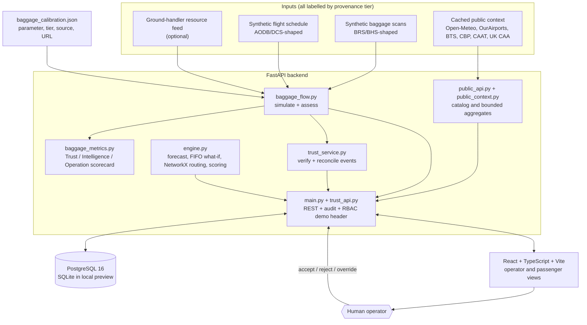
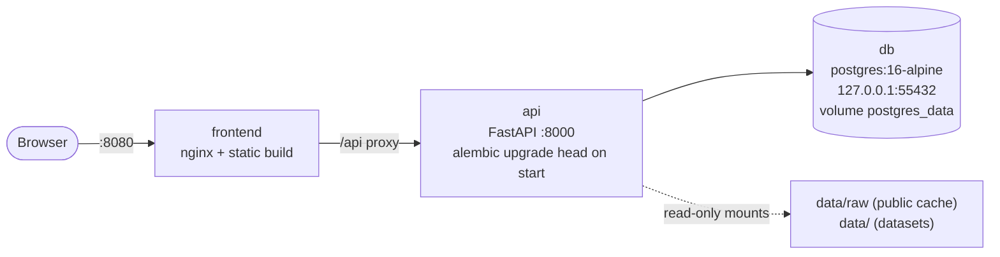
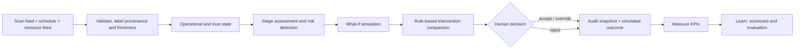
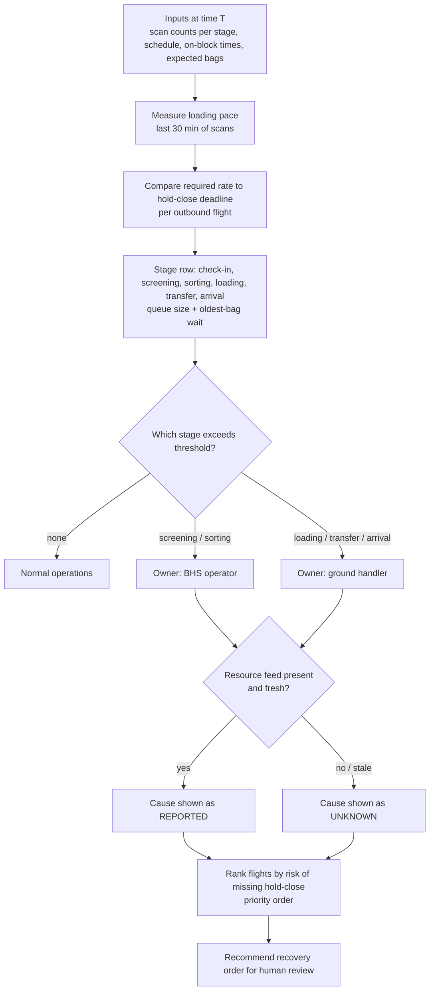
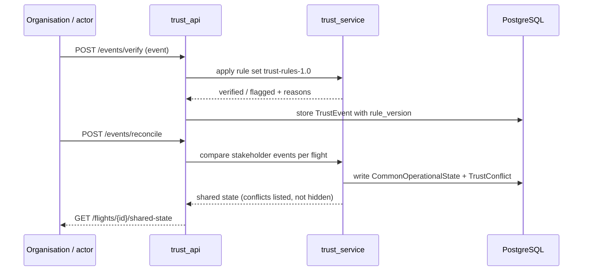
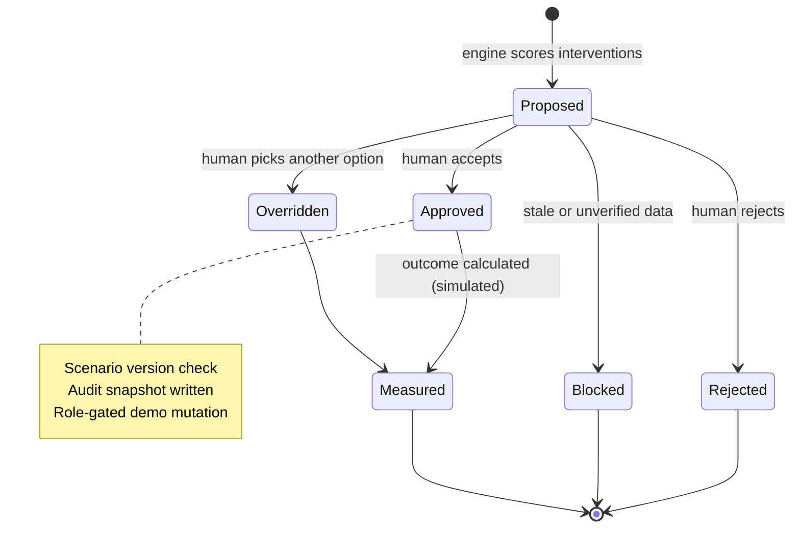
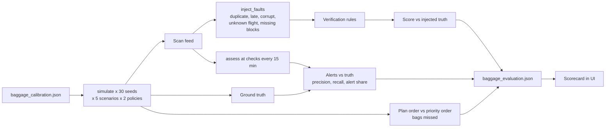

# One TrustX

**Trusted airport decision platform. Hero use case: baggage disruption recovery.**

One TrustX is a runnable airport decision-support MVP. It connects the signals existing airport systems already produce (BRS/BHS scans, AODB flight schedule, ground-handler resources, airline connections, weather) and answers three questions for an operator:

1. Is the baggage flow normal, and **where** is it blocked?
2. **What will it affect next** (which flights, which connections)?
3. **Which recovery action** should a human operator review first?

Positioning: **BRS tracks the bag. One TrustX coordinates the disruption around the bag.** It is an integration and recovery-prioritisation layer. It does **not** replace BRS, AODB or A-CDM, and it makes no claim that those systems lack alerting. See [scope decision](docs/decisions/2026-10-07-baggage-disruption-scope-narrowing.md).

> **Simulated MVP result. Not actual airport performance.** All operational inputs are synthetic. The terminal is illustrative and does not depict Suvarnabhumi's infrastructure. No live airport equipment is controlled. All benefits are calculated in simulation, not measured at an airport.

Last updated: 2026-10-26.

---

## Contents

1. [Problem and approach](#problem-and-approach)
2. [Tech stack](#tech-stack)
3. [System architecture](#system-architecture)
4. [Flow diagrams](#flow-diagrams)
5. [Baggage module](#baggage-module)
6. [Trust and event layer](#trust-and-event-layer)
7. [Data and provenance](#data-and-provenance)
8. [API overview](#api-overview)
9. [Frontend routes](#frontend-routes)
10. [Run it](#run-it)
11. [Testing and evaluation](#testing-and-evaluation)
12. [Security, privacy, limits](#security-privacy-and-limits)
13. [Repository layout](#repository-layout)
14. [Documentation index](#documentation-index)

---

## Problem and approach

Delayed or mishandled baggage cascades into missed connections, turnaround delay and passenger disruption. The cause often sits in a different organisation (ground handler staffing, sortation fault, late inbound flight) from where the symptom appears. Industry benchmark: SITA reports about 24M mishandled bags and about USD 6.3B in 2025 (mishandled, **not** lost; BENCHMARK tier, see [data sources](docs/data-sources.md)).

Operating loop:

**Observe → Predict → Simulate → Optimize → Recommend → Act (human) → Measure → Learn**

Design rules:

- **Assess sees only what real systems could provide.** The synthetic world (`simulate`) knows capacities, faults and the truth. The assessment (`assess`) sees only aggregate scan counts, the schedule with expected bag counts and on-block times, and an optional ground-handler feed. It never reads ground truth.
- **Humans decide.** Recommendations are ranked by transparent rules. Accept, reject and override are audited with a scenario-version check.
- **Honest provenance.** Every value is tagged `REAL_PUBLIC`, `BENCHMARK`, `SYNTHETIC`, `DERIVED`, `SIMULATED` or `ASSUMPTION`. Stale feeds block recommendations.
- **No LLM for facts.** A bounded no-LLM copilot only explains structured outputs.
- **Verification is not truth.** The trust layer checks configured rules passed. It does not prove an event is objectively true.

---

## Tech stack

| Layer | Technology | Notes |
|---|---|---|
| Frontend | React 19, TypeScript 5.8, Vite 6 | Operator and passenger views, Thai/English toggle |
| Charts | Recharts 3 | Queue forecasts, KPIs |
| Frontend serving | nginx (Docker), Vercel (`vercel.json`) | Set `VITE_API_BASE_URL` for deployed builds |
| Frontend tests | Vitest 4, Playwright 1.55 (e2e), ESLint 9 | |
| Backend | Python 3.12 (>=3.11), FastAPI, Uvicorn | REST API with OpenAPI docs at `/docs` |
| Decision logic | Deterministic FIFO cohort simulation, NumPy, NetworkX routing | Seeded and reproducible |
| ORM / migrations | SQLAlchemy 2, Alembic, `psycopg` 3 | `backend/migrations/001_schema.sql` + Alembic versions |
| Database | PostgreSQL 16 (Docker); SQLite for local preview | |
| HTTP client | httpx | Public-data fetch adapters |
| Optional ML | scikit-learn (extra `ml`) | Chronological baseline evaluation only; no model promoted |
| Optional ingestion | openpyxl, pypdf, Pillow (extra `ingestion`) | CAAT / UK CAA workbooks and PDFs |
| Python tooling | `uv` (+ `uv.lock`), pytest 8+, ruff | line length 100 |
| Infra | Docker Compose (db, api, frontend), Makefile | Services bind to `127.0.0.1` |
| Reports | Python render scripts to HTML/PDF (pitch decks, system report) | `scripts/render_*.py` |

Public context sources (cached, offline): Open-Meteo, OurAirports, OpenSky (optional token), BTS, CBP, CAAT, UK CAA.

---

## System architecture



Deployment topology (Docker Compose, all ports bound to localhost):



---

## Flow diagrams

### 1. Operator decision flow



### 2. Baggage assessment: how the bottleneck is located



Location of the bottleneck is derived from BRS and AODB signals alone (data SKY ICT already owns). The handler feed only names the cause.

### 3. Event trust layer



### 4. Recommendation lifecycle



### 5. Evaluation pipeline



---

## Baggage module

Implemented in `backend/app/baggage_flow.py` and `baggage_metrics.py`, calibrated by `baggage_calibration.json`.

**Pipeline stages:** check-in, screening, sorting, loading, transfer, arrival. Screening and sorting are owned by the BHS operator; loading, transfer and arrival by the ground handler.

**Simulation:** 5-minute ticks over a 540-minute horizon, FIFO cohorts per stage, deadlines at hold-close. Policies: `PLAN` (plan order) and priority order.

**Scenarios**

| ID | What happens | Evidence tier |
|---|---|---|
| `BAG-NORMAL` | Planned staffing and equipment. Control case. | SYNTHETIC |
| `BAG-FLOOD-STAFF` | Ground staff cannot reach the airport; manual handling capacity falls for the shift, carts fail mid-shift. Shaped on the Sept 2026 Suvarnabhumi incident; the staffing ratio (0.55) is an assumption. | REAL_PUBLIC context + ASSUMPTION |
| `BAG-BHS-FAULT` | Sortation capacity fault in a time window. | SYNTHETIC |
| `BAG-LATE-INBOUND` | Late inbound flights delay transfer bags. | SYNTHETIC |
| `BAG-STALE-FEED` | Loading feed lags 45 minutes; system must show it cannot be trusted rather than guess. | SYNTHETIC |

**Measured scorecard** (median of 30 seeds, SIMULATED; full ranges and definitions in `backend/app/baggage_evaluation.json`):

| Scenario | Bags missed, plan order | Bags missed, priority order | Flight precision | Flight recall | Alert share |
|---|---|---|---|---|---|
| Normal | 0 | 0 | n/a | n/a | 0% |
| Flood staff shortage | 297.5 | 142.5 | 0.91 | 0.84 | 59% |
| Sortation fault | 7 | 0 | 0.33 | 0.58 | 13% |
| Late inbound | 16.5 | 7.5 | 0.63 | 1.00 | 28% |
| Stale loading feed | 0 | 0 | n/a | n/a | 0% |

Limits stated up front: the "plan order" baseline is an assumed policy and a real handler may already do better; alerts and truth come from the same simulation; sortation-fault precision is low (0.33); the flood scenario does not reproduce the real incident's arrival-side backlog. Details: [decision record](docs/decisions/2026-10-08-computed-baggage-view-and-sourced-scenarios.md).

Regenerate:

```sh
cd backend
uv run python ../scripts/experiments/run_baggage_evaluation.py
```

---

## Trust and event layer

Prototype coordination logic in `trust_service.py` and `trust_models.py` (rule version `trust-rules-1.0`, generator `process-generator-1.0`).

- Eight controlled turnaround scenarios `S1`..`S8`: normal, baggage bottleneck, gate conflict, weather-affected, multi-factor disruption, data conflict, missing or late data, scale test.
- Organisations: airline, airport, ground handler, baggage operator (demo actors).
- Events are verified against configured rules, reconciled per flight into a `CommonOperationalState`, and conflicts are stored as `TrustConflict` rather than silently resolved.
- `ExperimentRun` and `KpiResult` tables hold validation-pack results (`scripts/experiments/generate_validation_pack.py`, contract in [validation-data-contract](docs/validation-data-contract.md)).
- A disaster scenario library with cited sources lives in `data/scenarios/scenario_library.json` (hero scenario `SCN-FLOOD-BAGGAGE-001`).

Verification means configured checks passed. It is **not** proof of objective truth.

---

## Data and provenance

| Tier | Meaning |
|---|---|
| `REAL_PUBLIC` | Official or public source facts (context only) |
| `BENCHMARK` | Industry reference (for example SITA), not airport-specific telemetry |
| `SYNTHETIC` | Generated by this repo, reproducible by seed |
| `DERIVED` | Computed from other tiers |
| `SIMULATED` | Output of the simulation |
| `ASSUMPTION` | Team-set parameter, never presented as a real company's figure |

Imported public foundation (cached locally, excluded from git; re-download with the checked-in scripts): BTS 504,884 US flights (Feb 2025); CBP 12,186 terminal-hour observations (JFK/LAX/SFO, Jan-Mar 2025); Open-Meteo 8,760 BKK hourly records (2025) plus an incident-window fetch for 22 Sept - 3 Oct 2026; OurAirports 145 selected airports; CAAT workbooks (188 national daily totals, 19 national monthly totals, 3 published BKK daily totals); three UK CAA annual tables. This is **not** a complete BKK history. AOT validation data and public checkpoint telemetry are unavailable.

`data/dataset_manifest.json` lists datasets; each external file carries a `*.provenance.json`. See [data sources](docs/data-sources.md), [data quality report](docs/data-quality-report.md), [Thai provenance report](docs/data-provenance-th.md) and [pipeline README](scripts/data/README.md).

---

## API overview

Interactive docs: <http://localhost:8000/docs>. Full reference: [docs/api.md](docs/api.md).

| Area | Endpoints (prefix `/api` unless noted) |
|---|---|
| Health | `GET /health` |
| Operations | `/overview`, `/flights`, `/flights/{id}`, `/flights/{id}/operations`, `/checkpoints`, `/checkpoints/{id}/status`, `/checkpoints/{id}/forecast`, `/passenger-flow`, `/airport/map`, `/airport/risk` |
| Simulation and decisions | `POST /simulation`, `POST /simulation/intervention`, `/recommendations`, `POST /recommendations/score`, `POST /recommendations/{id}/decision`, `/decision-history` |
| Outcomes and audit | `/audit`, `/results`, `POST /results/{id}/measure`, `/kpi`, `/root-causes`, `/evaluation` |
| Passenger | `/passenger/{id}/journey`, `/passenger/{id}/safe-time` |
| Copilot | `POST /copilot/query` (bounded, no LLM) |
| Demo | `POST /demo/event` (role-gated) |
| Trust / baggage (`/api/trustx`) | `/scenarios`, `/events`, `POST /events/verify`, `POST /events/reconcile`, `/flights/{id}/shared-state`, `/conflicts`, `/predictions`, `/recommendations`, `/kpis`, `/experiments`, `/baggage/scenarios`, `/baggage/control`, `/baggage/calibration`, `/baggage/evaluation` |
| Public data | `/api/data/catalog`, `/api/data/context`, `/api/public/context` |

`GET /api/trustx/baggage/control?scenario=BAG-FLOOD-STAFF&at=210&seed=42&resource_feed=true` returns the computed stage view for a scenario at minute `at` (0-539, seed 1-1000).

---

## Frontend routes

Top-navigation "Aviation Executive Operations" design. Legacy `/app/...` links redirect.

| Route | Purpose |
|---|---|
| `/` | Landing |
| `/demo` | Guided nine-step demo (starts only on click; pause, restart, manual steps) |
| `/overview` | Airport now |
| `/baggage` | **Baggage disruption view** (hero). `/trustx` redirects here |
| `/future` | Future map: now, +15, +30, +60 minutes |
| `/operations` | Operations control, decision workspace |
| `/simulator` | What-if lab |
| `/flights` | Flights and per-flight operations |
| `/passenger-flow` | Passenger flow |
| `/performance` | KPIs and evaluation |
| `/journey` | Passenger journey and Safe Time |
| `/sources` | Data and sources, freshness |
| `/integration` | Conceptual production connectors and pilot phases |
| `/app/audit` | Decision log |

Thai and English controls share a remembered preference.

---

## Run it

### Docker Compose (intended stack)

```sh
python3 scripts/configure_local.py     # creates .env from .env.example with a generated DB password
make up
```

- App: <http://localhost:8080>
- API docs: <http://localhost:8000/docs>
- `make down` keeps the PostgreSQL volume. Do not delete the volume to reset a demo; use the in-app **Reset Demo**.

Import cached public data into PostgreSQL:

```sh
docker compose --env-file .env -f infra/docker-compose.yml exec api /app/.venv/bin/python -m app.ingest_public
```

### Local preview without Docker

```sh
./run-local.sh        # http://localhost:5173, SQLite, needs Python/uv and Node.js
```

### Individual services

```sh
cd backend && uv sync && uv run uvicorn app.main:app --reload     # API on :8000
cd frontend && npm install && npm run dev                          # UI on :5173 (proxies /api)
```

### Deploy the frontend (Vercel)

Build with `VITE_API_BASE_URL` set to the public API origin **including** `/api` (for example `https://api.example.com/api`). It defaults to `/api` locally. Do not use a temporary tunnel URL: it expires and the deployed UI shows 503. See [deployment](docs/deployment.md).

### Environment

Copy `.env.example` to `.env` (gitignored). Keys: `DEMO_MODE`, `DATA_MODE`, `POSTGRES_DB`, `POSTGRES_USER`, `POSTGRES_PASSWORD`, `DATABASE_URL`, `CORS_ORIGINS`, optional `OPENSKY_ACCESS_TOKEN`.

---

## Testing and evaluation

```sh
make test                                   # backend pytest, frontend vitest + eslint + build
cd backend && uv run pytest -q              # test_api, test_engine, test_trustx, test_pilot, test_baggage_flow, test_baggage_metrics
cd frontend && npx playwright install chromium && npm run test:e2e   # needs the stack running
make evaluate                               # scikit-learn baseline comparison (chronological split with embargo)
```

- Queue forecast evaluation compares persistence, moving average, fluid, linear and random forest at 15/30/60 minutes. No model is promoted and confidence is heuristic and uncalibrated. See [evaluation](docs/evaluation.md).
- Executed checks and their actual results are recorded in [verification](docs/verification.md). Browser tests require the stack.
- Acceptance criteria in [acceptance](docs/acceptance.md) are MVP targets, not aviation standards.

---

## Security, privacy and limits

- **Demo auth is forgeable.** Role-gated mutations use an intentionally forgeable role header and the API binds locally. Non-demo mutations fail closed. Do not expose this as a production-authenticated service.
- Stale-data blocking, validated input and a local rate limit are implemented.
- Only anonymous synthetic passenger records are stored. Thai PDPA purpose and retention controls, and legal review, are required before any personal data is used. See [security](docs/security.md).
- `.env`, local databases and downloaded datasets are gitignored.
- Not implemented: real sensor or AODB/BRS integration (conceptual, pending authorised APIs), individual flight demand assignment for the queue model, calibrated uncertainty, full causal attribution, distributed operation, production identity. Only two checkpoints have dynamic queues; other process nodes use assumed routing times.
- Public context is never a substitute for airport operational data. CBP data is an external immigration benchmark only.

---

## Repository layout

```
onetrustx/
├── backend/
│   ├── app/                 main.py, trust_api.py, public_api.py, engine.py,
│   │                        baggage_flow.py, baggage_metrics.py, trust_service.py,
│   │                        models / trust_models / public_models, db.py, seed.py,
│   │                        ingest_public.py, baggage_calibration.json
│   ├── migrations/          Alembic (001_schema.sql + versions)
│   └── tests/               pytest suites
├── frontend/                React app, e2e (Playwright), nginx.conf, vercel.json
├── infra/docker-compose.yml
├── data/
│   ├── synthetic/           generated CSVs, baggage_flow/ scan feeds
│   ├── scenarios/           scenario_library.json
│   ├── external/            provenance manifests (downloads gitignored)
│   └── dataset_manifest.json
├── ml/evaluation/           scikit-learn baseline evaluation
├── scripts/                 generators, data fetchers, experiments, report renderers, verifiers
├── docs/                    architecture, API, decisions, pitch, reports, screenshots
├── schema.sql
├── Makefile
└── run-local.sh
```

---

## Documentation index

- Architecture: [architecture](docs/architecture.md), [ER diagram](docs/er-diagram.md), [data dictionary](docs/data-dictionary.md), [schema.sql](schema.sql)
- API and UX: [REST API](docs/api.md), [UX design](docs/ux-design.md), [design direction](docs/design-direction.md), [Executive UI](docs/executive-ui.md)
- Decisions (ADR): [docs/decisions/](docs/decisions/)
- Pitch and demo: [pitch](docs/onetrustx-pitch.md), [demo script](docs/demo-script.md), [preliminary pitch (EN)](docs/onetrustx_PreliminaryPitch_EN.pdf), [(TH)](docs/onetrustx_PreliminaryPitch.pdf)
- Reports (Thai): [system report](docs/onetrustx-system-report-th.md), [project bible](docs/onetrustx-project-bible-th.md), [handoff](docs/project-handoff-th.md)
- Data: [sources](docs/data-sources.md), [quality](docs/data-quality-report.md), [provenance](docs/data-provenance-th.md), [validation contract](docs/validation-data-contract.md)
- Assurance: [assumptions](docs/assumptions.md), [security](docs/security.md), [verification](docs/verification.md), [acceptance](docs/acceptance.md), [deployment](docs/deployment.md)
