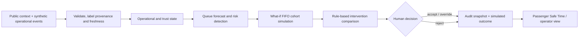
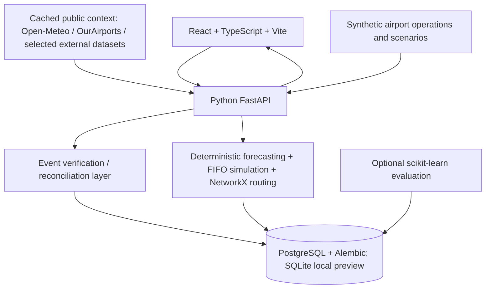

# One TrustX

**Predictive Airport Flow & Passenger Journey Decision Platform**

A runnable airport decision-support MVP: anticipate a queue, compare interventions across two checkpoints, choose a feasible action, and translate the model into accessible passenger guidance.

**Simulated MVP Result — Not actual airport performance.** All operational inputs are synthetic. The terminal is illustrative and does not depict Suvarnabhumi's infrastructure. No live airport equipment is controlled.

## Run

Local preview without Docker: `./run-local.sh` → **http://localhost:5173**. This convenience mode uses SQLite and requires Python/uv and Node.js. PostgreSQL Compose is the intended stack; see verification notes for checks executed on this machine.


```sh
python3 scripts/configure_local.py
make up
```

Open **http://localhost:8080**. API documentation: **http://localhost:8000/docs**. Docker Desktop must be running. `make down` preserves the PostgreSQL volume.

### Vercel frontend

The frontend must be built with `VITE_API_BASE_URL` set to the public API origin,
including the `/api` path (for example `https://api.example.com/api`). The value
defaults to `/api` for local development, where Vite proxies requests to the
local FastAPI service. Do not point this variable at a temporary localtunnel URL;
those URLs expire and cause the deployed frontend to show 503 errors.

For development and individual services see [deployment](docs/deployment.md).

## Problem, solution, and why now

Passenger journey uncertainty accumulates across multiple processes. Existing airport intelligence can provide a foundation for a separate decision layer: simulate the consequences of an intervention before an operator chooses it. One TrustX demonstrates that layer with reproducible public/synthetic inputs, transparent queue mechanics, and auditable human decisions. It makes no claim about a named vendor's missing capabilities or proven business outcomes.

**Observe → Predict → Simulate → Optimize → Recommend → Act → Measure → Learn**

React/TypeScript → FastAPI → deterministic forecasting, FIFO cohort simulation, NetworkX routing, scoring → PostgreSQL audit and operational entities. A bounded no-LLM copilot explains structured outputs; it is not a source of operational facts.

## Operational flow and implemented tech stack





| Layer | Implemented technology | Boundary |
| --- | --- | --- |
| Interface | React, TypeScript, Vite | Operator and passenger demo views |
| API and decision logic | FastAPI, Python, NetworkX | Forecast, simulation, routing, recommendation and audit |
| Persistence | PostgreSQL, SQLAlchemy, Alembic; SQLite in local preview | Scenario and event state; not live airport telemetry |
| Evaluation | Python, optional scikit-learn | Chronological model comparison; not a validated airport model |
| Public context | Cached external datasets and source manifests | Context only, not BKK operational ground truth |

The trust/event layer is prototype coordination logic. Verification means configured checks passed, **not** proof of objective truth. Operational impact remains simulated; no live airport equipment or production identity integration is claimed.

## Features

- Airport future map: Now, +15, +30, +60; queue, lanes, risk, assumption bands.
- Four network-aware interventions, configurable what-if controls, transparent weighted recommendations.
- Human accept/reject/override, scenario version checks, audit snapshots and synthetic outcome measurement.
- Mobile Safe Time, accessible routing, gate-change replan, Thai-ready passenger labels.
- Stale-data blocking, role-gated demo mutations, validated input and local rate limit.
- Normalized PostgreSQL schema, Alembic, seed CSVs, public context fetch adapters, chronological ML baseline evaluation.

## Demo

Reset → Start peak event → Compare interventions → Accept action → inspect Decision log. Then Passenger journey → Reset → Simulate gate change. See [demo script](docs/demo-script.md) and [three-minute pitch](docs/pitch.md).

The assumed peak profile yields 12→39 minutes at Security A; the default combined intervention improves the simulated network result. Accessible passenger Safe Time changes 34→11 in the separate reset gate-change vignette. All benefits are calculated, not measured at an airport.

## Data and evaluation

[Source matrix](docs/data-sources.md) distinguishes REAL_PUBLIC, SYNTHETIC, DERIVED, SIMULATED, and ASSUMPTION. Optional OurAirports, Open-Meteo and OpenSky context is cached separately and never used as a substitute for passenger or queue data. Default demo requires no public API.

```sh
cd backend
uv sync
uv run python ../scripts/generate_synthetic.py
uv run --extra ml python ../ml/evaluation/evaluate.py
```

[Evaluation report](docs/evaluation.md) compares persistence, moving average, fluid, linear and random forest models at 15/30/60 minutes. It uses a chronological split and embargo. No ML model is promoted. Confidence is heuristic and uncalibrated; independent real telemetry validation is outstanding.

KPIs include average/P95 remaining cohort wait, peak queue, throughput, utilization, passenger-minutes saved, Safe Time and an explicitly assumed missed-boarding risk proxy. [Acceptance criteria](docs/acceptance.md) are MVP targets, not aviation standards.

## Tests

```sh
make test
cd frontend
npx playwright install chromium
npm run test:e2e
```

Browser tests require the stack. See [verification](docs/verification.md) for actual execution results.

## Design and delivery documents

- [Delivery index](docs/deliverables.md) and [UX design](docs/ux-design.md)
- [Architecture and component diagram](docs/architecture.md)
- [Database ER diagram](docs/er-diagram.md), [schema SQL](schema.sql), [data dictionary](docs/data-dictionary.md)
- [REST API](docs/api.md)
- [Assumptions and known limitations](docs/assumptions.md)
- [Security and privacy](docs/security.md)
- [Deployment and production roadmap](docs/deployment.md)

## Limits and privacy

Two checkpoints have dynamic queues; other process nodes use assumed routing times. Individual flight demand assignment, real sensor integration, full causal attribution, calibrated uncertainty, distributed operations, full Thai localization and production identity are not implemented. The demo uses an intentionally forgeable role header and binds locally. Non-demo mutations fail closed. Do not expose this as a production-authenticated service.

Only anonymous synthetic passenger records are stored. Production PDPA governance, purpose/retention controls and appropriate legal review remain required before using personal data. Future integrations with AODB, FIDS, DCS, BHS/BRS, flow sensors and related systems are conceptual, pending authorized APIs and airport validation.

## Aviation experience (September 2026 update)

Open <http://localhost:8080> for the landing page, <http://localhost:8080/demo>
for the guided scenario, or <http://localhost:8080/app> for operations.
The guided demo starts only when clicked, supports pause/restart/manual steps,
and applies an explicitly synthetic recommendation to the shared demo state.

Additional views: `/app/future`, `/app/simulator`, `/app/flights`, `/app/flow`,
`/app/performance`, `/app/audit`, `/app/sources`, `/passenger/TT401`.
See [design direction](docs/design-direction.md) for the implemented navigation,
provenance and accessible motion behaviour.

From the relocated project directory:

```bash
cd '/Users/jswvn/Desktop/missj/my-exp/HACKTHON/sky ict/airport-timetwin'
docker compose --env-file .env -f infra/docker-compose.yml up -d --build
```

The latest **Aviation Executive Operations** design uses top navigation and
canonical routes `/overview`, `/future`, `/operations`, `/simulator`, `/flights`,
`/passenger-flow`, `/performance` and `/journey`. Existing `/app/...` links remain
compatible. See [Executive UI](docs/executive-ui.md) for visual/data provenance.

## Real-public data upgrade

The application now reads cached public data through normalized PostgreSQL tables and server-side aggregates. Imported foundation: BTS **504,884 US flights** (February 2025), CBP **12,186 terminal/hour observations** (JFK/LAX/SFO, January–March 2025), Open-Meteo **8,760 BKK hourly records** (2025), OurAirports **145 selected airport records**, CAAT historical workbooks and three UK CAA annual tables.

CAAT coverage is **188 distinct national daily totals**, **19 national monthly totals**, and **3 published BKK daily totals** after resolving overlapping extracts. This is not a complete BKK daily history. AOT validation and TSA observations remain unavailable in this cache; the Sources page says so. Exact quality, dates and missingness: [Data Quality Report](docs/data-quality-report.md). Acquisition commands: [Data pipeline](scripts/data/README.md).

Checkpoint telemetry is still unavailable publicly. Security configuration, modelled flights and what-if results remain modelled/simulated, not real BKK operations. CBP provides an external immigration benchmark only; no model is promoted or claimed calibrated to BKK security.

Thai / English controls share a remembered preference across pages. Demo controls are in **DEMO MODE**. `/demo` provides nine presenter-controlled steps including explicit human approval and deterministic measurement. `/integration` explains conceptual production connectors and pilot phases. `/api/data/catalog` exposes lineage; `/api/data/context` serves bounded historical aggregates without internet requests.

Run migrations and then import cached data:

```sh
docker compose --env-file .env -f infra/docker-compose.yml up -d --build
docker compose --env-file .env -f infra/docker-compose.yml exec api /app/.venv/bin/python -m app.ingest_public
```

Raw/normalized downloads are local offline assets excluded from git; download them using the checked-in scripts and source manifests on a new machine. They are mounted read-only into the API container. Never remove the PostgreSQL volume to reset a demo; use the session-scoped Reset Demo control.
