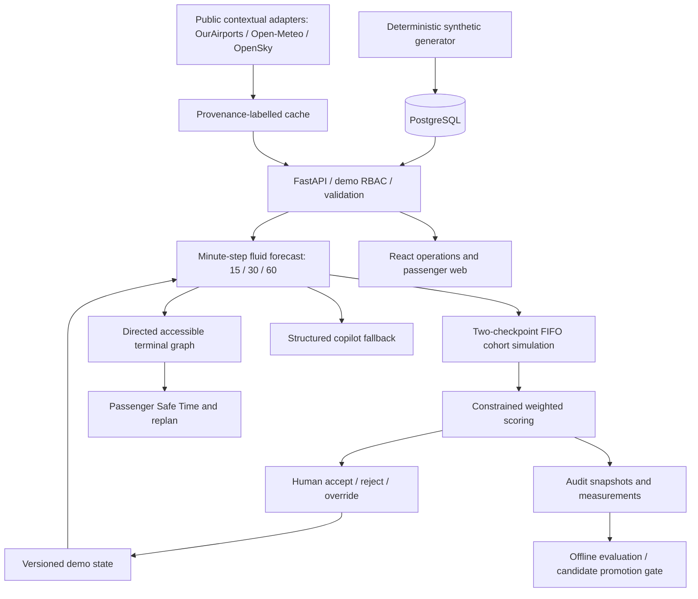
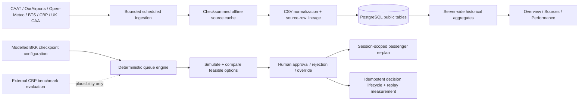
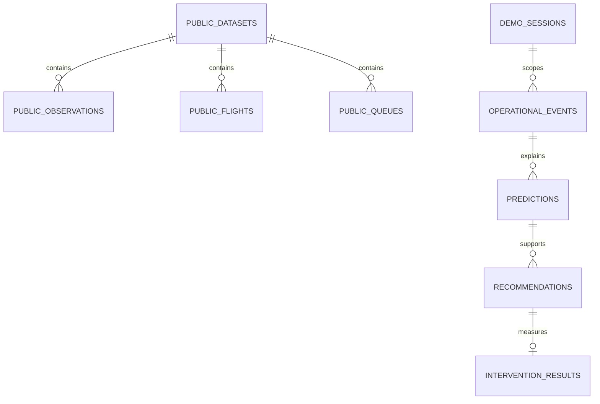

# Architecture and implementation contract

Airport TimeTwin is a decision and simulation layer above airport intelligence. It is a production-oriented demonstrator, not a deployed airport control system. Operations own action approval; passenger guidance is advisory.



## Components and responsibilities

| Component | Decision supported | Evidence | Failure behavior / owner |
|---|---|---|---|
| Forecast | Where to prepare capacity | Frozen synthetic arrival profile, current queue, open lanes | Mark stale; block actions; operator owns response |
| Simulator | Which feasible lane/redirect option to choose | Same cohort and horizon for every comparison | Reject invalid resource requests; retain No Action |
| Scorer | Best benefit against staffing and walking | Public formula, configurable nonnegative weights | No recommendation on stale data |
| Journey | Which eligible path to take now | Directed topology, checkpoint waits, deadline, buffer | No inaccessible path; stale warning; passenger advisory |
| Audit | Did the chosen action help? | Input/output snapshots, human reason, later synthetic observation | Persist transactionally; no automatic model promotion |
| Copilot | Explain engine results | Structured calculations only | No-LLM template layer always available |

Queue dynamics are Q(t+1)=max(0,Q(t)+arrivals−lanes×rate). Time step is one minute. Service is allocated to FIFO cohorts and drained up to 600 minutes so average/P95 waits are not silently horizon-censored; unresolved queues make an option infeasible. The initial queue is a cohort arriving at time zero, so metrics measure remaining wait, not already accrued wait.

Two security checkpoints are simulated. Other processing nodes are assumption-based routing costs, not independent capacity simulations. P95 is passenger-weighted FIFO cohort wait. Passenger-minutes saved is the difference in network queue area plus redirect walking cost. It is not a measured airport benefit. Risk is the share exceeding an assumed 35-minute checkpoint budget, not flight-specific missed-boarding probability.

Scenario time is frozen at 17:00 ICT. Wall-clock freshness is tracked independently with a five-minute threshold. Database row locking and version comparison stop duplicate/superseded decisions from silently overwriting state. Reset preserves audit history and increments the version.

## Initial delivery milestones

1. P0: normalized schema, seed, directed graph, conservation-tested queues and horizons.
2. P0: validated what-if API, resource constraints, deterministic scoring, operations interface.
3. P1: accessible Safe Time, gate changes, decision trail, measurement and KPI proxies.
4. P2: cached public context adapters, chronological baseline/ML evaluation, no-LLM copilot.
5. Verification: lint, tests, migrations, production frontend build, Docker health, desktop/mobile browser checks.

## Repository structure

```text
airport-timetwin/
  backend/app/            # ORM schema, seed, deterministic engines, FastAPI
  backend/migrations/     # Alembic
  backend/tests/          # conservation, decisions, stale-data and API tests
  frontend/src/           # React views, styles, API client
  frontend/e2e/           # browser integration and mobile tests
  data/synthetic/         # generated normalized CSVs and training history
  data/seeds/             # reproducible peak scenario
  data/raw/               # optional public cache, ignored by git
  scripts/                # ingestion, generation, seeding, demo
  ml/evaluation/          # chronological evaluation against baselines
  infra/                  # Docker Compose
  docs/                   # architecture, ERD, dictionary, evaluation, runbooks
```

Modules are intentionally small; a later service split must follow measured scaling needs. PostgreSQL is the supported Compose database; SQLite is used only for isolated tests and optional local development.

## Public-data foundation (September 2026 upgrade)



No third-party request is made by `/api/data/context` or `/api/data/catalog`. Public data provides historical context and external evaluation; it is not a substitute for missing BKK checkpoint telemetry. Current CBP analysis is concurrent hourly wait estimation, not a forward security forecast. No ML candidate is promoted.



Demo event/session linkage is recorded in event metadata; public lineage uses normalized foreign keys. Session UUID is a demo isolation mechanism, not a production authentication credential.
