# Airport TimeTwin
## เอกสารที่มา การสร้างข้อมูล Demo และการประเมินความน่าเชื่อถือ

**ฉบับสำหรับ Hackathon · 15 กันยายน 2026**

เอกสารนี้อธิบายว่าระบบ Airport TimeTwin ใช้ข้อมูลอะไร ข้อมูลมาจากไหน ข้อมูลจริงถูกใช้ในบทบาทใด ข้อมูลใดเป็นข้อมูลจำลอง วิธีสร้างสถานการณ์ Demo และระดับความน่าเชื่อถือที่ควรอ้างอิง

## 1. บทสรุปสำหรับกรรมการ

Airport TimeTwin เป็น **decision-support prototype** สำหรับทดลองผลของมาตรการจัดการผู้โดยสารในสนามบิน เช่น การเปิดเลนสำรอง การ redirect ผู้โดยสาร และการเปลี่ยนเส้นทางไป Gate ระบบไม่ได้อ้างว่าเป็นระบบพยากรณ์คิวสุวรรณภูมิจาก telemetry จริง

ข้อมูลในระบบแบ่งเป็นห้าประเภท:

| ประเภท | ความหมาย | ตัวอย่าง |
|---|---|---|
| `REAL_PUBLIC` | ข้อมูลจริงจากแหล่งสาธารณะ | OurAirports, Open-Meteo, BTS, CBP, CAAT, UK CAA |
| `SYNTHETIC` | แถวข้อมูลที่สร้างขึ้นเพื่อเป็น fixture/demo | เที่ยวบิน คิว เลน ผู้โดยสาร และเหตุการณ์ |
| `ASSUMPTION` | ค่าที่สมมติเพื่อให้แบบจำลองทำงาน | service rate, terminal topology, staff limit |
| `DERIVED` | ค่าที่คำนวณต่อจากข้อมูลต้นทาง | weather feature, aggregate |
| `SIMULATED` | ผลลัพธ์จากการรัน engine | forecast, wait, recommendation, Safe Time |

หน้าเว็บ production ที่ deploy อยู่ในปัจจุบันใช้ backend demo แบบ `SYNTHETIC/SIMULATED` เป็นหลัก ข้อมูลสาธารณะถูกจัดเก็บและออกแบบไว้เป็น public context/benchmark แต่ยังไม่ถูกใช้แทน checkpoint telemetry จริงของ BKK

ข้อสรุปด้านความน่าเชื่อถือ: ระบบน่าเชื่อถือในฐานะ **การสาธิตกลไกการตัดสินใจและการจำลองแบบ reproducible** แต่ยังไม่น่าเชื่อถือพอที่จะอ้างตัวเลขคิวหรือผลประโยชน์จริงของสนามบินจนกว่าจะ calibrate และ validate กับข้อมูล aggregate จากสนามบินจริง

## 2. คำถามที่ระบบกำลังแก้

โจทย์ไม่ใช่การบอกว่า “คิวจริงตอนนี้เท่าไร” แต่คือ:

> ถ้าเกิด arrival wave และเรามีทรัพยากรจำกัด ควรเปรียบเทียบมาตรการใดก่อนให้ผู้ปฏิบัติงานตัดสินใจ

ระบบจึงต้องรักษา demand เดียวกัน แล้วทดลองทางเลือกหลายแบบ เช่น No Action, เปิดเลน, redirect และมาตรการผสม เพื่อให้เห็น trade-off ระหว่าง wait reduction, staff, walking และ feasibility

## 3. แหล่งข้อมูลจริงและเหตุผลที่นำมาใช้

| Dataset | แหล่งอ้างอิง | บทบาทในระบบ | ขอบเขตที่ห้ามสรุปเกินจริง |
|---|---|---|---|
| Airport metadata | [OurAirports](https://ourairports.com/data/) | airport/runway reference | ไม่ใช่ passenger telemetry |
| Historical weather | [Open-Meteo](https://open-meteo.com/en/docs) | context และ weather feature | เป็น model/reanalysis ไม่ใช่ METAR sensor |
| Aircraft states | [OpenSky REST API](https://openskynetwork.github.io/opensky-api/rest.html) | aircraft movement context | ไม่ใช่ boarding, queue หรือ passenger count |
| BTS flights | [US BTS TranStats](https://transtats.bts.gov/) | external flight benchmark | เป็นข้อมูล US domestic ไม่ใช่ตารางบิน BKK |
| CBP wait times | [CBP Airport Wait Times](https://awt.cbp.gov/) | external immigration benchmark | ไม่ใช่ Security service rate ของ BKK |
| Thailand aviation statistics | [CAAT](https://www.caat.or.th/) | historical public aviation context | coverage ไม่ต่อเนื่องและไม่ใช่ checkpoint telemetry |
| UK airport statistics | [UK CAA](https://www.caa.co.uk/data-and-analysis/) | external scale/traffic context | ไม่ใช่ข้อมูลปฏิบัติการของไทย |

รายงานที่บันทึกจำนวน records, period, missingness, URL และ checksum อยู่ใน [Data Quality Report](data-quality-report.md) ตัวอย่างชุดข้อมูลที่ถูก normalize คือ BTS 504,884 records, CBP 12,186 observations, Open-Meteo BKK 8,760 hourly records และ OurAirports 145 records ตามรายงานของ repository

ข้อมูลจริงเหล่านี้ไม่ถูกนำมาใส่ชื่อใหม่เป็นข้อมูล BKK และไม่ถูกใช้เพื่ออ้างว่าโมเดลผ่านการ validate แล้ว หาก fetch public source ล้มเหลว ระบบต้องเก็บ stale marker หรือใช้ fallback ที่ติดป้าย synthetic แทนการ relabel เป็น real

### 3.1 เหตุผลและระดับความน่าเชื่อถือของแต่ละแหล่ง

| แหล่ง | ความน่าเชื่อถือของแหล่ง | เหตุผลที่เลือก | วิธีใช้ที่เหมาะสม |
|---|---|---|---|
| OurAirports | สูงสำหรับ metadata; ไม่ใช่ operational truth | เป็นฐานข้อมูลสาธารณะที่มี airport/runway reference และดาวน์โหลดซ้ำได้ | ใช้ตรวจชื่อสนามบิน พิกัด runway และ reference data |
| Open-Meteo | สูงสำหรับ historical weather model/reanalysis; ไม่เท่ากับ sensor | API มีช่วงเวลา หน่วย และพิกัดชัดเจน เหมาะกับ context ที่ reproducible | ใช้เป็น weather context และ feature ที่ต้องติด lineage |
| OpenSky | สูงสำหรับ aircraft state ที่ provider เห็น; coverage ไม่สมบูรณ์ | ให้ state vector แบบ time-stamped และมี API อ้างอิงชัด | ใช้ movement context เท่านั้น ไม่ใช้แทน manifest หรือ queue |
| BTS | สูงสำหรับ US air-carrier reporting; ไม่เกี่ยวกับ BKK โดยตรง | มีข้อมูลจำนวนมากและโครงสร้าง historical เหมาะกับ external benchmark | ใช้ศึกษารูปแบบเที่ยวบินและวิธีประเมิน ไม่ใช้เป็น BKK schedule |
| CBP | สูงสำหรับ US immigration wait reports; ไม่ใช่ security BKK | มี observations รายชั่วโมงและเหมาะกับ benchmark wait distribution | ใช้เป็น plausibility benchmark ภายนอกเท่านั้น |
| CAAT | สูงในฐานะแหล่งสถิติการบินไทยทางการ; coverage/ความสดมีข้อจำกัด | เป็นแหล่งไทยที่ใกล้บริบทมากที่สุดในชุด public ที่เข้าถึงได้ | ใช้ aggregate aviation context โดยรักษา period และ missingness |
| UK CAA | สูงสำหรับสถิติ UK ที่เผยแพร่โดยหน่วยงานกำกับ | ใช้เทียบ scale และ pattern ของสนามบินที่มีข้อมูลเปิด | ใช้ external context ไม่ใช่ parameter ของ BKK |

ความน่าเชื่อถือของแหล่งข้อมูลไม่ได้แปลว่าค่าที่นำไปใช้ตอบโจทย์ BKK จะถูกต้องโดยอัตโนมัติ ความถูกต้องต้องพิจารณา **ความตรงกับกระบวนการ (process match), geography, period, units, freshness และ missingness** ด้วย นี่คือเหตุผลที่ระบบไม่ใช้ CBP หรือ BTS เป็นตัวแทนของ Security checkpoint สุวรรณภูมิ

## 4. Dataset Demo ที่สร้างขึ้น

ข้อมูล demo อยู่ใน `data/synthetic/` และสร้างจาก seed/model ภายใน repository ได้แก่:

| Dataset | สิ่งที่เก็บ | สถานะ |
|---|---|---|
| `flights.csv` | เที่ยวบิน TT401–TT404, gate, เวลาออก | synthetic fixture |
| `checkpoint.csv` | Security A/B, จำนวนเลนสูงสุด, terminal/zone | synthetic + assumption |
| `passenger_flow.csv` | arrivals, departures, queue, wait, P95 | generated simulation fixture |
| `passenger_journey.csv` | ผู้โดยสารนิรนาม เส้นทาง และ gate | synthetic |
| `lane_status.csv` | สถานะเลน | synthetic |
| `baggage_events.csv`, `gate_events.csv`, `ground_handling.csv` | เหตุการณ์การปฏิบัติการ | synthetic |
| `airport_graph.csv` | โหนดและ edge สำหรับ routing | illustrative topology |
| `recommendations.csv` | ทางเลือกและคะแนน | derived from engine |
| `training.csv` | ประวัติ queue/arrivals/lanes | deterministic synthetic history |

ไม่มีชื่อจริง เลขหนังสือเดินทาง หมายเลขเที่ยวบินจริง หรือ itinerary จริง ข้อมูลผู้โดยสารทั้งหมดเป็น anonymous fixture เพื่อเล่า scenario

## 5. วิธีสร้างข้อมูล Demo ตั้งแต่ต้นจนจบ

### 5.1 กำหนด scenario seed

scenario หลักใช้ seed `42` และ frozen demo clock 17:00 ICT:

- Security A มี queue เริ่มต้น 96 คน
- Security B มี queue เริ่มต้น 12 คน
- Security A เปิด 4 จาก 5 lanes
- Security B เปิด 3 lanes
- service rate สมมติ 2 คนต่อนาทีต่อเลน
- reserve staff สูงสุด 4 คน
- redirect สูงสุด 30%
- มีเที่ยวบินจำลอง 4 เที่ยวและ representative cohort 580 คน

ค่าทั้งหมดเป็น assumptions ที่ระบุไว้ใน [Assumptions](assumptions.md) ไม่ใช่ข้อมูลจากระบบสนามบิน

### 5.2 สร้าง arrival profile

ในช่วง peak ระบบกำหนด arrivals ของ Security A เป็น 11.2 คนต่อนาทีในช่วงต้น, 19.2 ในช่วง peak สูงสุด, 9 ในช่วงถัดไป และ 1.6 ในช่วงท้าย ส่วนช่วงปกติใช้ 5 คนต่อนาที การใช้ seed เดิมทำให้ผลลัพธ์ reproducible

### 5.3 คำนวณ queue แบบ minute-step

ทุกหนึ่งนาที engine คำนวณ:

```text
Q(t+1) = max(0, Q(t) + arrivals(t) - lanes(t) × service_rate)
```

ตัวอย่างค่าประมาณ +30 นาทีของ Security A:

```text
(96 + 30 × (15.2 - 8)) / 8 = 39 นาที
```

เลข 8 มาจาก 4 lanes × 2 คนต่อนาที ไม่ใช่ค่าที่วัดจากสนามบินจริง

### 5.4 จำลอง FIFO cohorts

ผู้โดยสารถูกเก็บเป็น cohort ตามเวลาเข้าคิว ระบบให้บริการแบบ FIFO และคำนวณ average wait, passenger-weighted P95, peak queue, passenger-minutes, throughput และ unresolved queue จน queue drain หรือครบ horizon 600 นาที

การ drain ต่อเกิน 60 นาทีมีจุดประสงค์ป้องกันไม่ให้ผลลัพธ์ดูดีเพราะตัดผู้โดยสารที่ยังรออยู่ออกจากช่วงวัด

### 5.5 ทดลอง intervention

ทุกทางเลือกใช้ demand และ initial queue ชุดเดียวกัน แล้วเปลี่ยนเฉพาะ action:

1. No Action
2. เปิด reserve lane
3. redirect ผู้โดยสารบางส่วนไป Security B
4. เปิด lane และ redirect พร้อมกัน
5. เพิ่ม staff หรือ delay wave ใน what-if simulation

ระบบตรวจ resource constraint เช่น reserve staff, จำนวน lane สูงสุด, redirect cap และ queue ที่ยังไม่ถูก drain หากไม่ผ่านจะติดป้าย `infeasible`

### 5.6 ให้คะแนนทางเลือก

คะแนนใช้สูตรที่เปิดเผยและปรับน้ำหนักได้:

```text
score = wait reduction
      + 0.01 × passenger-minutes saved
      + 50 × risk reduction
      - additional staff
      - walking penalty
      - 0.001 × cost proxy
```

recommendation จึงเป็นผลจาก constrained weighted comparison ไม่ใช่คำตอบจาก LLM โดยตรง

### 5.7 สร้าง passenger route และ Safe Time

terminal graph เป็น directed graph ที่สร้างขึ้นเอง เช่น Food C → Security B → Immigration → Retail → Gate C8 ระบบใช้ walking time, processing time, boarding deadline และ buffer เพื่อคำนวณ Safe Time การเปลี่ยน Gate E7 เพิ่มเวลาเดินตาม edge ที่สมมติไว้

## 6. หลักการที่ทำให้ Demo ดูสมเหตุสมผล

ความสมเหตุสมผลของ Demo มาจาก consistency และ transparency ไม่ใช่การอ้างว่าเป็น observation จริง:

- scenario เดิมให้ผลเดิมด้วย seed เดิม
- conservation check ตรวจ arrivals = served + unresolved queue
- ทุก intervention รันบน demand เดียวกัน
- resource limit ทำให้ action ที่ทำไม่ได้ถูก reject
- P95 เป็น passenger-weighted FIFO wait
- stale data ลด confidence และ block mutation
- สูตรคะแนนและ assumptions แสดงต่อผู้ใช้
- UI แยก `REAL_PUBLIC`, `SYNTHETIC`, `ASSUMPTION` และ `SIMULATED`
- decision มี human accept/reject/override และ audit trail

## 7. เชื่อถือได้มากน้อยแค่ไหน

| คำถาม | ระดับความน่าเชื่อถือ | เหตุผล |
|---|---|---|
| Queue mechanics ทำงานตามสูตรหรือไม่ | สูง | สมการชัดเจนและทดสอบ conservation ได้ |
| เปรียบเทียบทางเลือกอย่างยุติธรรมหรือไม่ | สูง | ใช้ demand/initial condition เดียวกัน |
| ข้อมูล public มีแหล่งอ้างอิงหรือไม่ | สูงในฐานะ public context | มี URL, period, provenance และ checksum |
| ตัวเลขคิว BKK เป็นค่าจริงหรือไม่ | ต่ำ | ไม่มี BKK checkpoint telemetry |
| ค่าความแม่นยำของ forecast | ยังสรุปไม่ได้ | evaluation ส่วนใหญ่เป็น synthetic และ confidence ยัง heuristic |
| ใช้ควบคุมสนามบินจริงได้หรือไม่ | ไม่ได้ | ยังขาด identity, telemetry, safety case และ validation |

รายงาน evaluation ของ synthetic history อาจมี MAE/RMSE ดี เพราะ generator และ evaluator ใช้กลไกใกล้กัน ผลดังกล่าวยืนยันความสอดคล้องของ code path ได้ แต่ไม่ใช่หลักฐานว่า forecast แม่นในสนามบินจริง

## 8. ถ้าต้องการเปลี่ยนเป็นข้อมูลจริง

แผนที่เหมาะสมคือ:

1. ขอข้อมูล aggregate แบบไม่ระบุตัวบุคคลจากสนามบิน: queue length, arrivals/5 min, departures/5 min, open lanes, service rate และ timestamps
2. เก็บ source, timestamp, airport/terminal, units, schema version และ quality flags ทุกแถว
3. แยก train/validation/test ตามเวลา ห้าม random shuffle
4. calibrate arrival profile, service rate, walking time และ resource limits จาก historical observation
5. วัด MAE, RMSE, P95 error, interval coverage, false alarm และ lead time บนเหตุการณ์จริง
6. ทดสอบ peak, lane closure, gate change และ disruption ที่มี ground truth
7. เริ่ม shadow mode ให้ระบบแนะนำอย่างเดียว และให้ operator ตรวจทุก action
8. เปรียบเทียบกับ baseline เช่น persistence และ moving average
9. ค่อยเลื่อนไป pilot ที่ human-approved หลัง validation ผ่าน

ยังไม่ควรใช้ข้อมูล CBP หรือ BTS แทน BKK checkpoint data เพราะเป็นคนละสนามบิน คนละกระบวนการ และคนละ distribution

## 9. ข้อความที่ควรใช้ในการนำเสนอ Hackathon

ข้อความที่ถูกต้อง:

> Airport TimeTwin ใช้ public aviation data เพื่อสร้าง context และใช้ deterministic synthetic scenario เพื่อสาธิตการเปรียบเทียบมาตรการจัดการคิวอย่างโปร่งใส เนื่องจาก checkpoint telemetry จริงของ BKK ไม่เปิดเผย ระบบจึงพิสูจน์ decision workflow, constraints และ auditability ก่อน ไม่ได้อ้างความแม่นยำของสนามบินจริง

ข้อความที่ไม่ควรใช้:

- “โมเดลทำนายคิวสุวรรณภูมิได้จริง”
- “ลดเวลารอได้ 21 นาทีจริง”
- “ผ่านการ validate กับสนามบินแล้ว”
- “ใช้ข้อมูล passenger จริงของ BKK”

## 10. ตัวอย่างการใช้งานจริงตั้งแต่เปิดเว็บจนจบหนึ่งรอบ

### ฉากเหตุการณ์

สมมติผู้ใช้เป็น Airport Operator เข้ามาตรวจช่วงเย็น ระบบกำหนด demo clock ไว้ที่ 17:00 ICT และ session ของ browser มี UUID ของตัวเอง เพื่อไม่ให้การทดลองของผู้ใช้คนหนึ่งปนกับผู้ใช้อื่น

### ขั้นที่ 1 เปิด `/overview`

ผู้ใช้เปิดเว็บและ React เรียก API หลักสี่ชุดพร้อมกัน:

| API | ทำอะไร | ข้อมูลที่ได้ |
|---|---|---|
| `GET /api/overview` | โหลดสถานการณ์และ forecast | scenario, checkpoint, queue, wait, risk, journey, feed health |
| `GET /api/recommendations` | โหลดทางเลือก | options, score, feasibility, reason |
| `GET /api/flights` | โหลดเที่ยวบินของ scenario | flight number, gate, departure, status |
| `GET /api/passenger/demo-passenger/journey` | โหลด passenger route | gate, route, walking time, Safe Time |

API อ่าน `DemoSession` จาก database ตาม `X-Demo-Session` header ถ้ายังไม่มี row จะสร้าง session เริ่มต้นให้ จากนั้นสร้าง `Scenario` object และส่งให้ engine คำนวณ ไม่ได้อ่านค่าตัวเลขจากหน้าเว็บโดยตรง

หน้า Overview จะแสดง:

1. สถานะ feed ว่า fresh, stale หรือ context only
2. Current queue ของ Security A/B
3. forecast ที่ +15, +30 และ +60 นาที
4. root causes ที่เป็น model attribution ไม่ใช่ causal proof
5. เที่ยวบินและ gate ที่อยู่ใน representative scenario
6. action ที่ recommendation scorer เห็นว่าเหมาะที่สุด

### ขั้นที่ 2 ระบบวิเคราะห์ peak

ถ้า scenario เป็น peak engine ใช้ arrival profile และ service capacity ที่อธิบายในบทที่ 5 แล้วคำนวณ queue แบบหนึ่งนาที ระบบจำลองต่อไปจน queue ระบายหรือถึง 600 นาที จากนั้นบันทึก prediction snapshot เช่น target `security-a`, horizon 30, predicted wait, lower/upper bound, confidence และ `model_version = fluid-v1`

ผล prediction เชื่อมกับ `operational_events` และ `audit` เพื่อย้อนดูได้ว่า forecast นี้เกิดจาก input scenario version ใด

### ขั้นที่ 3 ผู้ใช้กด “Compare interventions”

ผู้ใช้ไปหน้า What-if lab ระบบไม่เปลี่ยนข้อมูลจริงของสนามบิน แต่สร้างผลลัพธ์จำลองสี่ชุดบน demand เดิม:

```text
No Action
Open A5
Redirect 20%
Open A5 + Redirect 12%
```

แต่ละชุดจะคำนวณ average wait, P95, peak queue, passenger-minutes saved, additional staff, walking penalty, confidence, cost และ feasibility แล้วนำไปจัดอันดับด้วย scoring formula

หากผู้ใช้ปรับ sliders เช่น lanes=5, redirect=20%, staff=1 ระบบส่ง `POST /api/simulation` พร้อมค่าที่ปรับไปให้ engine ตรวจ constraint และคืนผล simulation ใหม่ โดยยังไม่เขียน decision ลง audit จนกว่าผู้ใช้จะกดส่ง recommendation

### ขั้นที่ 4 ผู้ใช้ตรวจคำแนะนำ

ผู้ใช้ดูว่าทางเลือกใดลด wait ได้เท่าไร ต้องใช้ staff เท่าไร มี walking penalty เท่าไร และ queue drain สำเร็จหรือไม่ ตารางนี้ช่วยให้ผู้ใช้เข้าใจว่าระบบไม่ได้เลือกจากคะแนนอย่างเดียว แต่มีข้อจำกัดด้านทรัพยากรและความเป็นไปได้

ถ้าข้อมูลถูกทำเครื่องหมาย stale ระบบจะลด confidence และปิด action บางประเภท เพื่อไม่ให้ operator กดใช้ recommendation จากข้อมูลเก่า

### ขั้นที่ 5 ผู้ใช้กด Accept, Reject หรือ Override

เมื่อผู้ใช้ตัดสินใจ frontend ส่ง `POST /api/recommendations/{id}/decision` พร้อม:

- `decision`: accept, reject หรือ override
- `reason`: เหตุผลจากมนุษย์
- `intervention`: lanes, redirect, staff และ flight delay ที่เลือก
- `X-Demo-Session`: UUID ของ session

backend ตรวจ role `AIRPORT_OPERATOR` หรือ `ADMIN`, ตรวจ version ของ scenario, ตรวจ resource constraints และเขียน event/audit/recommendation snapshot ลง database การกดปุ่มนี้เปลี่ยนเฉพาะ state ของ Demo ไม่ได้สั่งอุปกรณ์สนามบินจริง

### ขั้นที่ 6 ระบบวัดผลจำลอง

หน้า Decision log โหลด `GET /api/audit` และ `GET /api/results` เพื่อแสดงว่า:

- forecast เดิมคาดการณ์เท่าไร
- intervention ที่รับรองคืออะไร
- ผลหลัง intervention ใน simulation เป็นเท่าไร
- actual value ที่ผู้ใช้กรอกเพื่อการทดสอบเป็น synthetic หรือไม่
- prediction error เท่าไร

เมื่อผู้ใช้กรอก observed average wait และกดวัดผล ระบบส่ง `POST /api/results/{id}/measure` แต่ field นี้บังคับ `source_type = SIMULATED` ใน Demo จึงไม่ควรเรียกว่า observation จากสนามบินจริง

### ขั้นที่ 7 ผู้ใช้ดู Passenger journey

เมื่อเปลี่ยนไปหน้า Journey ระบบใช้ directed airport graph หาเส้นทางที่ accessible และคำนวณ:

```text
Safe Time = เวลาถึง boarding deadline
             - processing time
             - walking time
             - safety buffer
```

ถ้ากด Simulate gate change จาก C8 เป็น E7 ระบบเปลี่ยน session scenario และคำนวณ route ใหม่ แสดงว่าการเปลี่ยน gate ทำให้ walking time และ Safe Time เปลี่ยนอย่างไร ข้อมูลนี้เป็น advisory simulation ไม่ใช่ passenger itinerary จริง

## 11. Database ทำงานอย่างไร

ระบบใช้ SQLAlchemy กับ SQLite ใน local development และออกแบบให้ใช้ PostgreSQL ใน Compose production-style stack การเชื่อมข้อมูลหลักมีดังนี้:

| ตาราง/กลุ่มข้อมูล | หน้าที่ | เขียนเมื่อใด |
|---|---|---|
| `demo_sessions` | แยก state ของแต่ละ browser/session | เปิดใช้ session หรือ mutate scenario |
| `demo_state` | state legacy/global ของ demo | seed และ compatibility |
| `flights`, `checkpoint`, `lane_status` | fixture operational entities | seed |
| `passenger_flow`, `passenger_journey` | flow และ route fixtures | seed / read |
| `airport_graph` | topology และ walking edges | seed / read |
| `operational_events` | event พร้อม actor, status และ metadata | overview, demo event, decision |
| `predictions` | forecast snapshot พร้อม bounds/confidence/model version | โหลด overview หรือสร้าง forecast |
| `recommendations` | option, score, constraints, decision และเหตุผล | โหลด/ตัดสินใจ |
| `audit` | human decision, event link, outcome และ error | ทุก lifecycle ของ decision |
| `intervention_results` | before/after และ measurement | รับ action และบันทึกผลจำลอง |

ความสัมพันธ์หลักคือ:

```text
DemoSession
  → Scenario
  → OperationalEvent
  → Prediction
  → Recommendation
  → Audit / InterventionResult
```

ระบบใช้ session UUID เพื่อแยกผู้ใช้ และใช้ scenario version เพื่อป้องกันการเขียนทับ state ที่ผู้ใช้อื่นเพิ่งเปลี่ยน การ reset จะ reset scenario แต่เก็บ audit history ไว้เพื่อให้ตรวจย้อนหลังได้

## 12. สรุป flow สำหรับผู้ไม่มีพื้นฐานเว็บ

```text
เปิดเว็บ
  ↓
สร้าง/อ่าน session ของผู้ใช้
  ↓
อ่าน scenario และ fixture จาก database
  ↓
engine คำนวณ queue และ forecast
  ↓
สร้าง prediction snapshot + audit event
  ↓
ผู้ใช้เห็น Overview
  ↓
ผู้ใช้ทดลองหลาย intervention
  ↓
engine คำนวณผลลัพธ์ด้วย demand เดิม
  ↓
scorer จัดอันดับตาม benefit, staff, walking และ feasibility
  ↓
ผู้ใช้ยอมรับ/ปฏิเสธ/override
  ↓
database บันทึก human decision และเหตุผล
  ↓
ผู้ใช้ตรวจผลและ synthetic measurement
  ↓
ผู้โดยสารเห็น route และ Safe Time ที่คำนวณใหม่
```

กล่าวง่าย ๆ คือเว็บนี้ทำหน้าที่เป็น “ห้องทดลองตัดสินใจ” ผู้ใช้ไม่ได้ป้อนตัวเลขเพื่อให้ระบบเดาคำตอบ แต่ระบบสร้างสถานการณ์ที่มีหลักเกณฑ์ชัด แล้วให้ผู้ใช้เห็นผลลัพธ์ของแต่ละทางเลือกก่อนตัดสินใจ

### หมายเหตุเรื่อง deployment ปัจจุบัน

Repository มี backend สองระดับ: `backend/app/main.py` คือ FastAPI + SQLAlchemy flow แบบเต็มสำหรับ local/Compose และ `backend/api/index.py` คือ serverless demo handler ที่ใช้กับ Vercel ปัจจุบัน URL production ใช้ handler แบบ demo ซึ่งตอบข้อมูล synthetic แบบ deterministic และไม่มีฐานข้อมูล PostgreSQL ถาวรแบบ Compose ดังนั้นเอกสาร database ข้างต้นอธิบาย architecture และ flow ของระบบเต็ม ขณะที่หน้า production ปัจจุบันควรถูกนำเสนอเป็น demo endpoint จนกว่าจะ deploy FastAPI เต็มพร้อม database ที่มี persistence, migration และ authentication

## 13. Architecture ของระบบ

### 13.1 ภาพรวมส่วนประกอบ

```text
ผู้ใช้ / Browser
      │
      ▼
React + TypeScript Frontend
  Landing · Overview · Simulator · Passenger · Sources
      │  JSON over HTTP + session UUID
      ▼
FastAPI API Layer
  validation · demo role · rate limit · route handlers
      │
      ├──────────────► Public Context API
      │                 cached OurAirports / Open-Meteo / BTS / CBP / CAAT / UK CAA
      │
      ▼
Decision & Simulation Engine
  arrivals → queue_step → FIFO simulation → forecast
  graph routing → Safe Time
  compare → constraints → weighted recommendation
      │
      ▼
SQLAlchemy Database
  operational fixtures · sessions · predictions · recommendations
  operational events · audit · intervention results
```

Frontend มีหน้าที่แสดงผลและรับ interaction ไม่ควรเป็นเจ้าของ business rule หลัก ส่วน FastAPI เป็น boundary ที่รับ request, ตรวจ input, ตรวจ demo role, หา session และเรียก engine ส่วน engine เป็น pure/deterministic calculation layer ที่คำนวณผลจาก `Scenario` และ parameters ส่วน database เก็บ fixture, state และหลักฐานการตัดสินใจ

### 13.2 Frontend layer

React entry point ตรวจ route แล้ว render Landing หรือ App หน้าหลักใช้ `api()` client ซึ่งเติม `X-Demo-Session` และ `X-Demo-Role` ให้ทุก request เมื่อผู้ใช้เปลี่ยน tab ระบบใช้ `history.pushState` เพื่อเปลี่ยน route โดยไม่ reload application ทั้งก้อน

หน้าจอแบ่งเป็น 3 กลุ่ม:

1. **Observe**: Overview, Future Flow, Operations, Flights, Passenger Flow
2. **Decide**: Simulator, Decision Log, Performance
3. **Explain/Trust**: Passenger Journey, Sources, Integration, Guided Demo และ TrustX

Frontend มี normalization/fallback layer เพื่อให้หน้าเว็บยังแสดงคำอธิบายได้เมื่อ public endpoint ไม่พร้อม แต่ fallback จะติดป้ายว่า data cache unavailable และไม่เปลี่ยน synthetic ให้เป็น real

### 13.3 API layer

API หลักแบ่งตามหน้าที่:

| กลุ่ม endpoint | ตัวอย่าง | หน้าที่ |
|---|---|---|
| Read scenario | `GET /api/overview`, `/api/flights` | โหลด state และ forecast |
| Forecast/simulation | `GET /api/checkpoints`, `POST /api/simulation` | คำนวณผลตาม parameters |
| Recommendation | `GET /api/recommendations`, `POST /api/recommendations/{id}/decision` | สร้าง option และรับ human decision |
| Passenger | `GET /api/passenger/{id}/journey` | route และ Safe Time |
| Demo control | `POST /api/demo/event` | reset, peak, lane closure, gate change, stale |
| Audit/measurement | `GET /api/audit`, `/api/results`, `POST /api/results/{id}/measure` | ตรวจ lifecycle และ error |
| Public context | `GET /api/data/context`, `/api/data/catalog` | historical context/provenance |

ทุก mutation ต้องผ่าน validation และ operator role ใน full FastAPI implementation คำสั่งที่ stale หรือทำให้ queue ไม่ feasible จะถูก reject

### 13.4 Engine layer

Engine แยกเป็นหน้าที่เล็ก ๆ:

- `arrivals()` สร้าง demand profile ของ scenario
- `queue_step()` คำนวณ queue หนึ่งนาที
- `simulate()` รัน FIFO cohorts จน queue drain และคืน metrics
- `forecast()` เลือกค่า +15/+30/+60 และสร้าง bounds/confidence
- `compare()` รันหลาย intervention บน demand เดียวกันแล้วคำนวณ score
- `graph()` สร้าง directed accessible terminal graph
- `journey()` หา route และคำนวณ Safe Time
- `root_causes()` ทำ counterfactual attribution ที่ติดป้ายว่าไม่ใช่ causal proof

Engine ไม่เรียก external API ระหว่างคำนวณ operational scenario และไม่ใช้ LLM เพื่อสร้างตัวเลข queue

### 13.5 Database และ persistence boundary

Full architecture ใช้ SQLAlchemy ORM และรองรับ SQLite สำหรับ isolated local/test กับ PostgreSQL สำหรับ Compose stack การอ่าน overview จะสร้าง/อ่าน `DemoSession`, รัน engine, บันทึก `operational_events` และ `predictions` แล้วจึงคืน JSON ให้ frontend การกด action จะสร้าง `recommendations`, `intervention_results` และ `audit` พร้อม scenario version ใหม่

Public data แยกจาก operational simulation ผ่าน normalized public tables และ provenance fields เช่น source URL, retrieval time, period, geography, checksum และ freshness ไม่อนุญาตให้ public context เขียนทับ synthetic queue fixture โดยอัตโนมัติ

### 13.6 Deployment boundary

```text
Local / Compose architecture:
React → FastAPI main.py → SQLAlchemy → SQLite/PostgreSQL
                         ├→ deterministic engine
                         └→ public normalized tables

Current Vercel demo:
React → Vercel rewrite `/api/*` → serverless demo handler
                                  └→ deterministic synthetic response
```

ดังนั้นหน้า production ปัจจุบันเหมาะกับการสาธิต UI, flow และ deterministic demo มากกว่าการอ้างว่าเป็นระบบ backend production ที่มี database persistence เต็มรูปแบบ การนำไปใช้งานจริงต้องเพิ่ม managed PostgreSQL, migration, OIDC/JWT, secret management, monitoring, backup, audit retention และ data owner approval

### 13.7 ตัวอย่าง request flow หนึ่งครั้ง

เมื่อเปิด `/overview`:

```text
1. Browser สร้าง/อ่าน session UUID
2. Frontend เรียก GET /api/overview
3. API อ่าน DemoSession และสร้าง Scenario
4. Engine รัน forecast(), journey() และ root_causes()
5. API บันทึก prediction/event snapshot ใน full architecture
6. API คืน JSON
7. React normalize ข้อมูลและ render KPI, map, chart, flights
8. PublicContext โหลดแหล่ง context แยกอีก request
9. ถ้า public cache ใช้ไม่ได้ UI แสดง fallback พร้อม provenance label
```

## 14. คู่มือแต่ละหน้าจอจากภาพ Demo

ส่วนนี้อธิบายภาพในโฟลเดอร์ `pic/` ตามลำดับการใช้งานจริง ภาพเป็นหลักฐานของ UI prototype และค่าที่เห็นยังอยู่ภายใต้ขอบเขต synthetic/simulated ตามที่ระบุในเอกสารนี้

### 13.1 Landing / Welcome

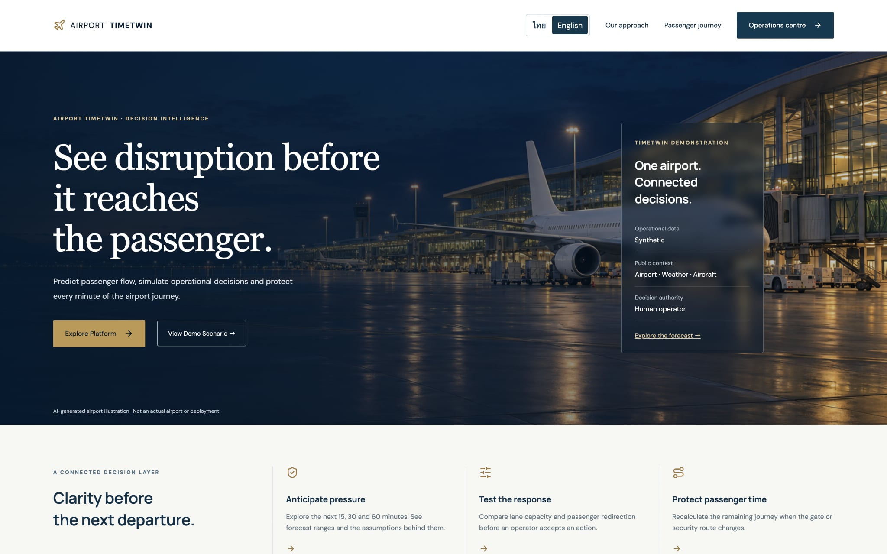

ผู้ใช้ใหม่เริ่มจากหน้า Landing เพื่อเข้าใจคำสัญญาของระบบ: anticipate pressure, test response และ protect passenger time หน้า นี้ไม่ได้คำนวณคิวเอง ปุ่ม `Operations centre` ไปที่ `/overview` ส่วน `View Demo Scenario` ไปยัง guided demonstration

### 13.2 Overview / Airport now

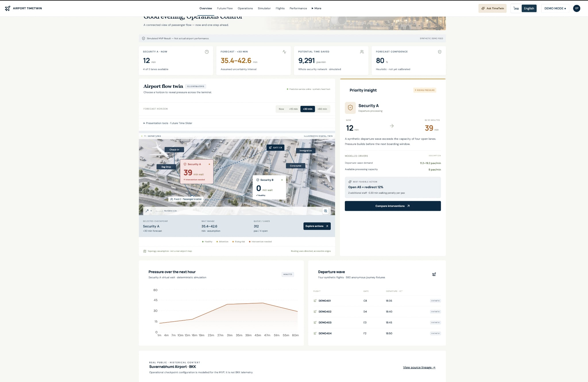

หน้า `/overview` เป็น command overview สำหรับ operator แสดง KPI, terminal map แบบ illustrative, Security A/B, current wait, +30 forecast, confidence, เที่ยวบิน และ priority insight การตัดสินใจในหน้านี้คือ “ควรไปวิเคราะห์สถานการณ์ใดต่อ” ไม่ใช่การสั่งเปิดเลนทันที

### 13.3 Operations control / Situations

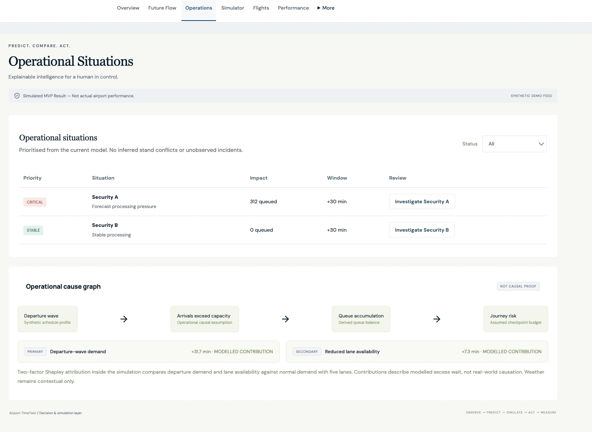

หน้า `/operations` เปลี่ยน forecast ให้เป็น work queue ของ operator เช่น Security A เป็น `CRITICAL`, Security B เป็น `STABLE` และมี time window +30 นาที ปุ่ม `Investigate` เปิดรายละเอียดเหตุผลเชิง model เช่น demand wave → capacity exceeded → queue accumulation → journey risk ด้านล่างเป็น model attribution ไม่ใช่ causal proof จากโลกจริง

### 13.4 Future Flow / Future map

หน้า `/future` ใช้ map และ horizon selector เพื่อดูผลที่ +15, +30 และ +60 นาที ผู้ใช้เลือก checkpoint เพื่อดู queue pressure ตามอนาคต ค่าในหน้านี้มาจาก `forecast()` และ `AirportMap` ไม่ใช่ภาพ floor plan ที่สำรวจจริง

### 13.5 What-if lab / Simulator

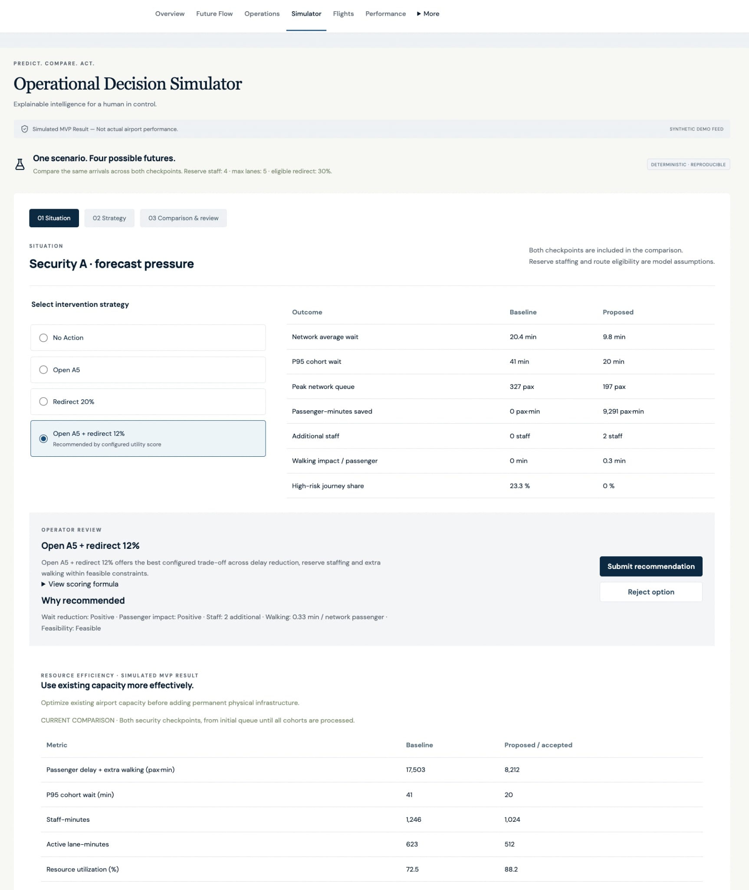

หน้า `/simulator` คือพื้นที่ทดลองมาตรการ ผู้ใช้เลือก No Action, Open A5, Redirect 20% หรือแบบผสม จากนั้นดู baseline/proposed, average wait, P95, queue, staff, walking impact, feasibility และ score ระบบใช้ demand เดิมทุกทางเลือกเพื่อให้การเปรียบเทียบยุติธรรม ปุ่ม custom simulation ส่งค่าจาก sliders ไปให้ engine แต่ยังไม่เปลี่ยน state จนกด submit decision

### 13.6 Flights

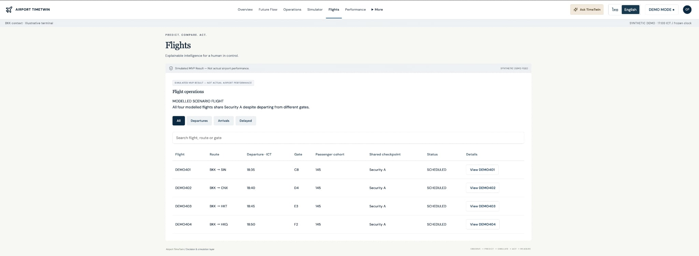

หน้า `/flights` แสดงเที่ยวบิน DEMO401–DEMO404, route, gate, เวลาออก, passenger cohort และสถานะ ตารางนี้ช่วยให้ operator เห็นว่า departure wave ใดแชร์ Security A การกด View เปิด ground handling, baggage และ gate events ทั้งหมดเป็น fixture จำลอง ไม่ใช่ commercial schedule จริง

### 13.7 Passenger flow

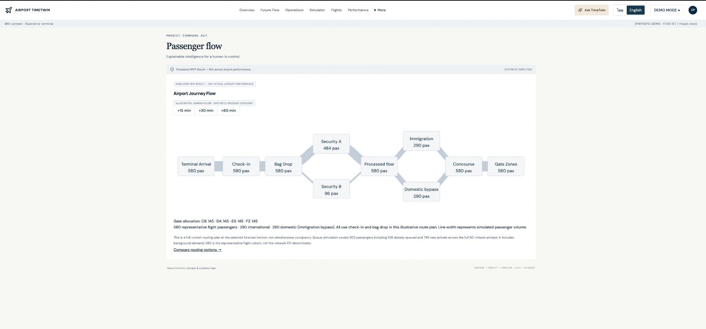

หน้า `/passenger-flow` แสดง flow จาก terminal arrival → check-in → bag drop → Security A/B → immigration/domestic bypass → concourse → gate ผู้ใช้เลือก +15/+30/+60 เพื่อดู scenario horizon ความหนาของเส้นเป็น simulated passenger volume ไม่ใช่ sensor count

### 13.8 Passenger journey

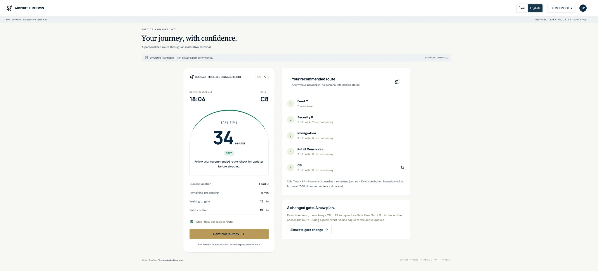

หน้า `/journey` ให้มุมมองของ passenger หน้าการ์ดแสดง deadline, gate, Safe Time และ action ปัจจุบัน ด้านข้างแสดงเส้นทางแบบ step-free จาก node ปัจจุบันไป gate เมื่อกด gate change ระบบคำนวณ route และ Safe Time ใหม่ ตัวอย่าง C8 → E7 เป็นสถานการณ์จำลอง ไม่ใช่ข้อมูล itinerary ของคนจริง

### 13.9 Performance

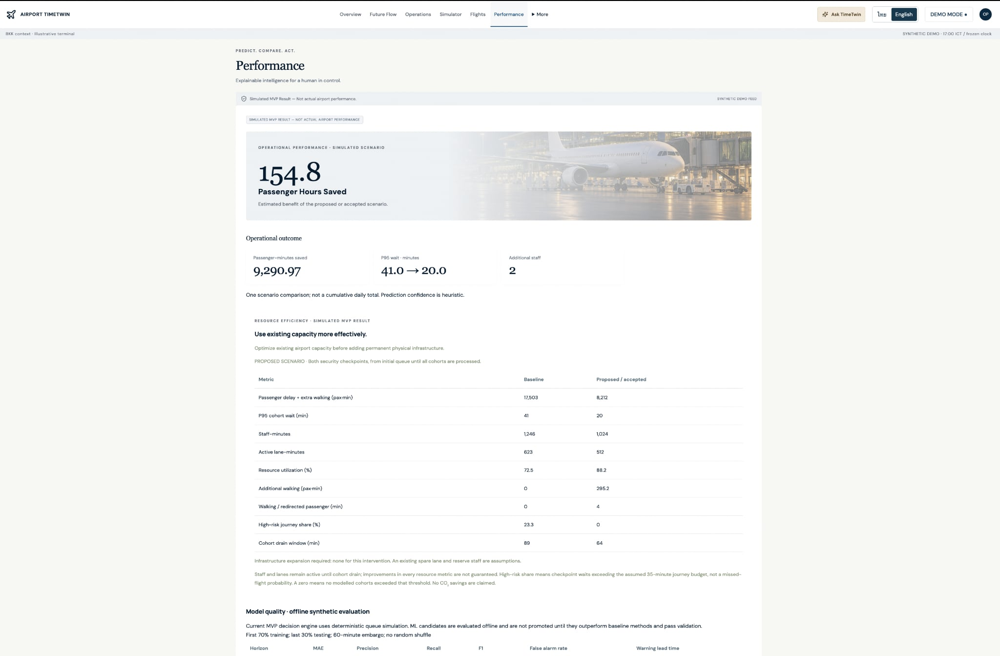

หน้า `/performance` ตอบคำถาม “มาตรการที่เลือกสร้างผลอย่างไร” แสดง passenger-minutes saved, P95 before/after, additional staff, resource efficiency และตาราง offline evaluation ค่าเหล่านี้เป็นผลจาก scenario เดียวและ synthetic history ไม่ใช่ KPI ที่วัดจากสนามบินจริง

### 13.10 Sources / Data & sources

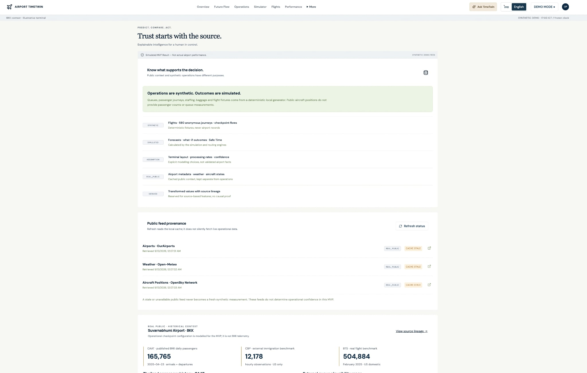

หน้า `/sources` ทำหน้าที่สร้างความเข้าใจเรื่อง provenance แยก `REAL_PUBLIC`, `SYNTHETIC`, `SIMULATED`, `ASSUMPTION` และ `DERIVED` พร้อมแสดง provider, freshness, record count และ source link ผู้ใช้ควรเปิดหน้านี้ก่อนตีความตัวเลขใน Overview

### 13.11 Decision log / Audit

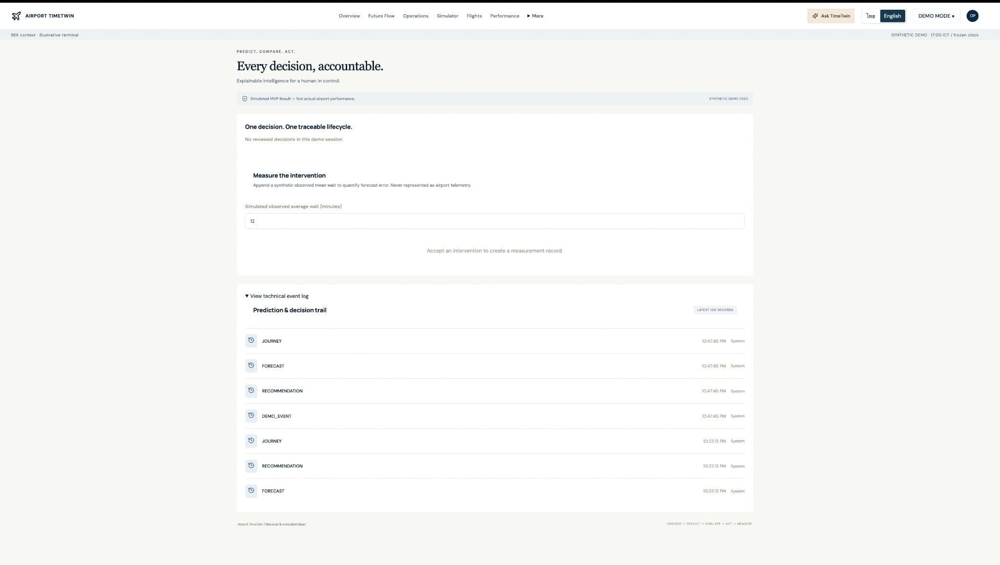

หน้า `/app/audit` แสดงว่าใครตัดสินใจอะไร เหตุผลอะไร scenario version ใดถูกใช้ และผลจำลองหลัง action เป็นเท่าไร ส่วน measurement เป็น synthetic observation ใน Demo เพื่อทดลอง error tracking ไม่ใช่ผลการตรวจวัดจริง

### 13.12 System Integration

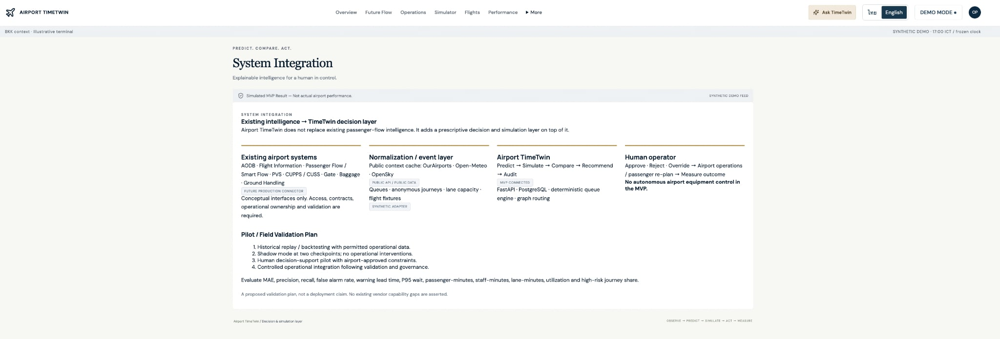

หน้า `/integration` อธิบายขอบเขตการเชื่อมต่อในอนาคต เช่น AODB/FIDS, baggage, gate และ human operator โดยแยก integration concept ออกจากระบบที่เชื่อมต่อจริงใน prototype หน้า นี้เป็น roadmap และ contract ไม่ใช่หลักฐานว่า connector production มีอยู่แล้ว

### 13.13 Guided demonstration

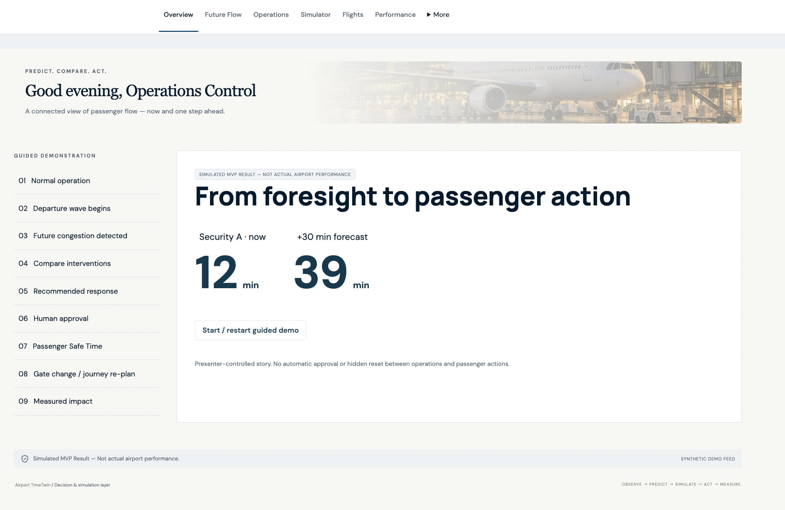

หน้า `/demo` ใช้เล่าเรื่องตามลำดับ: normal operation → departure wave → future congestion → compare interventions → recommended response → human approval → passenger Safe Time → gate change/re-plan → measured impact เหมาะสำหรับการนำเสนอ เพราะผู้พูดควบคุม step และอธิบาย data boundary ได้ทีละจุด

### 13.14 หน้า data catalog แบบละเอียด

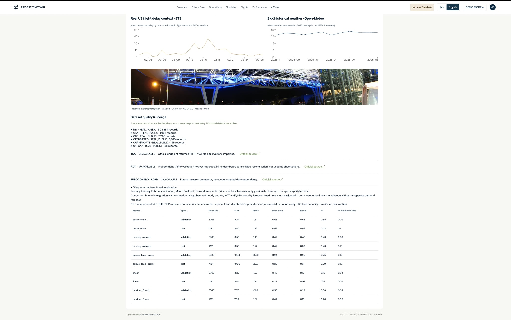

ภาพนี้เป็นมุมมอง Sources แบบละเอียด แสดง quality table, period, geography, missing/duplicate และ benchmark charts เป็นหลักฐาน provenance ของ public context ไม่ใช่หลักฐานว่า operational queue เป็นข้อมูลจริง

## 15. Database lineage: ตาราง, field และกระบวนการที่นำไปใช้

### 13.1 กติกาการอ่าน schema

ทุก operational table มี `id` และ `source_type` เป็น field กลาง `source_type` ใช้บอก provenance ของแถวนั้น ส่วน field ที่เขียนเป็น `@table` ใน schema คือ foreign key ไปยัง `table.id` ตารางหลักจึงไม่ได้เก็บค่าในหน้าเว็บแบบลอย ๆ แต่ถูก seed → อ่านเข้า engine → แปลงเป็น API response → แสดงผลบน UI

### 13.2 ตาราง reference และ operational input

| ตาราง | Field สำคัญ | ข้อมูลมาจากไหน | ใช้ทำอะไร |
|---|---|---|---|
| `airports` | `iata`, `icao`, `airport_name`, `latitude`, `longitude`, `timezone` | seed synthetic (`TWT/ZZTW`) หรือ public adapter ใน full pipeline | ระบุ airport context และผูก weather/metadata |
| `flights` | `flight_number`, `origin`, `destination`, `scheduled_departure`, `estimated_departure`, `gate`, `status` | seed สี่เที่ยวบิน DEMO401–404 | สร้าง departure wave, แสดง flight board และผูก passenger/baggage/gate |
| `aircraft_positions` | `timestamp`, `flight_id`, `latitude`, `longitude`, `altitude`, `ground_speed`, `heading` | synthetic fixture; OpenSky เป็น optional context | แสดง movement context; ไม่คำนวณ passenger queue |
| `weather` | `timestamp`, `airport_id`, `temperature`, `precipitation`, `wind_speed`, `visibility`, `weather_risk_score` | synthetic seed หรือ Open-Meteo cache | context เท่านั้น; ไม่เปลี่ยน Security capacity โดยอัตโนมัติ |
| `checkpoint` | `checkpoint_type`, `terminal`, `zone`, `maximum_lanes` | seed illustrative terminal | กำหนดจุดบริการและเพดาน lane |
| `lane_status` | `timestamp`, `checkpoint_id`, `lane_id`, `status`, `capacity_pax_min`, `staff_count` | seed; lane A5 เริ่ม unavailable | ใช้ตรวจ open lanes และ capacity |
| `passenger_flow` | `timestamp`, `checkpoint_id`, `passenger_arrivals`, `passenger_departures`, `queue_length`, `average_wait_min`, `p95_wait_min` | seed historical fixture | flow history และหน้า Passenger Flow; engine peak ใช้ arrival profile ที่กำหนดใน `engine.py` |
| `passenger_journey` | `anonymous_passenger_id`, `flight_id`, `current_node`, `journey_state`, `boarding_deadline`, `safe_time_min`, `risk_level` | สร้าง 580 anonymous journeys | เลือก passenger ตัวอย่างและคำนวณ route/Safe Time ใหม่ |
| `airport_graph` | `from_node`, `to_node`, `distance_m`, `walking_time_min`, `accessible`, `direction`, `capacity` | edges illustrative ใน `engine.py` และ seed | สร้าง directed accessible route ไป gate |

### 13.3 ตารางเหตุการณ์และผลลัพธ์

| ตาราง | Field สำคัญ | เขียนเมื่อใด | ใช้ต่อในขั้นตอนใด |
|---|---|---|---|
| `operational_events` | `timestamp`, `event_type`, `entity_type`, `entity_id`, `actor`, `status`, `metadata` | โหลด forecast, simulation, demo event และ human decision | เก็บ input snapshot, session UUID, output และ lineage ของเหตุการณ์ |
| `predictions` | `target`, `forecast_horizon`, `predicted_value`, `lower_bound`, `upper_bound`, `confidence`, `model_version`, `event_id` | เมื่อสร้าง overview/checkpoint/recommendation/journey prediction | แสดง forecast +30 และผูก prediction กับ event ต้นทาง |
| `recommendations` | `prediction_id`, `action`, `expected_impact`, `cost`, `constraints`, `score`, `accepted`, `decision`, `reason`, `actor` | เมื่อเรียก `/api/recommendations` | เก็บทางเลือกและ human decision lifecycle |
| `intervention_results` | `recommendation_id`, `before`, `after_predicted`, `after_actual`, `passenger_minutes_saved`, `prediction_error`, `result` | เมื่อ Accept/Override และเมื่อวัดผล | แสดง before/after และ prediction error |
| `audit` | `prediction_id`, `event_id`, `human_decision`, `action_taken`, `actual_outcome`, `prediction_error`, `result` | ทุก demo event และ decision | หน้า Decision Log, audit trail และ review ย้อนหลัง |

### 13.4 ตาราง state ของผู้ใช้และ demo

| ตาราง | Field | หน้าที่ |
|---|---|---|
| `demo_sessions` | `id`, `peak`, `lanes`, `redirect`, `gate`, `version`, `stale`, `updated_at` | state แยกตาม browser session; ใช้สร้าง `Scenario` ก่อนคำนวณทุก request |
| `demo_state` | `peak`, `lanes`, `redirect`, `gate`, `version`, `updated_at` | legacy/global compatibility state และ health check |

### 13.5 Data lineage ของค่าในหน้า Overview

| ค่าที่ผู้ใช้เห็น | อ่านจาก | คำนวณ/แปลงอย่างไร | แสดงที่ไหน |
|---|---|---|---|
| Current wait | `DemoSession` + `engine.forecast()` | queue เริ่มต้น ÷ lanes × service rate | metric Security A/B |
| +15/+30/+60 forecast | `Scenario` + `arrivals()` + `simulate()` | minute-step queue และ horizon row | forecast card/map |
| Lower/upper bound | prediction output | heuristic spread; fresh/stale confidence | uncertainty interval |
| Risk level | simulated wait | threshold GREEN/YELLOW/ORANGE/RED | priority/situations |
| Root causes | `Scenario` counterfactual | two-factor model attribution | priority insight |
| Best feasible action | `compare()` | weighted score + constraints | recommendation card |
| Flights | `flights` | serialize fixture ตาม session scenario | flight table |
| Safe Time | `passenger_journey` + `airport_graph` + `Scenario` | deadline − processing − walking − buffer | Passenger Journey |
| Public context | public normalized tables/cache | server-side aggregates | Sources/Overview context panel |

### 13.6 Data lineage ของ recommendation

```text
DemoSession
  ├─ peak, lanes, redirect, gate, version, stale
  ↓
Scenario
  ├─ arrivals()          → demand profile
  ├─ simulate()           → queue, wait, P95, throughput, cost
  ├─ journey()            → accessible route, walking, Safe Time
  └─ compare()            → options + score + feasible
       ↓
operational_events (input_snapshot + predicted_outcome)
       ↓
predictions (target + horizon + bounds + confidence)
       ↓
recommendations (action + constraints + score)
       ↓ human Accept / Reject / Override
intervention_results + audit
```

### 13.7 ตัวอย่างการคำนวณจาก field ไปถึงหน้าจอ

สมมติ row state มี `lanes=4`, `peak=true`, และ engine ใช้ `service_rate=2`:

```text
capacity = lanes × service_rate = 4 × 2 = 8 pax/min
queue_next = max(0, queue_current + arrivals - capacity)
```

ถ้าผู้ใช้เลือก redirect 20% ระบบแบ่ง arrival เป็น:

```text
Security A arrivals = arrivals × (1 - 0.20)
Security B arrivals = Security B baseline + arrivals × 0.20
```

จากนั้น `simulate()` คำนวณ wait ของแต่ละ FIFO cohort, รวม queue area เป็น passenger-minutes และส่งค่าไป `compare()` เพื่อหาคะแนน เมื่อผู้ใช้กด Accept ระบบเก็บ `before`, `after_predicted`, action และ reason ลง `intervention_results`/`audit` ก่อนเพิ่ม `version` ของ session

## 16. รายการอ้างอิง

1. Airport TimeTwin, [Data sources and provenance matrix](data-sources.md)
2. Airport TimeTwin, [Data Quality Report](data-quality-report.md)
3. Airport TimeTwin, [Assumptions and known limitations](assumptions.md)
4. Airport TimeTwin, [Architecture and implementation contract](architecture.md)
5. [OurAirports open data](https://ourairports.com/data/)
6. [Open-Meteo documentation](https://open-meteo.com/en/docs)
7. [OpenSky REST API](https://openskynetwork.github.io/opensky-api/rest.html)
8. [US BTS TranStats](https://transtats.bts.gov/)
9. [US CBP Airport Wait Times](https://awt.cbp.gov/)
10. [CAAT](https://www.caat.or.th/)
11. [UK Civil Aviation Authority data](https://www.caa.co.uk/data-and-analysis/)

**สถานะเอกสาร:** เอกสารนี้แยกข้อเท็จจริงจากข้อสมมติอย่างชัดเจน และไม่ควรใช้เป็น approval สำหรับการ deploy ในสนามบินจริงโดยไม่มี data owner, security review, operational validation และ safety governance

## 17. One TrustX: ชุด validation หลายสถานการณ์

เพื่อให้ผลประเมินไม่ขึ้นกับเดโมเพียงสถานการณ์เดียว repository มีชุด validation แบบจับคู่ (paired) ที่สร้างด้วย `scripts/experiments/generate_validation_pack.py` ประกอบด้วย 8 สถานการณ์, 100 seeds ต่อสถานการณ์ และ 4 เงื่อนไข (`BASELINE`, `SHARED_DATA`, `ONE_TRUSTX`, `ONE_TRUSTX_AI`) รวม **3,200 episodes** ทุกเงื่อนไขใช้ scenario และ seed เดียวกัน แล้วสรุปด้วย median, P25 และ P75

ผลรวม median ของ `BASELINE` เทียบกับ `ONE_TRUSTX_AI`:

| ตัวชี้วัด | Baseline | One TrustX + AI | ผลต่าง |
|---|---:|---:|---:|
| Coordination time | 19.66 วินาที | 7.67 วินาที | ลด 61.0% |
| Reconciliation time | 15.29 วินาที | 3.36 วินาที | ลด 78.0% |
| Risk visibility time | 45.88 วินาที | 11.93 วินาที | ลด 74.0% (เห็นเร็วขึ้นประมาณ 34 วินาที) |
| Event traceability | 42.0% | 100.0% | coverage ที่ตรวจได้ |
| Event verification rate | 0.0% | 85.7% | อัตราผ่านกฎตรวจสอบ |
| Delay risk proxy | 1.00 | 0.50 | ลด 50.0% |

ตัวเลขชุดนี้เป็น **ผล validation ของ prototype จากข้อมูล SYNTHETIC** ใช้ตรวจความสม่ำเสมอของ engine และทิศทางของ workflow เท่านั้น ไม่ใช่ผลการดำเนินงานจริง, ความน่าจะเป็นเที่ยวบินล่าช้าจริง หรือมูลค่าความเสียหายที่ลดลง ค่า delay เป็น proxy ที่สร้างจากกฎจำลอง และยังไม่ควรเรียก recommendation success ว่า AI accuracy เพราะยังไม่มีผลลัพธ์จริงที่มี label อิสระเพียงพอ

ไฟล์หลักของชุดข้อมูลคือ `data/cache/onetrustx-validation-runs.csv`, `data/cache/onetrustx-validation-summary.csv` และ `data/cache/onetrustx-validation-manifest.json` ส่วน schema สำหรับนำ telemetry จริงที่ได้รับอนุญาตเข้ามาวัดผลอยู่ใน [`validation-data-contract.md`](validation-data-contract.md)
