# One TrustX
## รายงานระบบฉบับเต็ม: โครงเดิมของโครงการ ทั้งระบบทำอะไร และลงลึกเรื่องกระเป๋า

**ฉบับวันที่ 8 ตุลาคม 2026 · ทีม onetrustx · SKY Innovation Spark 2026**

ผู้อ่าน: สมาชิกทีม mentor และกรรมการ เอกสารแบ่งเป็นภาค ก (ทั้งระบบ) ภาค ข (ลงลึกเรื่องกระเป๋าตามโครงเดิม) และภาค ค (ภาคผนวก)

สถานะของเอกสารนี้: ระบบเป็นต้นแบบที่รันด้วยข้อมูลจำลอง ไม่ใช่ระบบที่ใช้งานในสนามบิน และไม่มีตัวเลขใดในเอกสารนี้เป็นผลการปฏิบัติงานของท่าอากาศยานสุวรรณภูมิ

[[part:ภาค ก · ทั้งระบบ|One TrustX ใช้ทำอะไร แต่ละโมดูลทำงานอย่างไร ใช้ข้อมูลอะไร และวัดผลอย่างไร]]

## ส่วนที่ 1: สรุปหนึ่งหน้า

One TrustX คือแพลตฟอร์มกลางที่เชื่อมข้อมูลและเหตุการณ์จากหลายฝ่ายในการบิน ให้ทุกฝ่ายเห็นสถานการณ์ชุดเดียวกัน และช่วยวิเคราะห์ คาดการณ์ และแนะนำการตัดสินใจ โดยคนเป็นผู้ตัดสินใจขั้นสุดท้าย นี่คือนิยามเดิมของโครงการและยังคงเดิม ทุกโมดูลอยู่ในแถบเมนูเดียวกันที่ onetrustx.vercel.app รอบนี้ลงลึกเรื่องกระเป๋า (Baggage) โมดูลอื่นคงไว้และใช้งานได้ตามเดิม

[[diagram:platform]]

ข้อมูลของทั้งระบบมีสี่กลุ่ม และทุกหน้าจอติดป้ายบอกกลุ่ม:

[[diagram:data-map]]

- ข้อมูลจริงมาจากแหล่งสาธารณะ 10 แหล่ง ใช้เป็นบริบทและตัวเทียบเท่านั้น
- ค่าที่ไม่มีแหล่งเผยแพร่ ทีมตั้งเป็นสมมติฐานและประกาศไว้ทุกค่า
- ข้อมูลปฏิบัติการ (กระเป๋า เที่ยวบิน คิว ผู้โดยสาร) เป็นข้อมูลจำลองทั้งหมด ไม่มีข้อมูลของ SKY สายการบิน หรือสนามบินใดในระบบ
- รายละเอียดอยู่ในหัวข้อ 2.3 ถึง 2.5 และข้อมูลที่ต้องขอจาก SKY อยู่ในหัวข้อ 2.6

เอกสารแบ่งเป็นสามภาค:

- **ภาค ก ทั้งระบบ** (ส่วนที่ 1–6): ระบบใช้ทำอะไร แต่ละโมดูลทำงานอย่างไร ใช้ข้อมูลอะไร วัดผลอย่างไร
- **ภาค ข ลงลึกเรื่องกระเป๋า** (ส่วนที่ 7–16): ตามโครงเดิมของโครงการ คือ Pain Point, Solution, Impact
- **ภาค ค ภาคผนวก** (ส่วนที่ 17–19): สิ่งที่เปลี่ยนจากเวอร์ชันก่อน ข้อจำกัด และแหล่งอ้างอิง

สิ่งที่เปลี่ยนในรอบนี้ (7–8 ต.ค. 2026):

- เพิ่มเมนู **Baggage** ในแถบนำทางหลัก ถัดจาก Overview ใช้หน้าตาเดียวกับหน้าอื่น
- หน้ากระเป๋าคำนวณจากข้อมูลการสแกนและตารางบินทุกครั้งที่เปิด มี 5 สถานการณ์ รวมสถานการณ์ปกติ
- ค่าทุกตัวที่ใช้ตั้งสถานการณ์กระเป๋ามีป้ายประเภทและลิงก์แหล่งที่มา
- แก้หน้า Data & sources ที่เปิดไม่ขึ้นบนเว็บจริง
- เปลี่ยนชื่อโครงการจาก Airport TimeTwin เป็น One TrustX และลบหน้าแยก `TrustXPages` ที่ไม่เคยต่อเข้ากับเว็บ

สถานะการเผยแพร่ (ตรวจ 8 ต.ค. 2026): เว็บ onetrustx.vercel.app และ backend ถูก deploy แล้วพร้อมเมนู Baggage ทุกหน้าเปิดได้และไม่มี error ส่วนโค้ดบน GitHub ยังเป็นเวอร์ชัน 28 ก.ย. เพราะยังไม่ได้ commit และ push

ประโยคที่ใช้อธิบายตำแหน่งของโมดูลกระเป๋า:

> BRS ติดตามและตรวจสอบกระเป๋ารายใบ One TrustX ดูการไหลของกระเป๋ารายขั้นเทียบกับเวลาออกของเที่ยวบิน เพื่อบอกว่าติดที่ไหนและควรช่วยเที่ยวบินใดก่อน

---

## ส่วนที่ 2: One TrustX ทั้งระบบใช้ทำอะไร

### 2.1 หลักการที่ทุกโมดูลใช้ร่วมกัน

One TrustX ไม่ใช่ระบบเก็บข้อมูลต้นทาง และไม่ได้แทนระบบของสนามบิน มันเป็นชั้นช่วยตัดสินใจที่วางอยู่เหนือระบบเดิม ทุกโมดูลทำงานตามลำดับเดียวกัน:

[[diagram:loop]]

- **ข้อมูลติดป้ายที่มาเสมอ** ทุกหน้ามีแถบแจ้งว่าเป็นผลจำลอง และแยกข้อมูลจริง ข้อมูลจำลอง สมมติฐาน และผลคำนวณออกจากกัน
- **ระบบแนะนำ คนตัดสินใจ** ไม่มีโมดูลใดสั่งการอุปกรณ์หรือเปลี่ยนสถานะของสนามบิน
- **ทุกการตัดสินใจถูกบันทึก** ว่าใครทำอะไร เมื่อใด ด้วยเหตุผลใด
- **เมื่อข้อมูลไม่สด ระบบหยุดแนะนำ** และแจ้งให้ตรวจสอบ แทนการแสดงตัวเลขที่อาจผิด
- **ไม่ใช้ข้อมูลส่วนบุคคล** ผู้โดยสารและกระเป๋าเป็นข้อมูลไม่ระบุตัวตนหรือจำนวนรวม

### 2.2 ภาพรวมโมดูล

| เมนู | ใช้ทำอะไร | ผู้ใช้หลัก |
|---|---|---|
| Overview | ดูสถานะคิวที่จุดตรวจตอนนี้ และแนวโน้มอีก 15, 30, 60 นาที | ผู้ควบคุมการปฏิบัติการ |
| **Baggage** | ดูว่าการไหลของกระเป๋าปกติหรือไม่ ติดที่ขั้นไหน กระทบเที่ยวบินใด | ผู้ควบคุมงานกระเป๋าและภาคพื้น |
| Future Flow | ดูแรงกดดันบนแผนผังอาคารตามช่วงเวลาที่เลือก | ผู้ควบคุมการปฏิบัติการ |
| Operations | เรียงสถานการณ์ตามความเร่งด่วน พร้อมสาเหตุที่แบบจำลองประเมิน | ผู้ควบคุมการปฏิบัติการ |
| Simulator | เทียบผลของมาตรการหลายแบบก่อนเลือก | หัวหน้ากะ ผู้ตัดสินใจ |
| Flights | ดูเที่ยวบินที่เกี่ยวข้องกับจุดตรวจ | ผู้ควบคุมการปฏิบัติการ |
| Performance | ดูผลของมาตรการและความแม่นของแบบจำลอง | ผู้บริหาร ผู้ตรวจสอบ |
| Passenger flow | ดูเส้นทางการไหลของผู้โดยสารทั้งอาคาร | ผู้วางแผน |
| Passenger journey | มุมผู้โดยสาร: เวลาที่เหลืออย่างปลอดภัยและเส้นทาง | ผู้โดยสาร |
| Decision log | ย้อนดูการตัดสินใจและวัดผลหลังดำเนินการ | ผู้ตรวจสอบ |
| Data & sources | ดูว่าข้อมูลแต่ละชุดมาจากไหน เป็นประเภทใด | ทุกคน กรรมการ |
| System Integration | แผนการเชื่อมกับระบบจริงของสนามบิน | ฝ่าย IT |
| Guided demonstration | เดโมแบบมีผู้นำเสนอ 9 ขั้น | ผู้นำเสนอ |


### 2.3 ภาพรวมที่มาของข้อมูลทั้งระบบ

ข้อมูลทุกชิ้นในระบบอยู่ในหนึ่งในสี่กลุ่มนี้ และทุกหน้าจอติดป้ายบอกกลุ่ม

[[diagram:data-map]]

**กลุ่มที่ 1 ข้อมูลจริงจากแหล่งสาธารณะ** ใช้เป็นบริบทและตัวเทียบ ไม่ถูกนำมาแทนข้อมูลปฏิบัติการของสุวรรณภูมิ

| แหล่ง | ข้อมูล | ใช้ในโมดูล | ความน่าเชื่อถือ |
|---|---|---|---|
| Open-Meteo | ฝนและอากาศรายชั่วโมงที่ BKK ปี 2025 และช่วง 22 ก.ย.–3 ต.ค. 2026 | Baggage (บริบทเหตุการณ์), Data & sources | ผลจากแบบจำลองอากาศ ไม่ใช่มาตรวัดในสนามบิน |
| การบินไทย (หน้า check-in) | ปิดรับกระเป๋า 60 นาทีก่อนออก | Baggage | นโยบายที่สายการบินประกาศเอง |
| IATA Resolution 753 | จุดสแกนบังคับ 4 จุด | Baggage | มาตรฐานอุตสาหกรรม |
| SITA Baggage IT Insights 2026 | 24 ล้านใบ, 4.9 ต่อพันคน, 260 ดอลลาร์ต่อใบ, transfer 39% | Baggage (ขนาดปัญหา) | รายงานอุตสาหกรรมระดับโลก ไม่ใช่ตัวเลขของ SKY |
| AOT ผ่านสื่อ | BKK ปีงบ 2025: 62.9 ล้านคน 370,823 เที่ยว | Baggage (ขนาดเที่ยวบิน) | ตัวเลขที่สื่อรายงาน ต้องเทียบรายงานประจำปี |
| CAAT, The Nation, The Star | ประกาศและข่าวเหตุการณ์ ก.ย. 2026 | Baggage (เหตุการณ์อ้างอิง) | ประกาศทางการ 1 ฉบับ และข่าว 4 ชิ้น ตัวเลขเปลี่ยนตามวัน |
| CBP (สหรัฐฯ) | เวลารอคิว 12,186 รายการ ม.ค.–มี.ค. 2025 | Performance (ตัวเทียบคิว) | ข้อมูลทางการ แต่คนละประเทศ |
| BTS (สหรัฐฯ) | 504,884 เที่ยวบิน ก.พ. 2025 | Data & sources | ข้อมูลทางการ แต่คนละประเทศ |
| CAAT สถิติรายวัน | ผู้โดยสารไทย ก.ย. 2023–เม.ย. 2025 | Data & sources | CAAT ระบุว่าเป็นข้อมูลเบื้องต้น |
| OurAirports, UK CAA, OpenSky | ข้อมูลอ้างอิงสนามบินและการจราจร | Data & sources | ข้อมูลเปิด ใช้เป็นบริบทเท่านั้น |

**กลุ่มที่ 2 สมมติฐานของทีม** ค่าที่ไม่มีแหล่งเผยแพร่ ทีมตั้งเองและประกาศไว้

| เรื่อง | ตัวอย่างค่า | ใช้ในโมดูล | บันทึกไว้ที่ |
|---|---|---|---|
| กระเป๋า | กำลังคนเหลือ 55% ช่วงน้ำท่วม, กระเป๋า 0.9 ใบต่อคน, เกณฑ์เวลารอ 15 และ 30 นาที | Baggage | `backend/app/baggage_calibration.json` |
| คิวผู้โดยสาร | เลนละ 2 คนต่อนาที, ผู้โดยสารเข้า 11.2–19.2 คนต่อนาที, ช่วงพยากรณ์บวกลบ 15% | Overview, Future Flow, Simulator | `docs/assumptions.md` |
| อาคารและเส้นทาง | ผังอาคาร ระยะเดิน เวลาสำรอง 10 นาที | Passenger flow, Journey | `docs/assumptions.md` |

**กลุ่มที่ 3 ข้อมูลปฏิบัติการจำลอง** สร้างจากกลุ่มที่ 1 และ 2 ด้วยเลขสุ่มที่ทำซ้ำได้ ไม่มีข้อมูลของสายการบินหรือสนามบินใด

| ชุดข้อมูล | ขนาด | ใช้ในโมดูล |
|---|---|---|
| การสแกนกระเป๋าและตารางบิน | ประมาณ 8,000 รายการ 5 สถานการณ์ | Baggage |
| ประวัติคิว 14 วัน | 20,160 นาที | Performance |
| การเดินทางของผู้โดยสาร | 580 แถว 4 เที่ยวบิน | Flights, Passenger flow, Journey |
| เลน จุดตรวจ งานภาคพื้น gate | 6–28 แถวต่อชุด | Overview, Operations, Simulator |

**กลุ่มที่ 4 ผลคำนวณ** ทุกตัวเลขที่ระบบแสดง เช่น เวลารอที่พยากรณ์ คอขวด เที่ยวบินเสี่ยง คำแนะนำ และเวลาปลอดภัยของผู้โดยสาร มาจากการคำนวณบนกลุ่มที่ 3 จึงเป็นผลจำลองทั้งหมด

หัวข้อถัดไปลงรายละเอียดของแหล่งข้อมูลจริง (2.4) วิธีสร้างข้อมูลจำลอง (2.5) และข้อมูลที่ต้องขอจาก SKY (2.6) การวัดผลของโมดูลทั่วไปอยู่ในส่วนที่ 4 ค่าตั้งต้นของโมดูลกระเป๋าอยู่ในส่วนที่ 12 และรายการลิงก์ทั้งหมดอยู่ในส่วนที่ 19

### 2.4 รายละเอียดของแหล่งข้อมูลจริงแต่ละแหล่ง

ทุกไฟล์ที่ดึงมาเก็บไว้ใน `data/external/` พร้อมไฟล์กำกับที่บันทึก URL เวลาที่ดึง ช่วงเวลาของข้อมูล เงื่อนไขการใช้ และ SHA-256 ถ้าไฟล์ในเครื่องไม่ตรงกับ checksum สคริปต์จะหยุดแทนการเขียนทับ

| แหล่ง | ดึงจาก | วันที่ดึง | ช่วงเวลาของข้อมูล | เงื่อนไขการใช้ | ค่าที่นำมาใช้ |
|---|---|---|---|---|---|
| Open-Meteo (เหตุการณ์) | archive-api.open-meteo.com พิกัด 13.6811, 100.7470 | 7 ต.ค. 2026 | 22 ก.ย.–3 ต.ค. 2026 รายชั่วโมง 288 แถว | CC BY 4.0 | ปริมาณฝน รหัสสภาพอากาศ ลมกระโชก |
| Open-Meteo (ปี 2025) | archive-api.open-meteo.com | 12 ก.ย. 2026 | ปี 2025 รายชั่วโมง 8,760 แถว | CC BY 4.0 | อุณหภูมิ ฝน ลม ความกดอากาศ |
| CBP Airport Wait Times | awt.cbp.gov/api/waitTime | 12 ก.ย. 2026 | ม.ค.–มี.ค. 2025 ที่ JFK, LAX, SFO | ข้อมูลสาธารณะของรัฐบาลสหรัฐฯ | เวลารอเฉลี่ยและสูงสุด จำนวนผู้โดยสาร จำนวนช่องตรวจ |
| BTS On-Time Performance | transtats.bts.gov | 12 ก.ย. 2026 | ก.พ. 2025 | สถิติสาธารณะของ US DOT | เวลาออกตามแผนและจริง ความล่าช้า |
| CAAT สถิติรายวัน | caat.or.th ไฟล์ Excel 7 ไฟล์ | 12 ก.ย. 2026 | ก.ย. 2023–เม.ย. 2025 | สถิติสาธารณะ ต้องอ้างแหล่ง | ผู้โดยสารรายวันต่อสนามบิน |
| OurAirports | ourairports-data (GitHub Pages) | 12 ก.ย. 2026 | ภาพ ณ วันที่ดึง | Public domain | รหัสสนามบิน พิกัด ทางวิ่ง |
| UK CAA | caa.co.uk ตารางรายปี 3 ตาราง | 12 ก.ย. 2026 | ปี 2025 | เว็บไซต์ทางการ ต้องตรวจเงื่อนไขต้นทาง | จำนวนเที่ยวบินและผู้โดยสารต่อสนามบิน |
| AOT | airportthai.co.th รายงานปริมาณจราจรปี 2024 | 13 ก.ย. 2026 | ปี 2024 | รายงานสาธารณะ | บันทึกแหล่งไว้ แต่ไฟล์รายงานไม่อยู่ในแคช จึงยังไม่ได้ใช้ |

แหล่งที่อ่านจากหน้าเว็บโดยตรงเมื่อ 8 ต.ค. 2026 และไม่ได้เก็บเป็นไฟล์: นโยบาย check-in ของการบินไทย, IATA Resolution 753, ข่าวแจก SITA 2026, ประกาศ CAAT 30/2569 และข่าวจาก The Nation และ The Star ค่าที่ได้ถูกบันทึกพร้อมลิงก์ใน `backend/app/baggage_calibration.json`

ข้อมูลของ TSA ดึงไม่ได้ จึงไม่มีในระบบ

### 2.5 วิธีสร้างข้อมูลจำลอง ทีละขั้น

ข้อมูลจำลองทุกชุดสร้างด้วยเลขสุ่มคงที่ จึงได้ผลเดิมทุกครั้งที่รัน และตรวจสอบย้อนได้

**ชุดกระเป๋า** สร้างโดย `backend/app/baggage_flow.py` ส่งออกด้วย `scripts/experiments/run_baggage_evaluation.py`

1. สร้างตารางบิน: 12 เที่ยวบินขาออก ห่างกันประมาณ 27 นาที จำนวนผู้โดยสารสุ่มรอบค่าเฉลี่ย 170 คน (จากสถิติ BKK) จำกัดที่ 90–300 คน
2. คำนวณกระเป๋า: ผู้โดยสาร × 0.9 ใบ แบ่งเป็นกระเป๋าต่อเครื่องประมาณ 20% ที่เหลือเป็นกระเป๋าท้องถิ่น
3. สร้างเที่ยวบินขาเข้าที่ป้อนกระเป๋าต่อเครื่อง 12 เที่ยว จอดก่อนเที่ยวบินต่อ 90–150 นาที พร้อมกระเป๋าปลายทาง 80–160 ใบ
4. กระจายการรับกระเป๋าท้องถิ่น: เริ่ม 180 นาทีก่อนออก หนาแน่นสุดที่ 110 นาที หยุดที่ 60 นาที (เวลาปิดรับจริงของสายการบิน)
5. ตั้งกำลังปกติของแต่ละขั้นจากปริมาณตามแผน คูณ 1.3
6. ใส่เหตุของสถานการณ์: น้ำท่วมลดกำลังขั้นที่ใช้คนเหลือ 55% / เครื่องคัดแยกเหลือ 25% เป็นเวลา 75 นาที / ขาเข้า 4 เที่ยวช้า 55 นาที / ข้อมูล loading มาช้า 45 นาที
7. เดินเวลาทีละ 5 นาที กระเป๋าไหลผ่านแต่ละขั้นตามกำลัง ทุกครั้งที่ผ่านขั้นจะเกิดรายการสแกนหนึ่งแถว
8. กระเป๋าที่ยังไม่ถูกโหลดเมื่อถึงเวลาปิดห้องเก็บสัมภาระ ถูกบันทึกเป็นความจริงของแบบจำลองว่าตกเที่ยวบิน ตัวประเมินไม่เห็นข้อมูลส่วนนี้

ตัวอย่างแถวจริงจาก `data/synthetic/baggage_flow/`:

```text
ตารางบิน (flights.csv)
scenario_id      direction  flight  scheduled  actual  local/terminating  transfer  connection
BAG-FLOOD-STAFF  ARRIVAL    TT804   07:30      07:30   96                 38        TT404

รายการสแกน (BAG-FLOOD-STAFF.csv มี 1,968 แถว)
scenario_id      seed  stage     flight  bag_class  count  event_min  ingest_min  source_type
BAG-FLOOD-STAFF  42    check_in  TT402   LOCAL      2      65         66          SYNTHETIC
```

อ่านว่า: นาทีที่ 65 ของกะ มีกระเป๋าท้องถิ่น 2 ใบของเที่ยวบิน TT402 ถูกรับที่ check-in และระบบได้รับข้อมูลในนาทีที่ 66

**ชุดคิวผู้โดยสาร** สร้างโดย `backend/app/seed.py` และ `scripts/generate_synthetic.py`

1. ตั้งเวลาเดโมคงที่ที่ 17:00 และสร้างอาคารสมมติ: จุดตรวจ 2 จุด เลน 8 เลน เส้นทางเดิน 16 เส้น
2. สร้างเที่ยวบิน 4 เที่ยว เที่ยวละ 145 คน รวม 580 แถวการเดินทางแบบไม่ระบุตัวตน
3. ตั้งโปรไฟล์ผู้โดยสารเข้าต่อช่วง 15 นาที (11.2, 19.2, 9 และ 1.6 คนต่อนาที) และกำลังเลนละ 2 คนต่อนาที
4. สร้างประวัติคิว 14 วันสำหรับประเมินแบบจำลอง: เริ่มที่คิว 40 คน ผู้โดยสารเข้าเป็นคลื่นไซน์บวกสัญญาณรบกวน เลขสุ่ม 42 เลนสลับ 3 และ 4 ทุกสามชั่วโมง

ตัวอย่างแถวจริง:

```text
ประวัติคิว (training.csv มี 20,160 แถว)
minute  queue    arrivals  lanes  source_type
39      115.676  7.897     3      SYNTHETIC

การเดินทางของผู้โดยสาร (passenger_journey.csv มี 580 แถว)
anonymous_passenger_id  flight_id  current_node  journey_state  safe_time_min  risk_level
anon-0039               flight-4   Food C        PRE_SECURITY   34.0           SAFE
```

สิ่งที่ตั้งใจไม่สร้าง: ชื่อผู้โดยสาร เลขหนังสือเดินทาง เลขป้ายกระเป๋า และเลขเที่ยวบินของสายการบินจริง เที่ยวบินใช้รหัส TT และ DEMO เพื่อไม่ให้สับสนกับเที่ยวบินจริง

### 2.6 ข้อมูลที่ต้องขอจาก SKY เพื่อแทนข้อมูลจำลอง

ตารางนี้คือสิ่งที่ระบบต้องการ ไม่ใช่การยืนยันว่าระบบของ SKY ส่งออกได้ในรูปแบบนี้ ต้องถาม mentor ทุกรายการ

| ลำดับ | ระบบต้นทาง | ข้อมูลที่ต้องการ | ความละเอียด | ใช้แทนข้อมูลจำลองชุดใด | จำเป็นแค่ไหน |
|---|---|---|---|---|---|
| 1 | BRS | จำนวนกระเป๋าที่สแกนผ่านแต่ละจุด (รับ คัดแยก โหลด ส่งต่อ ถึง) แยกรายเที่ยวบิน และแยกกระเป๋าท้องถิ่นกับต่อเครื่อง | จำนวนรวมทุก 5 นาที พร้อมเวลาสแกนและเวลาที่ส่งข้อมูล | รายการสแกนกระเป๋า | จำเป็น |
| 2 | AODB | เวลาออกตามแผนและคาดการณ์ เวลาจอดจริงของขาเข้า gate หลุมจอด สถานะเที่ยวบิน | ทุกครั้งที่มีการอัปเดต | ตารางบินจำลอง | จำเป็น |
| 3 | DCS หรือ BRS | จำนวนกระเป๋าที่คาดไว้ต่อเที่ยวบิน และการจับคู่เที่ยวบินขาเข้ากับเที่ยวบินต่อ | ต่อเที่ยวบิน อัปเดตเมื่อปิด check-in | จำนวนกระเป๋าที่คาดไว้ | จำเป็น |
| 4 | BHS | สถานะสายพานและเครื่องคัดแยก รหัสข้อขัดข้อง | เมื่อสถานะเปลี่ยน | สถานการณ์เครื่องคัดแยกขัดข้อง | ช่วยระบุสาเหตุ |
| 5 | Ground handler | พนักงานที่เข้ากะเทียบแผน รถขนกระเป๋าและอุปกรณ์ที่ใช้ได้ | ทุก 30 นาที | ข้อมูลกำลังคนจำลอง | ช่วยระบุสาเหตุ |
| 6 | Smart Flows | จำนวนผู้โดยสารที่มาถึงและความหนาแน่นหน้า check-in | ทุก 5–15 นาที | โปรไฟล์ผู้โดยสารเข้าของโมดูลคิว | สำหรับโมดูลคิว และเตือนกระเป๋าล่วงหน้า |
| 7 | ระบบจุดตรวจ | จำนวนเลนที่เปิด และเวลารอที่วัดได้ | ทุก 5 นาที | สถานะเลนและคิวจำลอง | สำหรับโมดูลคิว |

หลักการขอข้อมูล:

- ขอเป็นจำนวนรวม ไม่ขอชื่อผู้โดยสาร เลขหนังสือเดินทาง หรือเลขป้ายกระเป๋ารายใบ
- เริ่มจากข้อมูลย้อนหลังของวันที่มีเหตุผิดปกติหนึ่งถึงสองวัน และวันปกติหนึ่งวัน เพื่อทดสอบแบบอ่านอย่างเดียวก่อนต่อข้อมูลสด
- รายการ 1–3 เพียงพอสำหรับการหาคอขวดและเที่ยวบินเสี่ยง รายการ 4–5 เพิ่มเพื่อบอกสาเหตุ
- มาตรฐานข้อความกระเป๋าของ IATA (BSM สำหรับข้อมูลต้นทางของกระเป๋า และ BPM สำหรับการสแกนแต่ละจุด) น่าจะเป็นรูปแบบที่ BRS ใช้อยู่ ต้องยืนยันกับ SKY
- ก่อนรับข้อมูลจริง ต้องมีข้อตกลงการใช้ข้อมูล และทบทวนตาม PDPA แม้จะเป็นจำนวนรวม

---

## ส่วนที่ 3: แต่ละโมดูลอย่างละเอียด

ภาพทั้งหมดในส่วนนี้แคปจาก onetrustx.vercel.app เมื่อ 8 ต.ค. 2026 ตัวเลขบนจอเป็นข้อมูลจำลอง

### 3.1 Overview

**ใช้ทำอะไร:** หน้าแรกของผู้ควบคุมการปฏิบัติการ ตอบว่าตอนนี้คิวที่จุดตรวจเป็นอย่างไร และอีกครึ่งชั่วโมงจะเป็นอย่างไร

**บนจอมีอะไร:** การ์ดสี่ใบ (เวลารอตอนนี้ / ช่วงพยากรณ์อีก 30 นาที / นาทีที่ผู้โดยสารประหยัดได้ถ้าทำตามคำแนะนำ / ความมั่นใจ) แผนผังอาคารที่กดเลือกช่วงเวลาได้ และกล่อง Priority insight ที่บอกจุดที่ต้องจับตาพร้อมมาตรการที่ทำได้

**คำนวณอย่างไร:** คิวใหม่ = คิวเดิม + ผู้โดยสารเข้า − กำลังให้บริการ ทีละนาที ในสถานการณ์ตั้งต้น Security A รอ 12 นาที และจะเป็น 39 นาทีในอีก 30 นาที เพราะผู้โดยสารเข้า 11.2–19.2 คนต่อนาที แต่ 4 เลนรับได้ 8 คนต่อนาที

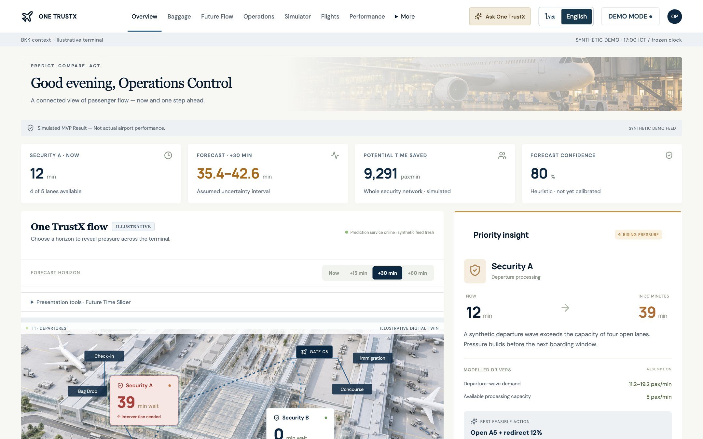

### 3.2 Future Flow

**ใช้ทำอะไร:** ดูภาพเดียวกับ Overview แต่เน้นแผนผัง เลือกดูตอนนี้ +15, +30 หรือ +60 นาที เพื่อเห็นว่าแรงกดดันย้ายไปที่ใด

**ข้อควรรู้:** แผนผังเป็นภาพประกอบ ไม่ใช่ผังของสุวรรณภูมิ ช่วงพยากรณ์ (บวกลบ 15% และ 2 นาที) เป็นสมมติฐาน

### 3.3 Operations

**ใช้ทำอะไร:** รวมสถานการณ์ทั้งหมดไว้ในตารางเดียว เรียงจากเร่งด่วนที่สุด กด Investigate เพื่อดูรายละเอียด แล้วไปต่อที่ Simulator

**บนจอมีอะไร:** ตารางสถานการณ์ (ระดับ / จุดที่เกิด / ผลกระทบ / ช่วงเวลา) และแผนผังสาเหตุที่แบ่งผลระหว่างปริมาณผู้โดยสาร (+31.7 นาที) กับจำนวนเลนที่ลดลง (+7.3 นาที)

**คำนวณอย่างไร:** แบ่งผลด้วยวิธี Shapley สองปัจจัยภายในแบบจำลอง หน้าจอติดป้ายว่า NOT CAUSAL PROOF คือไม่ใช่การพิสูจน์สาเหตุในโลกจริง

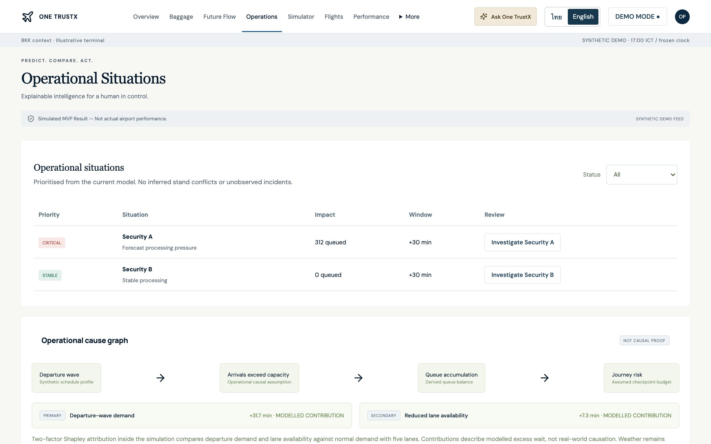

### 3.4 Simulator

**ใช้ทำอะไร:** ทดลองก่อนตัดสินใจ รันผู้โดยสารชุดเดียวกันผ่านมาตรการ 4 แบบ แล้วเทียบผล

**บนจอมีอะไร:** สามขั้น (สถานการณ์ / เลือกกลยุทธ์ / เทียบและทบทวน) ตารางเทียบก่อนและหลัง เช่น เวลารอเฉลี่ย 20.4 → 9.8 นาที คิวสูงสุด 327 → 197 คน ใช้พนักงานเพิ่ม 2 คน

**คำนวณอย่างไร:** จำลองผู้โดยสารเป็นกลุ่มตามลำดับมาก่อนได้ก่อน ให้คะแนนแต่ละมาตรการจากเวลารอที่ลด นาทีที่ประหยัด และสัดส่วนผู้โดยสารเสี่ยง หักด้วยพนักงาน ระยะเดิน และต้นทุนที่เพิ่ม มาตรการที่ทำไม่ได้ (เช่น พนักงานสำรองไม่พอ) ถูกตัดออก

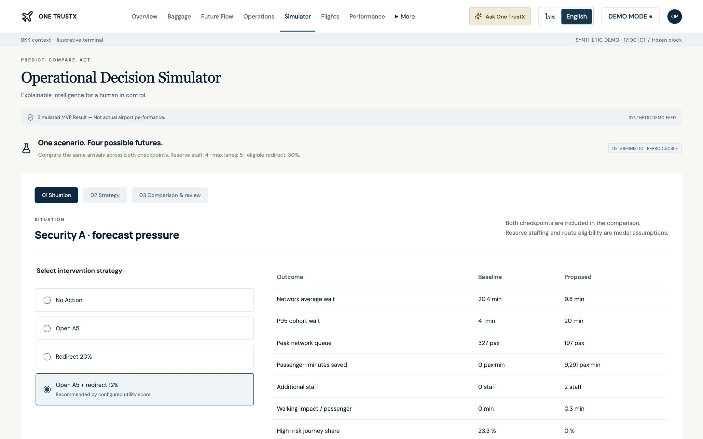

### 3.5 Flights

**ใช้ทำอะไร:** ดูว่าเที่ยวบินใดใช้จุดตรวจใด เพื่อเข้าใจว่าคิวที่จุดเดียวกระทบกี่เที่ยวบิน

**บนจอมีอะไร:** เที่ยวบินจำลอง 4 เที่ยว (DEMO401–404) เที่ยวละ 145 คน ทั้งหมดใช้ Security A กรองดูขาออก ขาเข้า หรือที่ล่าช้าได้

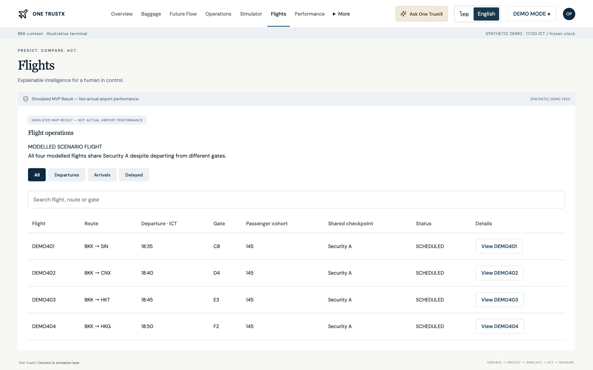

### 3.6 Performance

**ใช้ทำอะไร:** สรุปผลของมาตรการที่เลือก และแสดงความแม่นของแบบจำลองคิว

**บนจอมีอะไร:** ชั่วโมงผู้โดยสารที่ประหยัดได้ (154.8 ชั่วโมงในสถานการณ์เดียว) ตารางการใช้ทรัพยากรก่อนและหลัง และผลประเมินแบบจำลองทั้งชุดข้อมูลจำลองและข้อมูลจริงจากสหรัฐฯ แยกป้ายกัน

**ข้อควรรู้:** ตัวเลขเป็นผลของสถานการณ์เดียว ไม่ใช่ยอดสะสมรายวัน รายละเอียดการวัดอยู่ในส่วนที่ 4

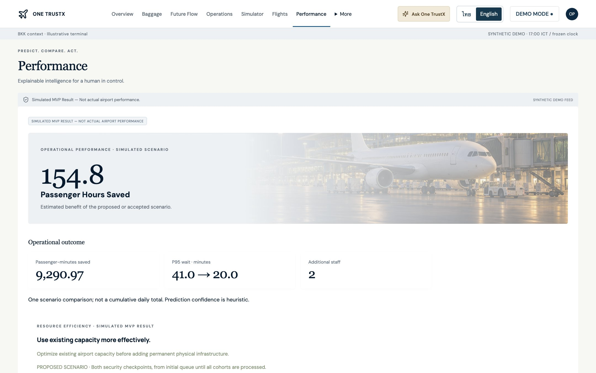

### 3.7 Passenger flow

**ใช้ทำอะไร:** ดูเส้นทางของผู้โดยสารทั้ง 580 คนผ่านอาคาร ตั้งแต่มาถึง check-in ฝากกระเป๋า จุดตรวจ ตรวจคนเข้าเมือง จนถึง gate

**บนจอมีอะไร:** แผนภาพการไหล ความหนาของเส้นแทนจำนวนคน ผู้โดยสารในประเทศ 290 คนข้ามขั้นตรวจคนเข้าเมือง

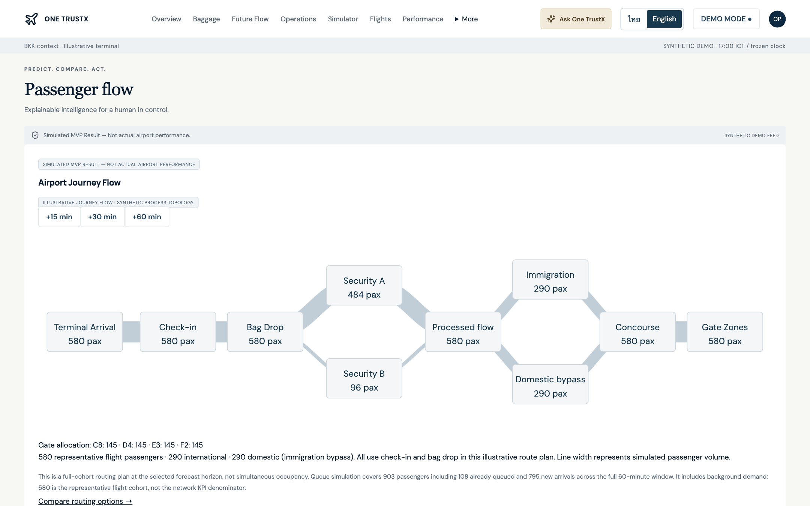

### 3.8 Passenger journey

**ใช้ทำอะไร:** มุมของผู้โดยสาร บอกว่าเหลือเวลาอย่างปลอดภัยกี่นาที และควรเดินเส้นทางใด

**คำนวณอย่างไร:** เวลาปลอดภัย = เวลาถึงปิดขึ้นเครื่อง − เวลาเดินและผ่านจุดตรวจที่เหลือ − เวลาสำรอง 10 นาที ตัวอย่างบนจอ: 64 − 20 − 10 = 34 นาที ถ้า gate เปลี่ยนจาก C8 เป็น E7 เส้นทางที่เข้าถึงได้ยาวขึ้น 23 นาที เหลือ 11 นาที และระบบวางเส้นทางใหม่ให้

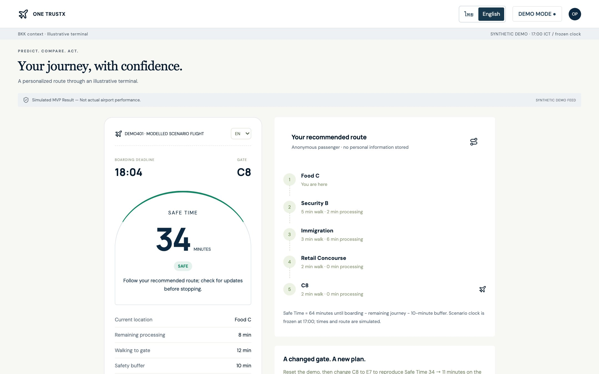

### 3.9 Decision log

**ใช้ทำอะไร:** ติดตามวงจรของการตัดสินใจหนึ่งครั้ง ตั้งแต่ระบบแนะนำ คนอนุมัติหรือปฏิเสธ จนถึงการวัดผลหลังดำเนินการ

**บนจอมีอะไร:** รายการการตัดสินใจในรอบนั้น และช่องบันทึกเวลารอที่สังเกตได้หลังทำ เพื่อเทียบกับที่พยากรณ์ไว้ ค่าที่กรอกในเดโมถูกติดป้ายว่าเป็นค่าจำลอง

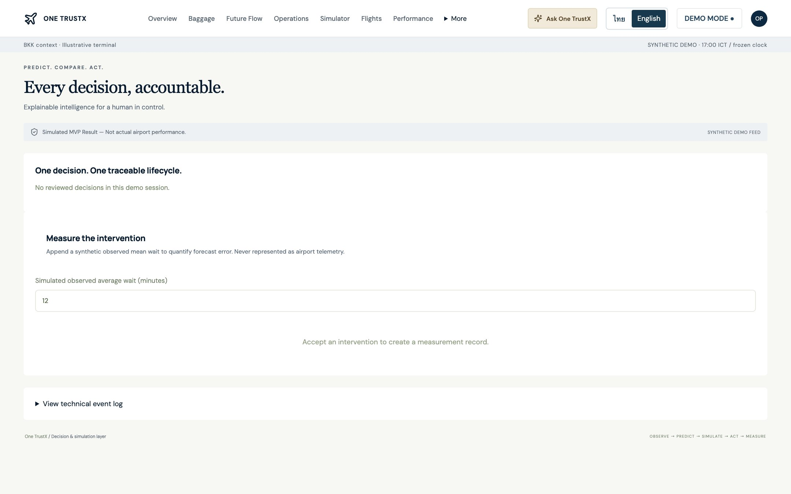

### 3.10 Data & sources

**ใช้ทำอะไร:** ให้ผู้ใช้และกรรมการตรวจได้ว่าตัวเลขแต่ละตัวมาจากข้อมูลประเภทใด

**บนจอมีอะไร:** คำอธิบายสี่ประเภทข้อมูล (จำลอง / ผลคำนวณ / สมมติฐาน / ข้อมูลจริงสาธารณะ) สถานะความสดของแต่ละแหล่ง และข้อมูลบริบทย้อนหลัง

**ข้อควรรู้:** หน้านี้เคยเปิดไม่ขึ้นบนเว็บจริง เพราะเซิร์ฟเวอร์ไม่มีไฟล์ผลเปรียบเทียบชุดหนึ่ง แก้แล้วในรอบนี้ ข้อมูลสาธารณะบางชุดจึงแสดงว่าไม่มีบนเว็บ

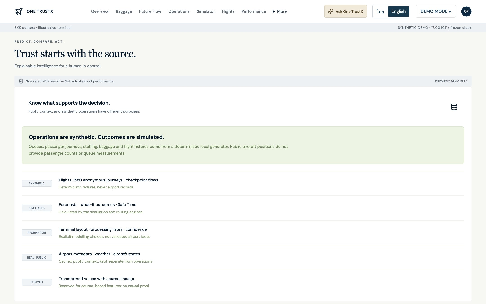

### 3.11 System Integration

**ใช้ทำอะไร:** อธิบายว่า One TrustX จะเชื่อมกับระบบจริงอย่างไร ระบุว่าตัวเชื่อมกับ AODB, Smart Flow, ระบบ gate, กระเป๋า และงานภาคพื้นเป็นแนวคิดสำหรับอนาคต ส่วนที่เชื่อมจริงในต้นแบบคือข้อมูลสาธารณะและตัวสร้างข้อมูลจำลอง

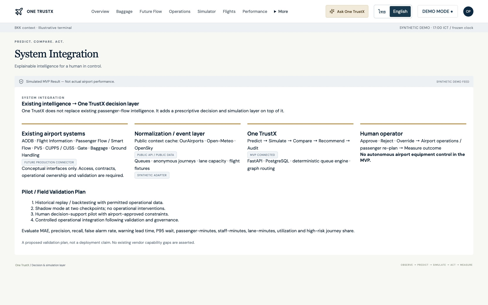

### 3.12 Guided demonstration และ Ask One TrustX

**Guided demonstration:** เดโม 9 ขั้นที่ผู้นำเสนอกดเดินเอง ตั้งแต่สถานะปกติ คลื่นผู้โดยสารเริ่ม ตรวจพบความแออัดล่วงหน้า เทียบมาตรการ คนอนุมัติ ผลต่อผู้โดยสาร เปลี่ยน gate จนถึงวัดผล ไม่มีการอนุมัติอัตโนมัติ

**Ask One TrustX:** ปุ่มถามคำถามเกี่ยวกับสถานการณ์ ตอบจากผลของแบบจำลองตามหัวข้อที่กำหนดไว้ และปฏิเสธหัวข้อนอกขอบเขต ไม่ได้ใช้ LLM

**DEMO MODE:** ปุ่มควบคุมเดโม เช่น เริ่มคลื่นผู้โดยสาร ปิดเลน เปลี่ยน gate และทดสอบข้อมูลไม่สด

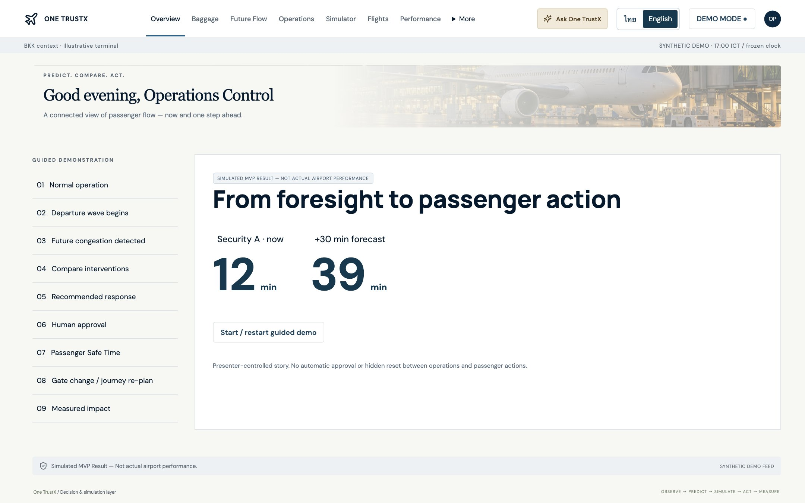

### 3.13 Baggage

โมดูลหลักของรอบนี้ อธิบายแยกทั้งภาค ข

---

## ส่วนที่ 4: ข้อมูล วิธีทำ และการวัดผลของโมดูลทั่วไป

ส่วนนี้ครอบคลุมโมดูลคิว การจำลองมาตรการ และมุมผู้โดยสาร ซึ่งมีมาตั้งแต่เวอร์ชันบน GitHub รอบนี้ไม่ได้แก้ตรรกะของโมดูลเหล่านี้ ตัวเลขมาจากไฟล์ผลประเมินใน repository ที่สร้างไว้เมื่อ 12–13 ก.ย. 2026 ไม่ได้รันใหม่ในรอบนี้ ข้อมูลของโมดูลกระเป๋าอยู่ในภาค ข

### 4.1 ข้อมูลจริงสาธารณะ และระดับความน่าเชื่อถือ

| แหล่ง | จำนวนและช่วงเวลา | ใช้ทำอะไร | ข้อจำกัด |
|---|---|---|---|
| CBP Airport Wait Times (สหรัฐฯ) | 12,186 รายการ รายชั่วโมงต่ออาคาร ที่ JFK, LAX, SFO ม.ค.–มี.ค. 2025 | ตัวเทียบภายนอกของเวลารอคิวตรวจคนเข้าเมือง | คนละประเทศและคนละกระบวนการ ใช้แทนข้อมูล BKK ไม่ได้ |
| BTS On-Time Performance (สหรัฐฯ) | 504,884 เที่ยวบิน ก.พ. 2025 | การกระจายของความล่าช้า | เที่ยวบินในประเทศสหรัฐฯ เท่านั้น ข้อมูลขาด 17.8% |
| CAAT สถิติรายวัน (ไทย) | 7 ไฟล์ ก.ย. 2023–เม.ย. 2025 ได้ยอดรวมประเทศ 188 วัน และยอด BKK รายวัน 3 วัน | ขนาดของปริมาณผู้โดยสารไทย | CAAT ระบุว่าเป็นข้อมูลเบื้องต้น และไม่ต่อเนื่องทุกวัน |
| Open-Meteo | 8,760 ชั่วโมง ปี 2025 ที่ BKK | บริบทสภาพอากาศ | เป็นผลจากแบบจำลองอากาศ ไม่ใช่เซนเซอร์ในสนามบิน |
| OurAirports | สนามบิน 145 แห่ง | พิกัดและข้อมูลอ้างอิงสนามบิน | ข้อมูลเปิดจากอาสาสมัคร ขาด 27.4% |
| UK CAA | 3 ตารางรายปี 2025 | ขนาดการปฏิบัติการของสนามบินเทียบเคียง | คนละประเทศ |
| OpenSky | ตำแหน่งอากาศยาน (ตัวเลือกเสริม) | บริบทการจราจรทางอากาศ | ไม่ใช่ตารางบิน ไม่มีข้อมูลผู้โดยสารหรือคิว |

ทุกไฟล์ที่ดึงมาเก็บ URL ต้นทาง เวลาที่ดึง ช่วงเวลาของข้อมูล เงื่อนไขการใช้ และ SHA-256 ไว้คู่กัน ถ้า checksum ไม่ตรง สคริปต์จะหยุดแทนการเขียนทับ รายละเอียดต่อไฟล์อยู่ใน `docs/data-quality-report.md` ข้อมูลของ AOT และ TSA ดึงไม่ได้ จึงไม่มีในระบบ และหน้า Data & sources แจ้งไว้

ข้อมูลจริงทั้งหมดไม่ถูกนำไปเปลี่ยนชื่อเป็นข้อมูลปฏิบัติการของ BKK และไม่ถูกใช้เพิ่มความมั่นใจของผลจำลอง

### 4.2 ข้อมูลที่สร้างขึ้น

| ชุดข้อมูล | จำนวน | สร้างอย่างไร |
|---|---|---|
| ประวัติคิวสำหรับฝึกและทดสอบ (`training.csv`) | 20,160 นาที (14 วัน) | คิวเริ่มต้น 40 คน ผู้โดยสารเข้าตามคลื่นไซน์บวกสัญญาณรบกวน เลขสุ่ม 42 จำนวนเลนสลับ 3 และ 4 |
| การเดินทางของผู้โดยสาร (`passenger_journey.csv`) | 580 แถว ไม่ระบุตัวตน | 4 เที่ยวบิน เที่ยวละ 145 คน |
| การไหลของผู้โดยสาร (`passenger_flow.csv`) | 72 แถว | โปรไฟล์ผู้โดยสารเข้าต่อช่วง 15 นาที |
| เที่ยวบิน gate งานภาคพื้น | 4, 4 และ 28 แถว | ชุดตัวอย่างคงที่สำหรับเล่าเรื่อง |
| สถานะเลนและจุดตรวจ | 21 และ 6 แถว | Security A มี 5 เลน เปิด 4 / Security B มี 3 เลน |
| แผนผังอาคาร (`airport_graph.csv`) | 16 เส้นเชื่อม | อาคารสมมติ ระยะเดินกำหนดเอง ไม่ใช่ผังสุวรรณภูมิ |

สถานการณ์ตั้งต้นที่เห็นบนหน้า Overview: เวลาหยุดนิ่งที่ 17:00 Security A มีคิวรอ 12 นาที ผู้โดยสารเข้า 11.2, 19.2, 9 และ 1.6 คนต่อนาทีในแต่ละช่วง 15 นาที แต่ละเลนให้บริการ 2 คนต่อนาที ค่าเหล่านี้เป็นสมมติฐานทั้งหมด และระบุไว้ใน `docs/assumptions.md`

### 4.3 วิธีทำของแต่ละโมดูล

- **พยากรณ์คิว:** คำนวณทีละนาทีจากสมดุลการไหล คือคิวใหม่เท่ากับคิวเดิมบวกผู้โดยสารเข้าลบกำลังให้บริการ ตัวอย่าง: (96 + 30 × (15.2 − 8)) ÷ 8 = 39 นาที เป็นแบบจำลองกำหนดแน่นอน ไม่ใช่ machine learning
- **ช่วงความไม่แน่นอน:** บวกลบ 15% ของค่าประมาณ บวก 2 นาที เป็นสมมติฐาน ค่า "ความมั่นใจ 80%" บนหน้าจอเป็นค่าที่ตั้งไว้ ไม่ได้ผ่านการสอบเทียบ
- **จำลองมาตรการ:** จำลองผู้โดยสารเป็นกลุ่มตามลำดับมาก่อนได้ก่อน รันสถานการณ์เดียวกัน 4 แบบ (ไม่ทำอะไร / เปิดเลน A5 / เบี่ยง 20% ไป Security B / เปิด A5 และเบี่ยง 12%) การเปิดเลนใช้พนักงาน 2 คน ผู้โดยสารที่ถูกเบี่ยงเดินเพิ่ม 4 นาที
- **การให้คะแนนมาตรการ:** คะแนนรวมถ่วงน้ำหนักจากเวลารอที่ลดลง นาทีที่ประหยัด สัดส่วนผู้โดยสารเสี่ยงตกเครื่อง หักด้วยพนักงานที่เพิ่ม ระยะเดินที่เพิ่ม และต้นทุน น้ำหนักแสดงบนหน้าจอและปรับได้
- **สาเหตุของคิว:** แบ่งผลระหว่างสองปัจจัย (ปริมาณผู้โดยสาร และจำนวนเลน) ด้วยวิธี Shapley ภายในแบบจำลอง หน้าจอระบุว่าไม่ใช่การพิสูจน์สาเหตุในโลกจริง
- **เวลาปลอดภัยของผู้โดยสาร:** เวลาถึงปิดขึ้นเครื่อง ลบเวลาเดินและเวลาผ่านจุดตรวจที่เหลือ ลบเวลาสำรอง 10 นาที ตัวอย่าง: 64 − 20 − 10 = 34 นาที เมื่อเปลี่ยน gate จาก C8 เป็น E7 เส้นทางที่เข้าถึงได้ยาวขึ้น 23 นาที เหลือ 11 นาที
- **เมื่อข้อมูลไม่สด:** ระบบหยุดแสดงคำแนะนำและแจ้งว่าการพยากรณ์ถูกพักไว้

### 4.4 การวัดผลของแบบจำลองคิว

ชุดที่ 1 ข้อมูลจำลอง 14 วัน แบ่งตามเวลา 70% แรกใช้ฝึก 30% หลังใช้ทดสอบ เว้นช่วง 60 นาทีระหว่างกัน ไม่สุ่มสลับ ตารางแสดงความคลาดเคลื่อนเฉลี่ย (นาที)

| วิธี | ล่วงหน้า 15 นาที | ล่วงหน้า 30 นาที | ล่วงหน้า 60 นาที |
|---|---|---|---|
| ใช้ค่าปัจจุบันต่อไป (persistence) | 5.97 | 11.70 | 22.56 |
| ค่าเฉลี่ยเคลื่อนที่ | 8.81 | 14.41 | 25.17 |
| สมดุลการไหล (ที่ระบบใช้) | 2.20 | 4.57 | 10.34 |
| Linear regression | 4.27 | 5.91 | 9.34 |
| Random forest | 1.75 | 3.21 | 6.13 |

เทียบกับเป้าที่ทีมตั้งไว้ (ไม่ใช่มาตรฐานอุตสาหกรรม):

| เป้า | 15 นาที | 30 นาที | 60 นาที |
|---|---|---|---|
| คลาดเคลื่อนเฉลี่ยไม่เกิน 5 นาที | ผ่าน (2.20) | ผ่าน (4.57) | ไม่ผ่าน (10.34) |
| จับภาวะแออัดได้อย่างน้อย 80% | ผ่าน (99%) | ผ่าน (98%) | ผ่าน (95%) |
| เตือนล่วงหน้าอย่างน้อย 15 นาที | ไม่ผ่าน (14) | ผ่าน (29) | ผ่าน (58) |

Random forest แม่นกว่าบนข้อมูลจำลอง แต่ทีมไม่ได้นำมาใช้ เพราะข้อมูลทดสอบสร้างจากกลไกเดียวกับแบบจำลอง ผลจึงยังไม่ใช่หลักฐานอิสระ

ชุดที่ 2 ข้อมูลจริงจาก CBP 12,178 รายการ ฝึกด้วย ม.ค. ตรวจด้วย ก.พ. ทดสอบด้วย มี.ค. 2025 เป็นการประมาณเวลารอในชั่วโมงเดียวกัน ไม่ใช่การพยากรณ์ล่วงหน้า เวลารอจริงมีค่ากลาง 17 นาที และ 10% ของชั่วโมงรอเกิน 37 นาที

| วิธี | คลาดเคลื่อนเฉลี่ย (นาที) | F1 ของการจับภาวะแออัด | อัตราเตือนผิด |
|---|---|---|---|
| ใช้ค่าปัจจุบันต่อไป | 8.40 | 0.52 | 10.6% |
| ค่าเฉลี่ยเคลื่อนที่ | 8.53 | 0.43 | 9.6% |
| ตัวแทนภาระต่อช่องตรวจ | 19.36 | 0.29 | 19.3% |
| Linear regression | 8.44 | 0.12 | 4.6% |
| Random forest | 7.96 | 0.26 | 5.8% |

บนข้อมูลจริง ไม่มีวิธีใดดีกว่าวิธีพื้นฐานอย่างชัดเจน จึงไม่มีแบบจำลองใดถูกยกขึ้นใช้งาน ผลนี้ใช้ยืนยันเพียงว่าช่วงเวลารอในระบบจำลอง (12–39 นาที) อยู่ในช่วงที่พบได้จริง

### 4.5 การทดสอบซอฟต์แวร์ของโมดูลเหล่านี้

| ชุดทดสอบ | จำนวน | ตรวจอะไร |
|---|---|---|
| `test_engine.py` | 10 ข้อ | สมดุลของคิว ผลของแต่ละมาตรการ การทำซ้ำได้ |
| `test_api.py` | 8 ข้อ | endpoint การตรวจสิทธิ์ ข้อมูลไม่สด การบันทึกการตัดสินใจ |
| `test_pilot.py` | 5 ข้อ | ขั้นตอนการทดลองใช้งาน |

ทั้งหมดผ่านในการรันล่าสุดเมื่อ 8 ต.ค. 2026 (รวมอยู่ใน 45 ข้อของส่วนที่ 6)

### 4.6 ข้อจำกัดเฉพาะของโมดูลเหล่านี้

- ไม่มีข้อมูลคิวหรือจุดตรวจจริงของ BKK อัตราให้บริการ 2 คนต่อนาทีต่อเลนเป็นสมมติฐาน
- มีคิวที่เปลี่ยนตามเวลาเพียงสองจุดตรวจ ขั้นอื่นใช้เวลาคงที่
- ผังอาคารเป็นภาพประกอบ ไม่ใช่ผังสุวรรณภูมิ
- ชุด validation เดิม 3,200 episodes ที่ให้ผล 61% / 78% / 74% / 50% ใช้อัตราส่วนที่กำหนดไว้ล่วงหน้า (ดูส่วนที่ 17) ไม่ควรนำไปอ้าง
- ผู้ช่วยตอบคำถามในระบบ (Ask One TrustX) ตอบจากผลของแบบจำลองตามหัวข้อที่กำหนด ไม่ได้ใช้ LLM

---

## ส่วนที่ 5: สถาปัตยกรรมและโครงสร้างโปรเจกต์

[[diagram:architecture]]

| Endpoint | หน้าที่ |
|---|---|
| `GET /api/trustx/baggage/scenarios` | รายการสถานการณ์และเวลาที่เลือกดูได้ |
| `GET /api/trustx/baggage/control` | ผลประเมิน รับ `scenario`, `at`, `seed`, `resource_feed` |
| `GET /api/trustx/baggage/calibration` | ค่าทุกตัวพร้อมประเภทและแหล่งที่มา |
| `GET /api/trustx/baggage/evaluation` | ผลจำลอง 30 รอบ |
| `GET /api/trustx/flights/{id}/shared-state` | สถานะร่วมเดิม ช่อง `baggage_control` คืนผลประเมินสถานการณ์น้ำท่วม |

เทคโนโลยี: React + TypeScript + Vite / FastAPI + Python / PostgreSQL หรือ SQLite สำหรับส่วนเดิม ส่วนกระเป๋าไม่เขียนฐานข้อมูล คำนวณจากเลขสุ่มและไฟล์ค่าตั้งต้น จึงทำซ้ำได้ทุกครั้ง ระบบไม่ใช้ LLM ในการตัดสินใจ

### 5.1 โครงสร้างโปรเจกต์

```text
onetrustx/
├── README.md
├── run-local.sh                      เปิดระบบบนเครื่องโดยไม่ใช้ Docker
├── infra/docker-compose.yml          PostgreSQL + API + frontend
├── backend/
│   ├── app/
│   │   ├── baggage_flow.py           แบบจำลอง ตัวประเมิน และการให้คะแนน (ใหม่)
│   │   ├── baggage_calibration.json  ค่าตั้งต้นพร้อมแหล่งที่มา (ใหม่)
│   │   ├── baggage_metrics.py        ตารางคะแนนและการใส่ข้อมูลผิดเพื่อทดสอบ (ใหม่)
│   │   ├── baggage_evaluation.json   ผลจำลอง 30 รอบ (ใหม่)
│   │   ├── trust_api.py              REST API ของ One TrustX
│   │   ├── trust_service.py          ชุดเหตุการณ์ TT401 และสถานะร่วม
│   │   ├── trust_models.py           ตารางฐานข้อมูลส่วน One TrustX
│   │   ├── main.py, engine.py        โมดูลคิวผู้โดยสารเดิม
│   │   └── public_*.py               ข้อมูลบริบทสาธารณะ
│   └── tests/
│       ├── test_baggage_flow.py      15 ข้อ (ใหม่)
│       ├── test_baggage_metrics.py   4 ข้อ (ใหม่)
│       └── test_trustx.py, test_api.py, test_engine.py, test_pilot.py
├── frontend/src/
│   ├── App.tsx                       โครงระบบและแถบนำทาง (เพิ่มเมนู Baggage)
│   ├── components/BaggageControl.tsx หน้ากระเป๋า (ใหม่)
│   ├── executive.css                 สไตล์ของระบบ รวมส่วนหน้ากระเป๋า
│   └── locales/th.json               คำแปลภาษาไทย
├── data/
│   ├── external/                     ไฟล์ต้นฉบับจากแหล่งสาธารณะ พร้อม checksum
│   ├── normalized/                   ข้อมูลสาธารณะที่จัดรูปแล้ว
│   ├── synthetic/baggage_flow/       รายการสแกนและตารางบินจำลอง (ใหม่)
│   └── scenarios/scenario_library.json
├── scripts/
│   ├── experiments/run_baggage_evaluation.py   ส่งออกข้อมูลและให้คะแนน (ใหม่)
│   ├── data/fetch_weather_incident.py          ดึงฝนช่วงเหตุการณ์ (ใหม่)
│   └── render_data_pdf.py                      สร้าง PDF ภาษาไทย
└── docs/
    ├── onetrustx-system-report-th.md/pdf       เอกสารนี้
    ├── preliminary-pitch-th.md                 โครง pitch 7 นาที
    ├── data-provenance-th.md                   คู่มือโครงการฉบับก่อน
    └── decisions/                              บันทึกเหตุผลการตัดสินใจ
```

---

## ส่วนที่ 6: การตรวจสอบ

| รายการ | ผล | วันที่ |
|---|---|---|
| Backend tests (`pytest`) | ผ่าน 45 ข้อ | 8 ต.ค. 2026 |
| Lint (`ruff check app`) | ผ่าน | 8 ต.ค. 2026 |
| Frontend type-check (`tsc --noEmit`) | ผ่าน | 8 ต.ค. 2026 |
| Frontend tests (`vitest`) | ผ่าน 2 ข้อ | 8 ต.ค. 2026 |
| Production build (`npm run build`) | ผ่าน | 8 ต.ค. 2026 |
| เปิดหน้า `/baggage` ในเบราว์เซอร์ ครบ 5 สถานการณ์ ทั้งภาษาอังกฤษและไทย | แสดงผลถูกต้อง ไม่มี error ใน console หน้าเดิมทุกหน้ายังเปิดได้ | 8 ต.ค. 2026 |

สิ่งที่เทสต์ตรวจโดยเฉพาะ:

- สถานการณ์ปกติขึ้น NORMAL ทุกจุดตรวจ
- สถานการณ์น้ำท่วมชี้ที่ Loading ก่อนกระเป๋าใบแรกตกเที่ยวบิน 30 นาที
- ปิด feed กำลังคนแล้วสาเหตุเป็น UNKNOWN แต่ยังชี้ตำแหน่งได้
- ข้อมูล loading ขาดแล้วระบบขอให้ตรวจสอบและซ่อนตัวเลข
- ตัวประเมินไม่ใช้สแกนที่ยังมาไม่ถึง
- จำนวนกระเป๋าที่โหลดบวกที่ตกเที่ยวบิน เท่ากับจำนวนที่คาดไว้ทุกเที่ยวบิน
- ค่าทุกตัวมีประเภทและแหล่งที่มา ค่าที่ไม่ใช่สมมติฐานต้องมีลิงก์

ตรวจบนเว็บจริงหลัง deploy: เปิดครบ 14 หน้ารวม Baggage ไม่มี error ใน console

ยังไม่ได้ตรวจ: Docker stack และ Playwright e2e ข้อความที่มาจาก backend (เช่น คำแนะนำและหลักฐาน) ยังแสดงเป็นภาษาอังกฤษในโหมดไทย และแถบเมนูบนจอมือถือล้นขอบ 81 พิกเซลทุกหน้า ซึ่งเป็นอยู่ก่อนแล้ว


### 6.1 การเผยแพร่ขึ้นเว็บจริง

เว็บ onetrustx.vercel.app ประกอบด้วยสองโปรเจกต์บน Vercel และ deploy ด้วยคำสั่งจากเครื่องพัฒนา ไม่ได้ผูกกับ GitHub

| ส่วน | โปรเจกต์บน Vercel | ที่อยู่ |
|---|---|---|
| หน้าเว็บ | `airport-timetwin-frontend` | onetrustx.vercel.app |
| API | `backend` | backend-mauve-six-34.vercel.app (หน้าเว็บเรียกผ่าน `/api`) |

ขั้นตอนที่ใช้เมื่อ 8 ต.ค. 2026:

1. ในโฟลเดอร์ `backend` รัน `vercel --prod` แล้วตรวจว่า `/api/trustx/baggage/scenarios` ตอบ 200
2. ในโฟลเดอร์ `frontend` รัน `vercel --prod`
3. โดเมน onetrustx.vercel.app ถูกผูกแบบกำหนดเอง จึงไม่ย้ายตาม deploy ใหม่ ต้องรัน `vercel alias set <ชื่อ deployment ใหม่> onetrustx.vercel.app`
4. เปิดเว็บจริงตรวจทุกหน้า

เวอร์ชันที่โดเมนชี้อยู่คือ `airport-timetwin-frontend-9drl3b0in` ถ้าต้องย้อนกลับไปเวอร์ชันก่อนมีหน้า Baggage ให้ชี้โดเมนไปที่ `airport-timetwin-frontend-72mipagqy`

ข้อควรระวัง: โค้ดที่อยู่บนเว็บตอนนี้ยังไม่ได้ commit และ push ขึ้น GitHub จึงมีอยู่เฉพาะในเครื่องพัฒนาและบน Vercel ชื่อโปรเจกต์บน Vercel และชื่อฐานข้อมูล Postgres ยังใช้ชื่อเดิม (timetwin) เพราะการเปลี่ยนจะกระทบข้อมูลและการผูกโดเมน

---

[[part:ภาค ข · ลงลึกเรื่องกระเป๋า ตามโครงเดิมของโครงการ|Pain Point → Solution → Impact โครงเดิมจากรอบแรก ลงลึกจนคำนวณได้จริงในเรื่องกระเป๋า]]

## ส่วนที่ 7: โครงเดิมของโครงการ และสิ่งที่ลงลึกในรอบนี้

โครงของโครงการยังเป็นโครงเดิมจากรอบแรก (สไลด์ 3 หน้า: Pain Point, Solution, Impact) รอบนี้ไม่ได้เปลี่ยนโครง แต่เลือกเรื่องกระเป๋าเป็นกรณีที่ลงลึกจนคำนวณได้จริง ตามคำแนะนำของ mentor ให้เลือกปัญหาเดียว

### 7.1 โครงเดิมสามส่วน และสิ่งที่ลงลึกในรอบนี้

| โครงเดิม (สไลด์รอบแรก) | ข้อความเดิม | ลงลึกเรื่องกระเป๋าอย่างไร | อยู่ในส่วนที่ |
|---|---|---|---|
| Pain Point | หลายองค์กร หลายระบบ ข้อมูลไม่ได้อยู่บนมาตรฐานเดียวกัน การตัดสินใจจึงช้า | กระเป๋าค้างสะสมเมื่อเกิดเหตุผิดปกติ ข้อมูลสแกน ตารางบิน และกำลังคนอยู่คนละฝ่าย | 8–9 |
| Solution | Data Integration Layer → Trusted Shared Event Ledger → Common Operation State → AI Decision Intelligence | สี่ชั้นเดิม ใช้กับข้อมูลกระเป๋าจริง ๆ ทีละชั้น | 10–13 |
| Impact | Trust · Intelligence · Operation และคุณค่าต่อแต่ละฝ่าย | ตัวชี้วัดสามเสาเดิม วัดจากแบบจำลองกระเป๋า | 14–16 |

### 7.2 ผู้มีส่วนเกี่ยวข้องเดิม 7 กลุ่ม ในกรณีกระเป๋า

สไลด์รอบแรกระบุผู้มีส่วนเกี่ยวข้อง 7 กลุ่ม ในกรณีกระเป๋าแต่ละกลุ่มมีบทบาทดังนี้

| กลุ่ม | ข้อมูลที่ให้ | ได้อะไรกลับ | สถานะในต้นแบบ |
|---|---|---|---|
| Baggage Operator (BRS/BHS) | จำนวนสแกนรายขั้น รายเที่ยวบิน | เห็นว่าขั้นใดเป็นคอขวด | ใช้แล้ว (ข้อมูลจำลอง) |
| Airport (AODB) | เวลาออก เวลาจอด gate | เที่ยวบินใดเสี่ยงจากกระเป๋า | ใช้แล้ว (ข้อมูลจำลอง) |
| Airline | จำนวนกระเป๋าที่คาดไว้ และเที่ยวบินต่อ | กระเป๋าต่อเครื่องชุดใดเสี่ยง ควรรอหรือส่งตาม | ใช้แล้ว (ข้อมูลจำลอง) |
| Ground Handler | กำลังคน รถขนกระเป๋า | ลำดับเที่ยวบินที่ควรทำก่อน | ใช้แล้วเป็นส่วนเสริม |
| Cargo Operator | ยังไม่ใช้ | ยังไม่มี | ขั้นขยายถัดไป |
| Security / Immigration | ยังไม่ใช้กับกระเป๋า | ยังไม่มี | มีในโมดูลคิวผู้โดยสาร |
| ATC / Other (สภาพอากาศ) | ฝนรายชั่วโมง | บริบทของเหตุ | ใช้เป็นบริบท ยังไม่ใช้เตือน |

### 7.3 จุดที่ระบบจริงยังไม่ตรงกับสไลด์รอบแรก

- **Blockchain's Ledger:** สไลด์เขียนว่าใช้ blockchain ระบบจริงเก็บเหตุการณ์เป็นบันทึกที่มี checksum ที่มา และลำดับ ไม่ได้ใช้ blockchain ต้องเลือกว่าจะปรับคำบนสไลด์ หรือจะพัฒนาส่วนนี้
- **โลโก้ ChatGPT ในกล่อง AI:** ระบบจริงคำนวณด้วยกฎที่ตรวจย้อนได้ ไม่ได้ใช้ LLM
- **ตัวเลข Impact เดิม** (86%, 100%, 61%, 78%, 50%, 117.39 พันล้านบาท) ไม่มีที่มาหรือเป็นค่าที่กำหนดไว้ ถูกแทนด้วยผลจากแบบจำลองกระเป๋าในส่วนที่ 14
- **"$60.3B / Year"** บนสไลด์ Pain Point ผิดสิบเท่า ค่าที่ถูกจาก SITA คือประมาณ 6.3 พันล้านดอลลาร์

ข้อเสนอสำหรับสองข้อแรก: แก้คำบนสไลด์ให้ตรงกับระบบ คือใช้คำว่า "บันทึกเหตุการณ์ร่วมที่ตรวจย้อนได้" แทน blockchain และ "กฎการตัดสินใจที่ตรวจย้อนได้" แทนโลโก้ ChatGPT เพราะทำได้ทันทีและตอบคำถามกรรมการได้ตรง ถ้าทีมต้องการคง blockchain หรือ LLM ไว้ ต้องพัฒนาส่วนนั้นจริงก่อนนำเสนอ

สิ่งที่ยังขาดเมื่อเทียบกับโครงเดิม และควรทำในรอบ prototype:

- นำการตรวจข้อมูลขัดแย้งระหว่างฝ่าย (แกนของชั้น Ledger) มาใช้กับข้อมูลกระเป๋า เช่น ground handler แจ้งว่าโหลดครบ แต่จำนวนสแกนยังไม่ครบ
- วัดเสา Operation ด้วยการทดลองกับผู้ใช้จริง: เวลาตั้งแต่เกิดเหตุจนมีผู้รับผิดชอบ
- ส่งการแจ้งเตือนไปยังแต่ละฝ่าย (Coordinate) ซึ่งตอนนี้ระบบระบุผู้รับผิดชอบแต่ยังไม่ส่งออก

---

## ส่วนที่ 8: Pain Point · ปัญหาและบริบทธุรกิจ

### 8.1 ขนาดของปัญหาในอุตสาหกรรม

SITA Baggage IT Insights 2026 รายงานข้อมูลปี 2025 ว่า:

- กระเป๋าที่จัดการผิดพลาด (mishandled) ทั่วโลกประมาณ 24 ล้านใบ ลดลงจากปีก่อน
- อัตรา 4.9 ใบต่อผู้โดยสาร 1,000 คน
- ต้นทุนของอุตสาหกรรมประมาณ 6.3 พันล้านดอลลาร์ต่อปี เฉลี่ย 260 ดอลลาร์ต่อใบ
- 39% ของกรณีเกิดในขั้นตอนต่อเครื่อง (transfer)

คำว่า mishandled หมายถึงล่าช้า เสียหาย หรือส่งผิดปลายทาง ไม่ได้แปลว่าหายถาวร ตัวเลข 33.4 ล้านใบที่ SKY อ้างในวัน Kick-off เป็นข้อมูลปี 2024

### 8.2 เหตุการณ์จริงที่ยืนยันปัญหา

ปลายเดือนกันยายน 2026 ที่ท่าอากาศยานสุวรรณภูมิ:

| วันที่ | สิ่งที่เกิดขึ้น | แหล่ง |
|---|---|---|
| 25 ก.ย. | ฝนที่จุดใกล้สนามบิน 116.1 มม. ในวันเดียว | Open-Meteo (ข้อมูลจริง) |
| 26 ก.ย. | CAAT ออกประกาศ 30/2569 ว่าฝนและน้ำท่วมขังกระทบการเดินทางเข้าออกสนามบิน | CAAT |
| 26–27 ก.ย. | พนักงานภาคพื้นของการบินไทยเดินทางมาทำงานไม่ได้ รถขนกระเป๋าบางส่วนเสีย เที่ยวบินขาออกล่าช้า ผู้โดยสารขาเข้ารอกระเป๋านาน | The Nation |
| 28 ก.ย. | กองทัพส่งกำลังพล 131 นายมาช่วย | The Nation |
| 29 ก.ย. | CEO การบินไทยระบุว่ามีกระเป๋าค้างประมาณ 5,000 ใบ | The Nation |
| 30 ก.ย. | สะสมกว่า 10,000 ใบช่วง 26–29 ก.ย. คืนแล้วประมาณ 1,800 ใบ เหลือประมาณ 8,000 ใบ งดรับ cargo 30 ก.ย.–6 ต.ค. และลดเที่ยวบิน | The Star / Bernama |
| 3–4 ต.ค. | เหลือ 1,092 ใบ | The Nation |

[[diagram:cause-chain]]

เหตุการณ์นี้ใช้เป็นหลักฐานว่าลำดับเหตุ "ฝน → คนมาไม่ได้ → กำลังการจัดการลด → กระเป๋าค้าง → เที่ยวบินได้รับผล" เกิดขึ้นจริง ไม่ใช่ข้อมูลนำเข้าของระบบ และไม่ใช่ผลงานของ One TrustX

### 8.3 ช่องว่างที่ระบบเข้าไปช่วย

ในเหตุการณ์จริง ทุกฝ่ายรู้ว่าคนไม่พอ สิ่งที่ยากคือการตัดสินใจภายใต้กำลังที่ลดลง: เที่ยวบินไหนต้องช่วยก่อน กระเป๋าต่อเครื่องชุดไหนเสี่ยงที่สุด และเมื่อใดที่การเร่งงานไม่พอแล้วต้องลดภาระ เช่น ชะลอเที่ยวบินหรือส่งกระเป๋าตามไปเที่ยวถัดไป ข้อมูลที่ใช้ตอบคำถามเหล่านี้อยู่คนละระบบ (การสแกนกระเป๋า ตารางบิน กำลังคน) One TrustX นำมารวมเป็นภาพเดียวและจัดลำดับให้

[[diagram:positioning]]

ระบบไม่ได้สร้างพนักงานเพิ่ม และเอกสารนี้ไม่อ้างว่าเหตุการณ์จริงจะจบเร็วขึ้นถ้ามีระบบนี้

### 8.4 ผู้ใช้

| บทบาท | ใช้ระบบทำอะไร |
|---|---|
| Baggage / Ground Operations Controller (ผู้ใช้หลัก) | ดูว่าติดที่ขั้นไหน จัดลำดับเที่ยวบิน อนุมัติคำแนะนำ |
| Airline Operations Control | ตัดสินใจรอหรือไม่รอกระเป๋า และการส่งกระเป๋าตามไป |
| Airport Operations | เห็นภาพรวมข้ามฝ่าย |
| ผู้โดยสาร | ได้ประโยชน์ทางอ้อม ไม่ได้ใช้ระบบ |

---

## ส่วนที่ 9: Pain Point · ระบบช่วยได้จริงหรือไม่ เมื่อพนักงานมาไม่ได้

คำถามที่ต้องตอบตรง ๆ: เหตุการณ์ ก.ย. 2026 เกิดจากพนักงานเดินทางมาไม่ได้ ซึ่งซอฟต์แวร์แก้ไม่ได้ แล้ว One TrustX ช่วยอะไร

### 9.1 สิ่งที่ระบบแก้ไม่ได้

- ระบบไม่ทำให้พนักงานมาถึงสนามบิน และไม่เพิ่มกำลังการขนถ่าย
- ถ้ากำลังที่เหลือน้อยกว่าปริมาณงานมาก จะมีกระเป๋าตกค้างไม่ว่าจัดลำดับดีเพียงใด ในแบบจำลองน้ำท่วม แม้จัดลำดับตามคำแนะนำ ก็ยังมีกระเป๋าตกเที่ยวบิน 142.5 ใบ (ค่ากลาง)
- เอกสารนี้ไม่อ้างว่าเหตุการณ์จริงจะจบเร็วขึ้นถ้ามีระบบนี้ เพราะไม่มีข้อมูลการปฏิบัติงานจริงมาพิสูจน์

### 9.2 สิ่งที่ระบบช่วยได้ เมื่อกำลังคนลดลงแล้ว

เมื่อคนเหลือครึ่งเดียว คำถามเปลี่ยนจาก "ทำอย่างไรให้ทัน" เป็น "ใช้กำลังที่เหลือกับอะไรก่อน" ระบบช่วยสามเรื่อง:

| เรื่อง | ถ้าไม่มีภาพรวม | สิ่งที่ระบบให้ |
|---|---|---|
| จัดลำดับ | แต่ละทีมทำเที่ยวบินของตัวเอง กำลังถูกใช้กับเที่ยวบินที่ยังมีเวลา ขณะที่เที่ยวบินที่ใกล้ปิดขาดคน | ลำดับเที่ยวบินตามเวลาปิดห้องเก็บสัมภาระ และจำนวนกระเป๋าต่อเครื่องที่เสี่ยง |
| รู้เร็วว่าเร่งไม่ทัน | รู้เมื่อกระเป๋าตกเที่ยวบินไปแล้ว | เตือนเมื่อกระเป๋าที่รอโตเร็วกว่าอัตราที่เคลียร์ได้ พร้อมข้อความว่าการจัดลำดับอย่างเดียวไม่พอ ให้พิจารณาลดภาระ |
| ภาพเดียวกันทุกฝ่าย | สายการบิน ground handler และสนามบินถือตัวเลขคนละชุด | จำนวนกระเป๋ารอรายขั้นและรายเที่ยวบินชุดเดียว ใช้ตัดสินใจร่วมและแจ้งผู้โดยสาร |

เรื่องที่สองเชื่อมกับเหตุการณ์จริงโดยตรง: มาตรการลดภาระ (งดรับ cargo และลดเที่ยวบิน) ถูกรายงานเมื่อ 30 ก.ย. ซึ่งเป็นวันที่ห้าของเหตุการณ์ หลังกระเป๋าสะสมเกิน 10,000 ใบ ระบบที่แสดงทุก 5 นาทีว่ากระเป๋ารอเพิ่มขึ้นเร็วกว่าที่เคลียร์ได้ จะให้ข้อมูลสำหรับตัดสินใจเรื่องนี้ตั้งแต่ชั่วโมงแรก ๆ ส่วนจะตัดสินใจเร็วขึ้นจริงหรือไม่ ขึ้นกับผู้มีอำนาจ ไม่ใช่ระบบ

### 9.3 ตัวเลขจากแบบจำลอง

ในสถานการณ์น้ำท่วมจำลอง 30 รอบ (กำลังคนเหลือ 55%):

- แบ่งกำลังเท่ากันทุกเที่ยวบิน: กระเป๋าตกเที่ยวบิน 297.5 ใบ ในจำนวนนี้เป็นกระเป๋าต่อเครื่อง 61.5 ใบ
- จัดลำดับตามคำแนะนำ: 142.5 ใบ กระเป๋าต่อเครื่อง 15.5 ใบ
- ระบบเตือนก่อนกระเป๋าใบแรกตกเที่ยวบิน 55 นาที (ต่ำสุด 25 สูงสุด 125)

ตัวเลขนี้ขึ้นกับสมมติฐานว่าวิธีเดิมคือการแบ่งกำลังเท่ากัน ถ้า ground handler จริงจัดลำดับได้ดีอยู่แล้ว ประโยชน์จะน้อยกว่านี้ นี่คือข้อที่ต้องถามผู้เชี่ยวชาญก่อนรอบ prototype

### 9.4 สิ่งที่ยังไม่ได้ทำ แต่ตรงกับต้นเหตุมากกว่า

ต้นเหตุคือคนมาไม่ถึง ฝนตก 116 มม. ในวันที่ 25 ก.ย. หนึ่งวันก่อนเหตุการณ์เริ่ม ระบบปัจจุบันมีข้อมูลฝนนี้เป็นบริบทเท่านั้น ยังไม่ได้ใช้เตือนล่วงหน้า ขั้นถัดไปที่ควรทำคือเตือนความเสี่ยงด้านกำลังคนจากพยากรณ์ฝนและน้ำท่วมถนน เพื่อให้ผู้จัดการกะเตรียมการได้ก่อน เช่น ให้พนักงานพักใกล้สนามบินหรือจัดรถรับส่ง ส่วนนี้ยังเป็นแผน ไม่มีในระบบ

### 9.5 คำตอบสั้นสำหรับกรรมการ

> ระบบไม่ได้แก้ปัญหาคนมาไม่ได้ แต่ช่วยให้ใช้คนที่เหลือกับเที่ยวบินและกระเป๋าที่สำคัญที่สุดก่อน และบอกให้รู้ตั้งแต่ต้นว่าเมื่อใดการเร่งงานไม่พอและต้องลดภาระ ผลที่มีตอนนี้มาจากแบบจำลอง ยังต้องพิสูจน์กับข้อมูลจริง

---

## ส่วนที่ 10: Solution · สี่ชั้นเดิมของ One TrustX กับข้อมูลกระเป๋า

Solution ของ One TrustX ยังเป็นสี่ชั้นเดิม ส่วนนี้แสดงว่าแต่ละชั้นทำอะไรกับข้อมูลกระเป๋า รายละเอียดของแต่ละชั้นอยู่ในส่วนที่ 11–13

[[diagram:original-frame]]

| ชั้นเดิม | ทำอะไรกับกระเป๋า | ทำแล้วแค่ไหน |
|---|---|---|
| 1. Data Integration Layer | รับจำนวนสแกนรายขั้น ตารางบิน จำนวนกระเป๋าที่คาดไว้ และข้อมูลกำลังคน แปลงเป็นรูปแบบเดียว: ขั้น เที่ยวบิน ประเภทกระเป๋า จำนวน เวลาเกิดเหตุ เวลาที่ได้รับ | ทำแล้วกับข้อมูลจำลอง ตัวเชื่อมกับระบบจริงยังเป็นแผน |
| 2. Trusted Shared Event Ledger | ทุกรายการมีป้ายที่มาและเวลาที่ได้รับ ตรวจว่าข้อมูลสดหรือไม่ ถ้าขั้นใดไม่มีสแกนใหม่ขณะมีกระเป๋ารอ จะไม่นำไปตัดสิน | ทำแล้วเรื่องที่มาและความสด การตรวจข้อมูลขัดแย้งระหว่างฝ่ายมีใน backend ของชุดเที่ยวบินเดียว ยังไม่ได้ใช้กับกระเป๋า ไม่ใช้ blockchain |
| 3. Common Operation State | สถานะเดียวที่ทุกฝ่ายเห็นตรงกัน: 6 ขั้นของกระเป๋า จำนวนที่รอ เวลารอ และสถานะรวม | ทำแล้ว คือหน้า Baggage |
| 4. AI Decision Intelligence | Detect หาคอขวด / Predict เที่ยวบินและกระเป๋าที่จะไม่ทัน / Recommend ลำดับที่ควรทำก่อน / Coordinate ระบุผู้รับผิดชอบและเส้นตาย | ทำแล้วด้วยกฎที่ตรวจย้อนได้ ยังไม่มีการส่งแจ้งเตือนไปยังแต่ละฝ่าย |

### 10.1 Detect · Predict · Recommend · Coordinate ในกรณีกระเป๋า

| ขั้นเดิม | คำถาม | วิธีทำ | ตัวอย่างจากสถานการณ์น้ำท่วม 08:30 |
|---|---|---|---|
| Detect | ติดที่ไหน | เวลารอของกระเป๋าใบแรกสุดในแต่ละขั้น เทียบเกณฑ์ | Loading รอ 35 นาที เกินเกณฑ์ 30 |
| Predict | จะกระทบอะไร | กระเป๋าที่เหลือเทียบกับอัตราโหลดจริง เรียงตามเวลาปิด | 3 เที่ยวบิน 60 ใบ ต่อเครื่อง 44 ใบ |
| Recommend | ทำอะไรก่อน | เที่ยวบินที่ปิดก่อนได้ก่อน | TT403 ก่อน แล้ว TT404, TT405 |
| Coordinate | ใครทำ ก่อนเมื่อใด | ระบุผู้รับผิดชอบตามขั้นที่ติด และเส้นตาย | Ground handler ก่อน 08:55 คนอนุมัติ |

---

## ส่วนที่ 11: Solution · หน้า Baggage ใช้งานอย่างไร

### 11.1 หน้ากระเป๋าในระบบ One TrustX

หน้ากระเป๋าเป็นเมนู **Baggage** ในแถบนำทางเดียวกับ Overview, Future Flow, Operations, Simulator, Flights และ Performance ใช้หน้าตา ตัวเลือกภาษา และแถบแจ้งว่าเป็นข้อมูลจำลองแบบเดียวกับหน้าอื่น ที่อยู่คือ `/baggage`

หน้านี้อยู่บนเว็บจริงแล้วที่ onetrustx.vercel.app/baggage ภาพแรกแคปจากเว็บจริง ภาพขยายแต่ละสถานการณ์แคปจากระบบชุดเดียวกันบนเครื่องพัฒนา ภาพทั้งหมดเป็นข้อมูลจำลอง

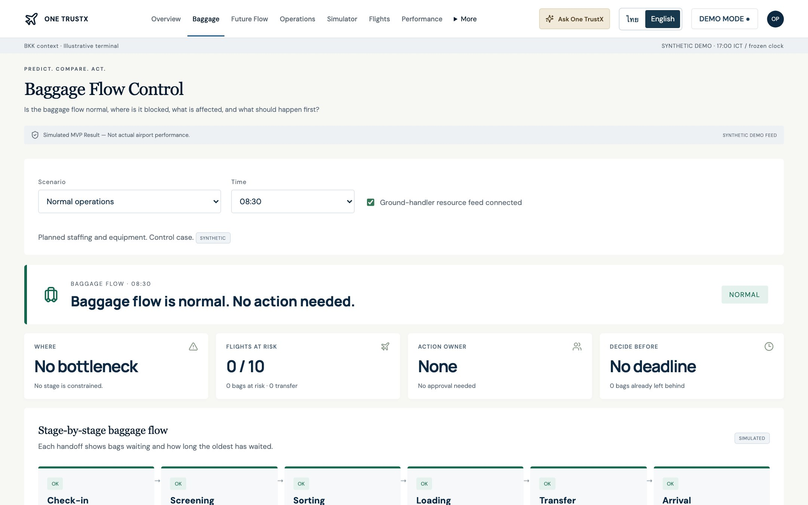

**ขั้นที่ 1: เลือกสถานการณ์และเวลา** เมื่อเลือก "Normal operations" ทุกขั้นเป็นสีเขียว สถานะรวมเป็น NORMAL และไม่มี action

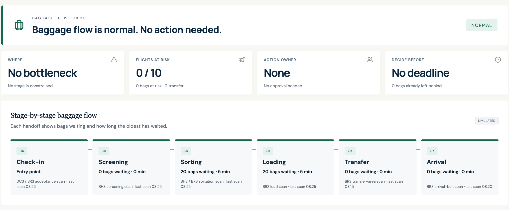

**ขั้นที่ 2: ดูว่าติดที่ไหน** เปลี่ยนเป็นสถานการณ์น้ำท่วม ขั้น Loading เปลี่ยนเป็น DELAY พร้อมจำนวนกระเป๋าที่รอและเวลาที่ใบแรกสุดรอมาแล้ว การ์ดสี่ใบตอบ ติดที่ไหน / กระทบกี่เที่ยวบิน / ใครรับผิดชอบ / ต้องตัดสินใจก่อนกี่โมง

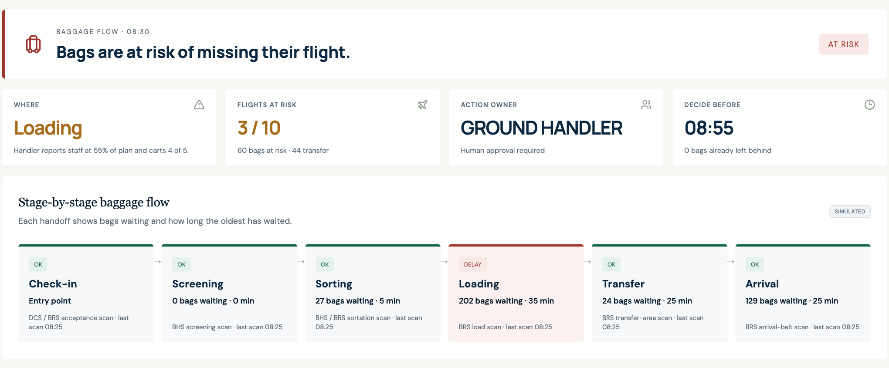

**ขั้นที่ 3: อ่านเหตุผลและลำดับที่แนะนำ** ด้านซ้ายคือหลักฐานที่ทำให้ระบบสรุปเช่นนั้น ด้านขวาคือคำแนะนำ ตารางล่างเรียงเที่ยวบินตามเวลาปิดห้องเก็บสัมภาระ ผู้ควบคุมงานเป็นผู้ตัดสินใจ

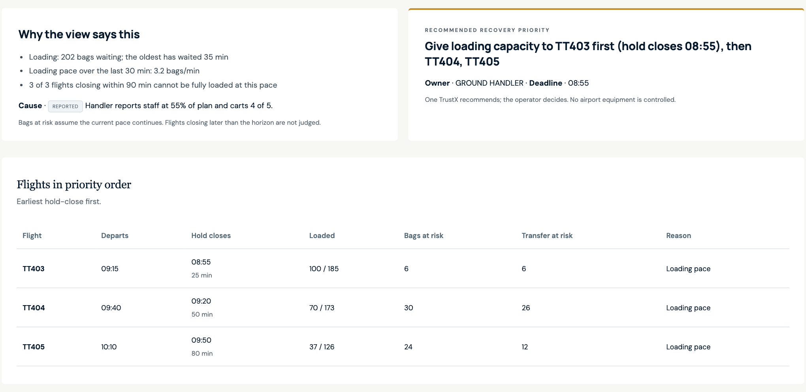

**ขั้นที่ 4: ปิดข้อมูลกำลังคน** เมื่อเอาเครื่องหมายถูกออก ระบบยังชี้ว่าติดที่ Loading ได้เหมือนเดิม แต่ช่องสาเหตุเปลี่ยนเป็น UNKNOWN นี่คือสิ่งที่ระบบทำได้ด้วยข้อมูลของ SKY เพียงอย่างเดียว

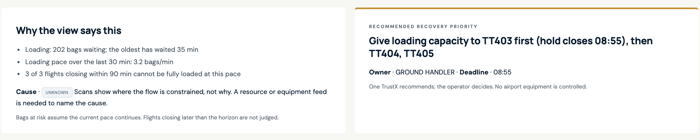

**ขั้นที่ 5: สถานการณ์อื่น** เครื่องคัดแยกขัดข้องทำให้คอขวดย้ายไปที่ Sorting ส่วนเที่ยวบินขาเข้าที่ช้าทำให้ขั้น Transfer ขึ้น RISK โดยไม่มีคอขวด เพราะปัญหาคือเวลาต่อเครื่องไม่พอ

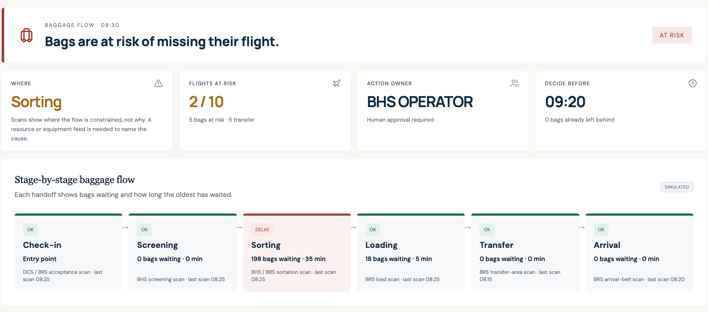

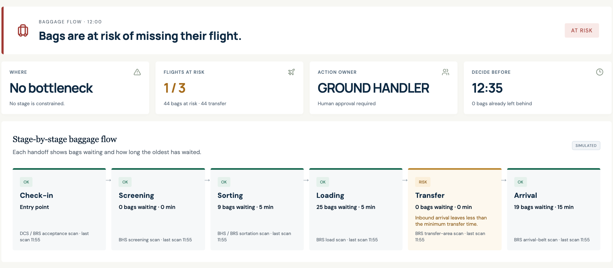

**ขั้นที่ 6: เมื่อข้อมูลขาด** ถ้าการสแกน loading หยุดเข้ามา ระบบขึ้น VERIFY DATA ซ่อนตัวเลขที่เชื่อไม่ได้ และแนะนำให้ยืนยันสถานะทางวิทยุก่อน

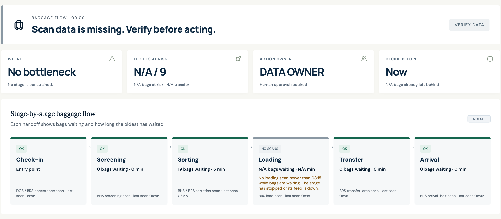

**ขั้นที่ 7: ดูผลจำลองซ้ำ** ท้ายหน้าเดียวกันมีตารางผล 30 รอบของทุกสถานการณ์

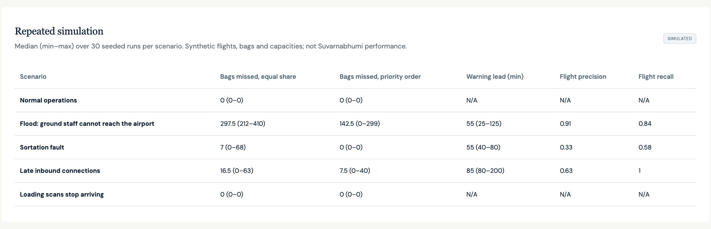

### 11.2 สถานการณ์ที่สลับได้

| สถานการณ์ | สิ่งที่จำลอง | สิ่งที่ระบบควรแสดง |
|---|---|---|
| ปกติ | กำลังคนและอุปกรณ์ตามแผน | NORMAL ไม่มี action |
| น้ำท่วม คนมาไม่ได้ | งานที่ใช้คนเหลือ 55% ทั้งกะ รถขนกระเป๋าเสียช่วงกลางกะ | ติดที่ Loading พร้อมลำดับเที่ยวบิน |
| เครื่องคัดแยกขัดข้อง | กำลังคัดแยกเหลือหนึ่งในสี่เป็นเวลา 75 นาที | ติดที่ Sorting |
| ขาเข้าช้า | เที่ยวบินขาเข้า 4 เที่ยวช้า 55 นาที | เตือนกระเป๋าต่อเครื่องที่เวลาไม่พอ |
| ข้อมูลสแกนขาด | งานปกติ แต่ข้อมูล loading มาช้า 45 นาที | ให้ตรวจสอบข้อมูลก่อน ไม่แจ้งว่ากระเป๋าล่าช้า |

### 11.3 พฤติกรรมที่ออกแบบไว้โดยเจตนา

- หาตำแหน่งคอขวดจากจำนวนสแกนและตารางบินเท่านั้น ซึ่งเป็นข้อมูลที่ SKY มีใน BRS และ AODB
- ข้อมูลกำลังคนจาก ground handler ใช้บอกสาเหตุ ถ้าไม่มี ระบบแสดง "UNKNOWN" แทนการเดา
- ถ้าขั้นใดไม่มีสแกนใหม่ขณะที่ยังมีกระเป๋ารอ ระบบซ่อนตัวเลขและขอให้ตรวจสอบ เพราะแยกไม่ได้ว่าขั้นนั้นหยุดจริงหรือข้อมูลไม่มา
- ทุกคำแนะนำต้องมีคนอนุมัติ ระบบไม่สั่งการอุปกรณ์ใด
- ใช้เฉพาะจำนวนรวมรายเที่ยวบินและรายขั้น ไม่ใช้ชื่อผู้โดยสาร เลขหนังสือเดินทาง หรือเลขป้ายกระเป๋า

---

## ส่วนที่ 12: Solution · ข้อมูลของโมดูลกระเป๋าและที่มา

### 12.1 ข้อมูลสามชั้น

[[diagram:data-layers]]

### 12.2 ป้ายประเภทข้อมูล

| ป้าย | ความหมาย |
|---|---|
| REAL_PUBLIC | ข้อเท็จจริงที่เผยแพร่โดยแหล่งทางการ |
| BENCHMARK | ค่าอ้างอิงระดับอุตสาหกรรม |
| DERIVED | คำนวณจากข้อมูลจริง |
| ASSUMPTION | ค่าที่ทีมตั้งเอง ไม่ใช่ตัวเลขของสายการบินหรือสนามบินใด |
| SYNTHETIC | ข้อมูลปฏิบัติการที่สร้างขึ้น |
| SIMULATED | ผลจากการรันแบบจำลอง |

### 12.3 ค่าที่ขับสถานการณ์ (จาก `backend/app/baggage_calibration.json`)

| ค่า | ตัวเลข | ประเภท | ที่มา |
|---|---|---|---|
| ปิดรับกระเป๋าก่อนออก | 60 นาที | REAL_PUBLIC | นโยบาย check-in ของการบินไทย |
| จุดสแกนบังคับ | รับ โหลด ส่งต่อ ถึง | REAL_PUBLIC | IATA Resolution 753 |
| ผู้โดยสารเฉลี่ยต่อเที่ยวบิน | 170 คน | DERIVED | BKK ปีงบ 2025: 62.9 ล้านคน หาร 370,823 เที่ยว ตามที่สื่อรายงาน ต้องเทียบรายงานประจำปี AOT |
| สัดส่วนกรณีผิดพลาดจาก transfer | 39% | BENCHMARK | SITA 2026 ใช้อธิบายเหตุผลการจัดลำดับ ไม่ใช่ค่านำเข้า |
| กระเป๋าต่อผู้โดยสาร | 0.9 | ASSUMPTION | ไม่พบตัวเลขสาธารณะของ BKK |
| สัดส่วนกระเป๋าต่อเครื่อง | 20% | ASSUMPTION | ต้องใช้ข้อมูลสายการบินมาแทน |
| เที่ยวบินขาออกในช่วงจำลอง | 12 | ASSUMPTION | BKK เฉลี่ยประมาณ 21 เที่ยวขาออกต่อชั่วโมงทุก handler รวมกัน |
| กำลังสำรองปกติ | 1.3 เท่า | ASSUMPTION | รอแทนด้วยค่าที่วัดจาก BRS |
| ปิดห้องเก็บสัมภาระก่อนออก | 20 นาที | ASSUMPTION | ต้องยืนยันกับผู้เชี่ยวชาญ |
| กำลังคนช่วงน้ำท่วม | 55% | ASSUMPTION | ข่าวรายงานว่าคนมาไม่ได้ แต่ไม่มีตัวเลขสัดส่วน |
| เกณฑ์เวลารอ ขั้นขาออก | เฝ้าระวัง 15 ล่าช้า 30 นาที | ASSUMPTION | ต้องยืนยันกับผู้ควบคุมงาน |
| เกณฑ์เวลารอ transfer และ arrival | 30 และ 45 นาที | ASSUMPTION | ต้องเทียบกับ service level ของ handler |
| เวลาต่อเครื่องขั้นต่ำของกระเป๋า | 40 นาที | ASSUMPTION | รอแทนด้วยค่าทางการของสนามบิน |
| ช่วงเวลาที่ประเมินความเสี่ยง | 90 นาที | ASSUMPTION | ไกลกว่านี้ไม่ประเมิน |
| ข้อมูลถือว่าขาด | 15 นาที | ASSUMPTION | – |

### 12.4 ปริมาณฝนจริง (Open-Meteo จุดใกล้ BKK)

| วันที่ | มม./วัน | สูงสุด มม./ชม. |
|---|---|---|
| 24 ก.ย. 2026 | 22.4 | 8.6 |
| 25 ก.ย. 2026 | 116.1 | 13.4 |
| 26 ก.ย. 2026 | 66.1 | 7.1 |
| 27 ก.ย. 2026 | 59.2 | 9.0 |
| 28 ก.ย. 2026 | 38.8 | 4.9 |
| 29 ก.ย. 2026 | 3.1 | 1.0 |

เป็นข้อมูลจากแบบจำลองอากาศย้อนหลัง ไม่ใช่มาตรวัดฝนในสนามบิน ไฟล์ต้นฉบับพร้อม checksum อยู่ที่ `data/external/openmeteo/bkk-2026-09-incident.json`

### 12.5 ข้อมูลจำลองที่ระบบสร้าง

| ไฟล์ | เนื้อหา |
|---|---|
| `data/synthetic/baggage_flow/flights.csv` | ตารางบินจำลองของทั้ง 5 สถานการณ์ (เที่ยวบิน TT4xx ขาออก TT8xx ขาเข้า) |
| `data/synthetic/baggage_flow/BAG-*.csv` | รายการสแกนรวมรายเที่ยวบิน รายขั้น ทุก 5 นาที รวมประมาณ 8,000 แถว |
| `backend/app/baggage_evaluation.json` | ผลจำลอง 30 รอบต่อสถานการณ์ |

โครงสร้างของรายการสแกนหนึ่งแถว:

```text
scenario_id   รหัสสถานการณ์
seed          เลขสุ่มที่ใช้สร้าง (ทำซ้ำได้)
stage         check_in / screening / sorting / loading / transfer / arrival
flight        เที่ยวบินที่กระเป๋าชุดนี้สังกัด
bag_class     LOCAL / TRANSFER / TERMINATING
count         จำนวนใบ
event_min     นาทีที่สแกนเกิดขึ้น
ingest_min    นาทีที่ระบบได้รับข้อมูล (ใช้ทดสอบข้อมูลมาช้า)
source_type   SYNTHETIC
```

### 12.6 แหล่งข้อมูลของโมดูลอื่น

OpenSky, OurAirports, CAAT, BTS, CBP และ UK CAA เป็นข้อมูลของโมดูลคิวผู้โดยสารและหน้าบริบท ไม่ได้ใช้กับหน้ากระเป๋า รายละเอียดอยู่ในส่วนที่ 4

---

## ส่วนที่ 13: Solution · การทำงาน การคำนวณ และการวิเคราะห์

โค้ดอยู่ใน `backend/app/baggage_flow.py` แบ่งเป็นสองส่วนที่แยกกันโดยเจตนา

### 13.1 `simulate`: โลกจำลอง

[[diagram:process]]

- เวลาเดินทีละ 5 นาที รวม 540 นาที เริ่ม 05:00 ของวันที่ 26 ก.ย. 2026
- กระเป๋าท้องถิ่นเข้าระบบช่วง 180 ถึง 60 นาทีก่อนออก หนาแน่นสุดที่ 110 นาที
- กระเป๋าต่อเครื่องและกระเป๋าปลายทางเข้าระบบเมื่อเที่ยวบินขาเข้าจอด
- เส้นทาง: ท้องถิ่น → screening → sorting → loading / ต่อเครื่อง → transfer → sorting → loading / ปลายทาง → arrival
- กำลังปกติของขั้นอัตโนมัติคิดจาก 5 นาทีที่หนาแน่นสุด ขั้นที่ใช้คนคิดจากชั่วโมงที่หนาแน่นสุด คูณ 1.3
- กระเป๋าที่ยังไม่ถูกโหลดเมื่อถึงเวลาปิดห้องเก็บสัมภาระ นับเป็นตกเที่ยวบิน
- วิธีจัดสรรกำลังมีสองแบบ: `PLAN` แบ่งเท่ากันทุกเที่ยวบิน และ `PRIORITY` ให้เที่ยวบินที่ปิดก่อนได้ก่อน

### 13.2 `assess`: ส่วนที่เป็น One TrustX

รับข้อมูลได้เพียงสามอย่าง: รายการสแกนที่ได้รับแล้ว ณ เวลานั้น ตารางบินพร้อมจำนวนกระเป๋าที่คาดไว้ และ feed กำลังคนถ้ามี ไม่อ่านค่ากำลังการผลิตหรือความจริงจากแบบจำลอง

```text
สำหรับแต่ละขั้น:
  กระเป๋ารอ      = ที่เข้าขั้นนี้แล้ว - ที่สแกนผ่านขั้นนี้แล้ว
  เวลารอ         = อายุของกระเป๋าที่เข้าก่อนสุดและยังไม่ถูกสแกน
  สถานะ          = OK / WATCH / DELAY ตามเกณฑ์เวลารอ
                   STALE ถ้ามีกระเป๋ารอแต่ไม่มีสแกนใหม่เกิน 15 นาที

คอขวด            = ขั้นที่เวลารอนานสุดในกลุ่ม WATCH หรือ DELAY

สำหรับเที่ยวบินที่ปิดภายใน 90 นาที เรียงตามเวลาปิด:
  ถ้ามีคอขวด:    กระเป๋าที่เหลือสะสม เทียบกับ อัตราโหลด 30 นาทีล่าสุด x เวลาที่เหลือ
  ถ้าขาเข้าช้า:  เวลาจอด + 40 นาที เกินเวลาปิด → กระเป๋าต่อเครื่องเสี่ยงทั้งชุด

สถานะรวม         = VERIFY_DATA > AT_RISK > WATCH > NORMAL
```

### 13.3 `evaluate`: การให้คะแนน

รันทั้งสองวิธีจัดสรรบนเลขสุ่มเดียวกัน 30 ค่า ตรวจสถานะทุก 15 นาที แล้วเทียบกับความจริงของแบบจำลอง: กระเป๋าตกเที่ยวบินกี่ใบ เตือนก่อนใบแรกตกกี่นาที เที่ยวบินที่เตือนตรงกับที่ตกจริงเท่าใด และสัดส่วนครั้งที่เตือน

### 13.4 ตัวอย่างการคำนวณจริงจากหน้าจอ

สถานการณ์น้ำท่วม เวลา 08:30 (ข้อมูลจำลอง เลขสุ่ม 42):

**ขั้นที่ 1 หาว่าติดที่ไหน** ขั้น Loading มีกระเป๋าเข้ามาแล้วมากกว่าที่สแกนโหลด 202 ใบ กระเป๋าใบแรกสุดที่ยังไม่ถูกโหลดเข้ามาตั้งแต่ 07:55 จึงรอมาแล้ว 35 นาที เกินเกณฑ์ 30 นาที สถานะเป็น DELAY ขั้นอื่นรอไม่เกินเกณฑ์ คอขวดจึงอยู่ที่ Loading

**ขั้นที่ 2 วัดอัตราจริง** ใน 30 นาทีล่าสุดมีการสแกนโหลด 95 ใบ อัตราคือ 95 ÷ 30 = 3.17 ใบต่อนาที

**ขั้นที่ 3 ตรวจทีละเที่ยวบิน เรียงตามเวลาปิดห้องเก็บสัมภาระ**

| เที่ยวบิน | ปิด (เหลือ) | ยังไม่โหลด | สะสมรวมเที่ยวบินก่อนหน้า | โหลดได้ทัน | เสี่ยงตกเที่ยวบิน |
|---|---|---|---|---|---|
| TT403 | 08:55 (25 นาที) | 185 − 100 = 85 | 85 | 3.17 × 25 = 79 | 85 − 79 = 6 |
| TT404 | 09:20 (50 นาที) | 173 − 70 = 103 | 188 | 3.17 × 50 = 158 | 188 − 158 = 30 |
| TT405 | 09:50 (80 นาที) | 126 − 37 = 89 | 277 | 3.17 × 80 = 253 | 277 − 253 = 24 |

รวม 60 ใบใน 3 เที่ยวบิน ตรงกับที่หน้าจอแสดง

**ขั้นที่ 4 ออกคำแนะนำ** ให้กำลัง loading กับ TT403 ก่อน เพราะปิดเร็วที่สุด แล้วตามด้วย TT404 และ TT405 ผู้รับผิดชอบคือ ground handler ต้องตัดสินใจก่อน 08:55

**ขั้นที่ 5 ระบุสาเหตุ** ถ้ามีข้อมูลจาก ground handler ระบบแสดงว่า "พนักงาน 55% ของแผน รถขนกระเป๋า 4 จาก 5 คัน" ถ้าไม่มี ระบบแสดงว่ายังระบุสาเหตุไม่ได้

การคำนวณทั้งหมดเป็นกฎที่ตรวจย้อนได้ ไม่ใช้ machine learning และไม่ใช้ LLM

---

## ส่วนที่ 14: Impact · ผลที่ได้จากการจำลอง

จำลอง 30 รอบต่อสถานการณ์ แต่ละรอบสุ่มจำนวนผู้โดยสารและกระเป๋าต่างกัน ตัวเลขเป็นค่ากลาง ในวงเล็บคือต่ำสุดถึงสูงสุด

| สถานการณ์ | กระเป๋าตกเที่ยวบิน เมื่อแบ่งกำลังเท่ากัน | กระเป๋าตกเที่ยวบิน เมื่อจัดลำดับตามคำแนะนำ | เตือนล่วงหน้า (นาที) |
|---|---|---|---|
| ปกติ | 0 | 0 | ไม่มีการเตือน |
| น้ำท่วม คนมาไม่ได้ | 297.5 (212–410) | 142.5 (0–299) | 55 (25–125) |
| เครื่องคัดแยกขัดข้อง | 7 (0–68) | 0 (0–0) | 55 (40–80) |
| ขาเข้าช้า | 16.5 (0–63) | 7.5 (0–40) | 85 (80–200) |
| ข้อมูลสแกนขาด | 0 | 0 | ไม่มีการเตือนผิด |

[[diagram:results]]

ความแม่นของการเตือนระดับเที่ยวบิน:

| สถานการณ์ | เที่ยวบินที่ถูกเตือน | เที่ยวบินที่กระเป๋าตกจริง | เตือนถูก (precision) | จับได้ (recall) |
|---|---|---|---|---|
| น้ำท่วม คนมาไม่ได้ | 204 | 221 | 0.91 | 0.84 |
| เครื่องคัดแยกขัดข้อง | 46 | 26 | 0.33 | 0.58 |
| ขาเข้าช้า | 52 | 33 | 0.63 | 1.00 |

### 14.1 วิธีอ่านผลนี้อย่างถูกต้อง

- เป็นผลจำลองทั้งหมด ใช้พิสูจน์ว่าวิธีคิดทำงานได้ ไม่ใช่ผลที่คาดว่าจะเกิดที่สนามบิน
- "แบ่งกำลังเท่ากัน" เป็นวิธีทำงานแบบเดิมที่ทีมสมมติขึ้น ถ้า handler จริงจัดลำดับได้ดีอยู่แล้ว ส่วนต่างจะน้อยกว่านี้
- กรณีเครื่องคัดแยกขัดข้อง ระบบเตือนผิดสองในสามเที่ยวบิน เพราะคาดการณ์ว่าความช้าจะคงอยู่ ขณะที่ในแบบจำลองเครื่องกลับมาทำงานหลัง 75 นาที ตัวเลขนี้ไม่ได้ถูกปรับแต่ง
- การเตือนและความจริงที่ใช้ตรวจมาจากแบบจำลองเดียวกัน จึงยังไม่ใช่การทดสอบอิสระ
- ตัวเลขชุดเก่าบนสไลด์รอบแรก (86%, 100%, 61%, 78%, 50%, 117.39 พันล้านบาท) ไม่มีที่มาหรือเป็นค่าคงที่ในโค้ด ห้ามนำมาใช้

### 14.2 ผลตามสามเสาเดิมของสไลด์ Impact

| เสาเดิม | ตัวชี้วัดบนสไลด์รอบแรก | ตัวชี้วัดที่วัดได้จริงในกรณีกระเป๋า | ผล (แบบจำลอง) |
|---|---|---|---|
| Trust | Data Consistency 100% / Event Verification 85.7% | ค่าตั้งต้นทุกตัวมีประเภทและที่มา | ครบทุกค่า มีเทสต์บังคับ |
| Trust | เหมือนข้างบน | เมื่อข้อมูลสแกนขาด ระบบไม่แจ้งผิดว่ากระเป๋าล่าช้า | เตือนผิด 0 ครั้งใน 30 รอบ |
| Intelligence | Risk Detection Accuracy 86% | เที่ยวบินที่เตือนตรงกับที่กระเป๋าตกจริง (น้ำท่วม) | เตือนถูก 0.91 จับได้ 0.84 |
| Intelligence | AI Recommendation Accuracy 100% | กระเป๋าตกเที่ยวบินเมื่อทำตามลำดับที่แนะนำ (น้ำท่วม) | 297.5 → 142.5 ใบ |
| Intelligence | Airport 31 วินาทีเร็วขึ้น | เตือนก่อนกระเป๋าใบแรกตกเที่ยวบิน (น้ำท่วม) | 55 นาที (25–125) |
| Operation | Coordination Time 18 → 7 วินาที | เวลาที่มีให้ตัดสินใจก่อนเที่ยวบินแรกปิด (น้ำท่วม) | 80 นาที (5–90) เวลาประสานงานของคนต้องทดลองกับผู้ใช้ |
| Operation | Delay Risk Reduction 50% | กระเป๋าตกเที่ยวบินรวม 30 รอบ (น้ำท่วม) | ลดลง 53.5% (9,082 → 4,227 ใบ) |
| Trust | Data Consistency 100% | สถานะผิดโดยไม่เตือน เมื่อข้อมูลมีความผิด | 41% → 7% เมื่อมีชั้นตรวจ |
| Trust | Event Verification 85.7% | ข้อมูลผิดที่กฎตรวจจับได้ | 7,636 จาก 7,636 รายการ ปฏิเสธผิด 0 |

### 14.3 คุณค่าต่อแต่ละฝ่าย (โครงเดิม) ในกรณีกระเป๋า

| ฝ่าย | คุณค่าบนสไลด์รอบแรก | คุณค่าที่อ้างได้ตอนนี้ |
|---|---|---|
| Airline | ลดความเสี่ยงเที่ยวบินล่าช้า 50% | รู้ล่วงหน้าว่าเที่ยวบินใดกระเป๋าจะไม่ครบ เพื่อตัดสินใจรอหรือส่งตาม ยังไม่มีตัวเลขความล่าช้า |
| Airport | คาดการณ์ล่วงหน้าเร็วขึ้น 61% | เห็นคอขวดรายขั้นจากข้อมูลที่มีอยู่ เตือนล่วงหน้า 55 นาทีในแบบจำลอง |
| Ground Handler | ลดเวลาประสานงาน 78% | ได้ลำดับเที่ยวบินที่ควรทำก่อนเมื่อคนไม่พอ |
| Passenger | ลดเวลาที่ได้รับผลกระทบ 54% | กระเป๋าตกเที่ยวบินน้อยลงในแบบจำลอง ยังไม่ได้วัดผลต่อผู้โดยสารโดยตรง |
| Industry & Economy | 117.39 พันล้านบาท | ไม่อ้างมูลค่าเงิน ใช้ค่าอ้างอิง SITA 260 ดอลลาร์ต่อใบเพื่ออธิบายขนาดปัญหาเท่านั้น |


### 14.4 ความต่อเนื่องกับค่าที่เสนอไปแล้วในรอบแรก

ทีมเสนอตัวเลขชุดหนึ่งไปแล้วในสไลด์รอบแรก ตารางนี้เทียบค่าเดิมกับค่าที่วัดได้จากแบบจำลองกระเป๋า แบบจำลองถูกสร้างและรันก่อนการเทียบนี้ ไม่มีการปรับค่าเพื่อให้ตรงกับของเดิม

| ค่าเดิมบนสไลด์ | ค่าที่วัดได้ | ใกล้เคียงหรือไม่ | ป้ายที่ต้องใช้ |
|---|---|---|---|
| Risk Detection Accuracy 86% | 87% (F1 ของการเตือนระดับเที่ยวบิน สถานการณ์น้ำท่วม: เตือนถูก 0.91 จับได้ 0.84) รวมทุกสถานการณ์ 80% | ใกล้เคียง | "ตรวจจับเที่ยวบินเสี่ยง F1 87% ในสถานการณ์น้ำท่วม (แบบจำลอง)" |
| Delay Risk Reduction 50% | 53.5% (กระเป๋าตกเที่ยวบินรวม 30 รอบ ลดจาก 9,082 เหลือ 4,227 ใบ สถานการณ์น้ำท่วม) | ใกล้เคียง แต่วัดคนละสิ่ง | "กระเป๋าตกเที่ยวบินลดลง 53.5% (แบบจำลอง)" ไม่ใช่ความล่าช้าของเที่ยวบิน |
| Passenger 54% | 62.9% (กระเป๋าต่อเครื่องตกเที่ยวบินรวม 30 รอบ ลดจาก 1,862 เหลือ 690 ใบ สถานการณ์น้ำท่วม) และ 36.7% ในสถานการณ์ขาเข้าช้า | อยู่ในช่วงเดียวกัน แต่วัดคนละสิ่ง | "กระเป๋าต่อเครื่องตกเที่ยวบินลดลง 63% ในสถานการณ์น้ำท่วม (แบบจำลอง)" |
| Coordinator Reduction Time 78% | เวลาที่ผู้ควบคุมงานมีก่อนเที่ยวบินแรกปิด: 80 นาที (5–90) หลังระบบระบุชื่อเที่ยวบิน | คนละหน่วย | "มีเวลาตัดสินใจ 80 นาทีก่อนเที่ยวบินแรกปิด (แบบจำลอง)" เวลาประสานงานของคนยังต้องทดลองกับผู้ใช้ |
| AI Recommendation Accuracy 100% | ใน 90 รอบของสามสถานการณ์ผิดปกติ การทำตามลำดับที่แนะนำให้ผลดีกว่า 62 รอบ เท่ากัน 28 รอบ แย่กว่า 0 รอบ | เลขเท่ากัน ความหมายต่างกัน | "คำแนะนำไม่ทำให้ผลแย่ลงใน 100% ของรอบจำลอง" ไม่ใช่ accuracy |
| Data Consistency 100% | เมื่อใส่ข้อมูลผิดเข้าไป สถานะที่ระบบแสดงตรงกับของจริง 62% ขอให้ตรวจสอบ 31% ผิดโดยไม่เตือน 7% (ถ้าไม่มีชั้นตรวจ: 42% / 17% / 41%) | ต่ำกว่าเดิม | "สถานะผิดโดยไม่เตือนลดจาก 41% เหลือ 7% (แบบจำลอง)" |
| Event Verification 85.7% | กฎตรวจจับข้อมูลผิดที่ใส่เข้าไปได้ 7,636 จาก 7,636 รายการ และไม่ปฏิเสธข้อมูลที่ถูกต้องเลยจาก 87,890 รายการ | สูงกว่าเดิม แต่เป็นการทดสอบกับความผิดชนิดที่กฎรู้จัก | "ตรวจจับข้อมูลผิด 4 ชนิดที่ทดสอบได้ครบ (แบบจำลอง)" |
| Coordination Time 18 → 7 วินาที (61%) | วัดไม่ได้จากแบบจำลอง เพราะเป็นเวลาของคน | ไม่มี | เอาออก และใช้วิธีวัดในหัวข้อถัดไปเมื่อทดลองกับผู้ใช้ |
| Airport 31 วินาทีเร็วขึ้น | เตือนล่วงหน้า 55 นาที (25–125) ก่อนกระเป๋าใบแรกตกเที่ยวบิน | คนละหน่วย | "เตือนล่วงหน้า 55 นาที (แบบจำลอง)" |
| 117.39 พันล้านบาท และกราฟ loss | ต้นทุนที่เลี่ยงได้ 42,077 ดอลลาร์ต่อกะที่เกิดน้ำท่วม (กระเป๋าที่ไม่ตกเที่ยวบิน 161.8 ใบ × 260 ดอลลาร์ตาม SITA) สำหรับ 12 เที่ยวบิน | คนละระดับ | "เลี่ยงต้นทุนได้ประมาณ 42,000 ดอลลาร์ต่อกะที่เกิดเหตุ (แบบจำลอง)" ไม่ขยายเป็นตัวเลขระดับประเทศ |
| $60.3B / Year | $6.3B ตาม SITA | ผิดสิบเท่า | แก้เป็น $6.3B |

สิ่งที่ทำได้เพื่อรักษาความต่อเนื่อง: คงโครงสามเสาและตำแหน่งของตัวเลขบนสไลด์ไว้ ใช้ค่าที่วัดได้ทุกตัวพร้อมป้ายใหม่ และบอกกรรมการตรง ๆ ว่ารอบแรกเป็นค่าประมาณเบื้องต้นจากชุดจำลองเที่ยวบินเดียว รอบนี้วัดจากแบบจำลองกระเป๋าที่ละเอียดขึ้น ตัวเลขหลักจึงอยู่ในระดับเดียวกัน

สิ่งที่ไม่ควรทำ: ปรับสมมติฐานของแบบจำลองเพื่อให้ได้ตัวเลขเท่าเดิม หรือคงตัวเลขเดิมไว้ใต้ชื่อตัวชี้วัดเดิม เพราะถ้ากรรมการขอดูที่มา ทีมจะแสดงไม่ได้ และค่าทั้งหมดขึ้นกับสมมติฐานว่าวิธีเดิมคือการแบ่งกำลังเท่ากันทุกเที่ยวบิน

### 14.5 ตารางคะแนน: ทุกค่าพร้อมนิยาม สูตร และวิธีวัด

ทุกค่าในตารางนี้คำนวณจากการรันแบบจำลอง 30 รอบต่อสถานการณ์ด้วย `scripts/experiments/run_baggage_evaluation.py` ผลเก็บใน `backend/app/baggage_evaluation.json` ไม่มีค่าใดเป็นค่าคงที่ในโค้ด รันซ้ำได้ผลเดิม

**เสา Trust** วัดด้วยการใส่ข้อมูลผิดที่รู้คำตอบเข้าไปในข้อมูลสแกน แล้วดูว่ากฎตรวจจับได้เท่าใด (60 รอบ: สถานการณ์ปกติและน้ำท่วม)

| ตัวชี้วัด | นิยามและสูตร | ผล |
|---|---|---|
| ตรวจจับข้อมูลซ้ำ | รายการที่ส่งมาสองครั้งและถูกตัดออก ÷ รายการซ้ำที่ใส่ | 1,919 ÷ 1,919 = 100% |
| ตรวจจับข้อมูลมาช้า | รายการที่มาช้ากว่า 15 นาทีและถูกทำเครื่องหมาย ÷ ที่ใส่ | 1,956 ÷ 1,956 = 100% |
| ตรวจจับจำนวนผิดปกติ | รายการที่จำนวนเป็นศูนย์ ติดลบ หรือเกินขนาดเที่ยวบิน และถูกปฏิเสธ ÷ ที่ใส่ | 1,872 ÷ 1,872 = 100% |
| ตรวจจับเที่ยวบินที่ไม่มีในตาราง | รายการที่ถูกปฏิเสธ ÷ ที่ใส่ | 1,889 ÷ 1,889 = 100% |
| ตรวจจับสแกนที่หายทั้งขั้น | คู่เที่ยวบินและขั้นที่ถูกชี้ว่าขาด ÷ ที่ลบออก | 168 ÷ 168 = 100% |
| ปฏิเสธข้อมูลที่ถูกต้อง | รายการถูกต้องที่ถูกปฏิเสธ ÷ รายการถูกต้องทั้งหมด | 0 ÷ 87,890 = 0% |
| สถานะตรงกับของจริง | จุดตรวจที่สถานะรวมตรงกับที่ได้จากข้อมูลสะอาด ÷ จุดตรวจทั้งหมด 1,920 จุด | มีชั้นตรวจ 62.2% / ไม่มี 42.3% |
| ระบบขอให้ตรวจสอบข้อมูล | จุดตรวจที่ขึ้น VERIFY DATA แทนสถานะจริง | มีชั้นตรวจ 31.2% / ไม่มี 17.1% |
| สถานะผิดโดยไม่เตือน | จุดตรวจที่สถานะต่างจากของจริงและไม่ขอให้ตรวจสอบ | มีชั้นตรวจ 6.6% / ไม่มี 40.5% |
| ค่าตั้งต้นมีที่มา | ค่าที่มีประเภทและแหล่งที่มา ÷ ค่าทั้งหมด | 15 ÷ 15 = 100% (จริง 2 อ้างอิง 1 คำนวณ 1 สมมติฐาน 11) |

อัตราตรวจจับ 100% หมายความว่ากฎจับความผิดสี่ชนิดที่ออกแบบไว้ได้ครบ ไม่ได้พิสูจน์ว่าจับความผิดชนิดอื่นในข้อมูลจริงได้ ค่าที่สะท้อนคุณภาพจริงกว่าคือสามบรรทัดเรื่องสถานะ: ชั้นตรวจลดสถานะที่ผิดโดยไม่เตือนจาก 40.5% เหลือ 6.6% แต่สถานะที่ตรงพอดียังมีเพียง 62.2% เพราะเมื่อสแกนหาย ระบบเลือกขอให้ตรวจสอบแทนการเดา

**เสา Intelligence** (30 รอบต่อสถานการณ์)

| ตัวชี้วัด | นิยามและสูตร | น้ำท่วม | เครื่องคัดแยกขัดข้อง | ขาเข้าช้า |
|---|---|---|---|---|
| เตือนถูก (precision) | เที่ยวบินที่เตือนและกระเป๋าตกจริง ÷ เที่ยวบินที่เตือน | 0.91 | 0.33 | 0.63 |
| จับได้ (recall) | เที่ยวบินที่เตือนและกระเป๋าตกจริง ÷ เที่ยวบินที่กระเป๋าตกจริง | 0.84 | 0.58 | 1.00 |
| F1 | 2 × precision × recall ÷ (precision + recall) | 0.87 | 0.42 | 0.77 |
| เตือนล่วงหน้า | นาทีจากการเตือนครั้งแรกถึงกระเป๋าใบแรกตกเที่ยวบิน ค่ากลาง | 55 | 55 | 85 |
| คำแนะนำไม่ทำให้แย่ลง | รอบที่ลำดับที่แนะนำให้กระเป๋าตกน้อยกว่าหรือเท่ากับวิธีเดิม ÷ รอบทั้งหมด | 30 ÷ 30 | 30 ÷ 30 | 30 ÷ 30 |
| คำแนะนำดีกว่า | รอบที่กระเป๋าตกน้อยกว่าวิธีเดิม ÷ รอบทั้งหมด | 30 ÷ 30 | 18 ÷ 30 | 14 ÷ 30 |

รวมสามสถานการณ์: precision 0.78 recall 0.84 F1 0.80 การเตือนผิดในสถานการณ์ปกติและข้อมูลขาด: 0 จาก 960 จุดตรวจต่อสถานการณ์

**เสา Operation** (30 รอบต่อสถานการณ์)

| ตัวชี้วัด | นิยามและสูตร | น้ำท่วม | เครื่องคัดแยกขัดข้อง | ขาเข้าช้า |
|---|---|---|---|---|
| กระเป๋าตกเที่ยวบิน วิธีเดิม | ผลรวม 30 รอบ เมื่อแบ่งกำลังเท่ากัน | 9,082 | 454 | 553 |
| กระเป๋าตกเที่ยวบิน ตามคำแนะนำ | ผลรวม 30 รอบ เมื่อจัดลำดับ | 4,227 | 0 | 350 |
| ลดลง | (เดิม − ใหม่) ÷ เดิม | 53.5% | 100% | 36.7% |
| กระเป๋าต่อเครื่องตกเที่ยวบิน ลดลง | สูตรเดียวกัน นับเฉพาะกระเป๋าต่อเครื่อง | 62.9% | 100% | 36.7% |
| เวลาที่มีให้ตัดสินใจ | นาทีจากการระบุชื่อเที่ยวบินครั้งแรกถึงเที่ยวบินนั้นปิดห้องเก็บสัมภาระ ค่ากลาง (ต่ำสุด–สูงสุด) | 80 (5–90) | 80 (10–90) | 85 (80–90) |
| ต้นทุนที่เลี่ยงได้ต่อกะ | กระเป๋าที่ไม่ตกเที่ยวบินเฉลี่ยต่อรอบ × 260 ดอลลาร์ (SITA) | 42,077 ดอลลาร์ | 3,935 ดอลลาร์ | 1,759 ดอลลาร์ |

ค่าร้อยละในตารางนี้คิดจากผลรวม 30 รอบ จึงต่างเล็กน้อยจากตารางค่ากลางตอนต้นของส่วนที่ 14 (เช่น น้ำท่วม 53.5% เทียบกับ 52.1% จากค่ากลาง และขาเข้าช้า 36.7% เทียบกับ 54.5%) ค่าจากผลรวมเป็นค่าที่ควรใช้อ้าง เพราะไม่ไวต่อรอบที่กระเป๋าตกน้อย

**ค่าที่แบบจำลองวัดไม่ได้ และวิธีวัดเมื่อมีผู้ใช้จริง**

| ตัวชี้วัด | ทำไมยังวัดไม่ได้ | วิธีวัด |
|---|---|---|
| เวลาประสานงานของคน | เป็นเวลาที่คนใช้คุยและตกลงกัน แบบจำลองไม่มีคน | ให้ผู้ควบคุมงาน 6–10 คนทำสถานการณ์เดียวกันสองแบบ (มีหน้าจอ และไม่มี) จับเวลาจากสัญญาณแรกจนมีผู้รับผิดชอบรับงาน เทียบค่ากลาง |
| ความล่าช้าของเที่ยวบิน | แบบจำลองนับกระเป๋าที่ตก ไม่ได้จำลองการรอหรือเลื่อนเที่ยวบิน | เพิ่มกฎการรอกระเป๋าในแบบจำลอง หรือเทียบกับข้อมูลย้อนหลังในช่วง shadow mode |
| มูลค่าทางการเงินระดับสนามบิน | ไม่มีข้อมูลความถี่ของเหตุผิดปกติและปริมาณจริง | ต้นทุนต่อกะ × จำนวนกะที่เกิดเหตุต่อปี จากข้อมูลจริงของผู้ให้บริการ |

ข้อจำกัดที่ใช้กับทุกค่า: เป็นผลจากแบบจำลอง วิธีเดิมที่ใช้เทียบเป็นสมมติฐาน อัตราความผิดของข้อมูลที่ใส่ (2% ต่อชนิด) เป็นสมมติฐานที่กำหนดความยากของการทดสอบ และความจริงที่ใช้ตรวจมาจากแบบจำลองเดียวกัน
---

## ส่วนที่ 15: Impact · ตรงเป้า SKY แล้วหรือยัง

### 15.1 เทียบกับสิ่งที่ mentor และ buddy ขอ (7 ต.ค. 2026)

| สิ่งที่ขอ | สถานะ | หลักฐาน |
|---|---|---|
| เลือกปัญหาเดียว | ทำแล้ว | กระเป๋าค้างสะสมช่วงเหตุผิดปกติ |
| บอกว่าปัญหาเกิดจากส่วนไหน | ทำแล้ว | แถบ 6 ขั้น แต่ละขั้นมีจำนวนกระเป๋ารอและเวลารอของใบที่รอนานสุด |
| มองแล้วรู้ว่า "ไม่มีปัญหา" | ทำแล้ว | สถานการณ์ปกติขึ้น NORMAL และไม่เตือนเลยตลอดการจำลอง 30 รอบ |
| แก้ให้ใคร | ทำแล้ว | ระบุเจ้าของ action และเวลาที่ต้องตัดสินใจ |
| ใช้ข้อมูลส่วนไหน จากใคร | ทำแล้ว | หน้าจอแสดงรายการข้อมูลที่ใช้จริงในแต่ละครั้ง |
| สาเหตุของปัญหา | ทำได้บางส่วน | บอกได้เมื่อมี feed จาก ground handler ถ้าไม่มี ระบบแจ้งว่ายังระบุสาเหตุไม่ได้ |
| เรื่องขยาย พูดตอนจบเท่านั้น | เป็นเรื่องของ deck | ยังไม่ได้ทำ deck |

### 15.2 เทียบกับผลิตภัณฑ์ที่ SKY มีอยู่

| ระบบของ SKY | ตอบคำถาม | One TrustX ทำต่างอย่างไร |
|---|---|---|
| BRS | กระเป๋าใบนี้อยู่ที่ไหน ขึ้นเครื่องถูกลำหรือไม่ มี alert กรณีผู้โดยสาร no-show และกระเป๋าลงผิดตู้ | ไม่ติดตามรายใบ ใช้จำนวนสแกนรวมรายขั้นเทียบเวลาออกของเที่ยวบิน |
| AODB | เที่ยวบินออกและถึงกี่โมง gate ไหน | ใช้เป็นเส้นตายในการจัดลำดับ |
| A-CDM | ทุกฝ่ายทำงานตาม milestone ของเที่ยวบิน | ไม่สร้าง A-CDM ใหม่ ให้ข้อมูลความเสี่ยงด้านกระเป๋ารายเที่ยวบิน |
| Smart Flows | ผู้โดยสารมาถึงเมื่อใด หนาแน่นตรงไหน | ยังไม่ใช้ เป็นสัญญาณล่วงหน้าในระยะถัดไป |

ข้อมูลความสามารถของ BRS มาจากหน้าเว็บสาธารณะของ SKY ICT การใช้งานจริงภายในอาจมีมากกว่านี้ ต้องยืนยันกับ mentor

### 15.3 สิ่งที่ยังไม่ตรงเป้า

- ยังไม่ได้ยืนยันกับ SKY ว่า BRS ส่งออกเวลาสแกนรายขั้นได้ ซึ่งเป็นสมมติฐานหลักของวิธีตรวจจับ
- เกณฑ์เวลารอและวิธีทำงานแบบเดิมที่ใช้เทียบ ยังไม่ผ่านผู้เชี่ยวชาญงานกระเป๋า
- สถานการณ์น้ำท่วมในแบบจำลองยังไม่สะท้อนกระเป๋าขาเข้าค้าง ซึ่งเป็นภาพหลักของเหตุการณ์จริง
- โค้ดรอบนี้ยังไม่ได้ commit และ push ขึ้น GitHub
- ยังไม่มี deck สำหรับ Preliminary Pitch (ส่ง 20 ต.ค. 2026)

---

## ส่วนที่ 16: Impact · ความเป็นไปได้และขั้นถัดไป

### 16.1 เหตุผลที่ทำได้จริง

- เริ่มจากข้อมูลสองแหล่งที่ SKY ดูแลอยู่แล้ว (BRS และ AODB) ไม่ต้องติดเซนเซอร์ใหม่
- ข้อมูลที่ต้องขอจากบริษัทอื่น (กำลังคนของ ground handler) เป็นส่วนเสริม ระบบทำงานได้โดยไม่มี
- ใช้จำนวนรวม ไม่ใช้ข้อมูลส่วนบุคคล จึงลดภาระด้าน PDPA ในระยะแรก
- เริ่มแบบอ่านอย่างเดียว ถ้า One TrustX หยุดทำงาน ระบบต้นทางไม่ได้รับผล

### 16.2 คำถามที่ต้องถาม SKY ก่อนรอบ prototype

1. BRS เก็บเวลาสแกนรายขั้น (รับ คัดแยก โหลด ส่งต่อ ถึง) และส่งออกเป็นจำนวนรวมรายเที่ยวบินได้หรือไม่
2. มีข้อมูลจำนวนกระเป๋าที่คาดไว้ต่อเที่ยวบินก่อนเครื่องออกหรือไม่
3. เกณฑ์เวลารอที่ผู้ควบคุมงานถือว่า "เริ่มมีปัญหา" คือเท่าใด
4. เมื่อคนไม่พอ ปัจจุบันจัดลำดับเที่ยวบินอย่างไร

### 16.3 แผนงาน

| ระยะ | งาน | ผลลัพธ์ |
|---|---|---|
| ก่อน 20 ต.ค. 2026 | ทำ deck 8 หัวข้อ และชีต Q&A | ไฟล์ onetrustx_PreliminaryPitch.pdf |
| Prototype | ยืนยันเกณฑ์กับผู้เชี่ยวชาญ ปรับสถานการณ์น้ำท่วมให้มีกระเป๋าขาเข้าค้าง | สถานการณ์ที่ผู้เชี่ยวชาญรับรอง |
| Validation | ให้ผู้ควบคุมงานทดลองใช้บนสถานการณ์จำลอง | อัตราเตือนผิดและความเห็นต่อคำแนะนำ |
| Shadow mode | ต่อข้อมูลจริงแบบไม่ระบุตัวตน อ่านอย่างเดียว | ผลเทียบกับการทำงานจริง |
| ขยาย | cargo, turnaround, gate | เฉพาะส่วนที่พิสูจน์คุณค่าแล้ว |

---

[[part:ภาค ค · ภาคผนวก|สิ่งที่เปลี่ยนจากเวอร์ชันก่อน ข้อจำกัด และแหล่งอ้างอิง]]

## ส่วนที่ 17: เปลี่ยนอะไรจากเวอร์ชันบน GitHub

เวอร์ชันก่อนหน้าที่ใช้เทียบคือโค้ดบน GitHub (`Dxrksvng/OneTrustX` commit `386d911` วันที่ 28 ก.ย. 2026) และเอกสารของเวอร์ชันนั้นคือ "Airport TimeTwin · Data provenance and demo methodology" ฉบับ 15 ก.ย. 2026 จำนวน 19 หน้า repository เป็นแบบ private การเทียบทำจากสำเนาในเครื่องซึ่งตรงกับ commit ล่าสุดบน GitHub

งานทั้งหมดในรายงานนี้ถูก deploy ขึ้นเว็บจริงแล้วเมื่อ 8 ต.ค. 2026 แต่ยังไม่ได้ commit หรือ push เวอร์ชันบน GitHub จึงยังเป็นของเดิม

[[diagram:before-after]]

### 17.1 เทียบทีละด้าน

| ด้าน | เวอร์ชันบน GitHub (28 ก.ย. 2026) | ปัจจุบัน (8 ต.ค. 2026) |
|---|---|---|
| ชื่อและจุดขาย | Airport TimeTwin ปนกับ One TrustX README เขียนว่า "Predictive Airport Flow & Passenger Journey Decision Platform" | One TrustX เรื่องเดียว: กระเป๋าค้างสะสมช่วงเหตุผิดปกติ |
| ปัญหาที่แก้ | คิวผู้โดยสารที่จุดตรวจ และ "ความจริงร่วม" ของหลายฝ่ายสำหรับเที่ยวบินเดียว | กระเป๋าติดที่ขั้นไหน กระทบเที่ยวบินใด ทำอะไรก่อน |
| ผู้ใช้หลัก | ผู้ควบคุมการปฏิบัติการทั่วไป และผู้โดยสาร | ผู้ควบคุมงานกระเป๋าและงานภาคพื้น |
| หน้ากระเป๋า | ไม่มีในเมนู มีไฟล์ `TrustXPages.tsx` ที่ไม่ได้ต่อเข้าระบบ | เมนู Baggage ในแถบนำทางหลัก 6 ขั้น สลับได้ 5 สถานการณ์ ไฟล์ `TrustXPages.tsx` ถูกลบ |
| ที่อยู่ของหน้า | `/trustx` ถูกพากลับไปหน้า Overview | `/baggage` (และ `/trustx` พามาที่หน้านี้) |
| ข้อมูลกระเป๋า | 4 แถว ค่าเท่ากัน เวลาเดียว | ประมาณ 8,000 รายการสแกน มีเวลาเกิดเหตุและเวลาที่ระบบได้รับแยกกัน |
| เที่ยวบิน | 1 เที่ยว (TT401) | ขาออก 12 ขาเข้า 12 ต่อสถานการณ์ |
| ที่มาของค่า | อธิบายเป็นข้อความในเอกสาร ไม่ผูกกับโค้ด | `baggage_calibration.json` ระบุประเภทและลิงก์ทุกค่า มีเทสต์บังคับ |
| ข้อมูลจริงที่อ้างอิง | Open-Meteo ปี 2025, OurAirports, CAAT, BTS, CBP, UK CAA (บริบทคิว) | เพิ่มฝนจริงช่วงเหตุการณ์ ก.ย. 2026, นโยบาย check-in, IATA 753, SITA 2026, ข่าวเหตุการณ์ |
| ตัวเลขผล | ลดเวลาประสานงาน 61% ลดเวลา reconcile 78% เห็นความเสี่ยงเร็วขึ้น 74% ลด delay proxy 50% | กระเป๋าตกเที่ยวบิน การเตือนล่วงหน้า precision และ recall ต่อสถานการณ์ |
| ที่มาของตัวเลขผล | อัตราส่วนถูกกำหนดไว้ในตัวสร้างข้อมูล แล้วรัน 8 สถานการณ์ x 100 seed | ผลจากแบบจำลองการไหล ไม่มีการกำหนดอัตราการดีขึ้นไว้ล่วงหน้า |
| การทดสอบ backend | 26 ข้อ | 45 ข้อ |
| เอกสารหลัก | เน้นวิธีสร้างข้อมูลคิวและคู่มือหน้าจอโมดูลคิว | รายงานฉบับนี้ |

ตัวเลขผลของเวอร์ชันก่อนหน้าตรวจย้อนได้ในโค้ด: `generate_validation_pack.py` คูณค่าพื้นฐานด้วย 0.39, 0.22 และ 0.26 สำหรับเงื่อนไข One TrustX + AI จึงได้ผลลด 61%, 78% และ 74% ทุกครั้งโดยไม่ขึ้นกับสถานการณ์ และตั้ง delay proxy ไว้ที่ 0.50 ตัวเลขเหล่านี้จึงเป็นค่าที่กำหนด ไม่ใช่สิ่งที่ระบบค้นพบ

### 17.2 ขนาดของการเปลี่ยนแปลง (เทียบกับ commit `386d911`)

| ส่วน | ไฟล์ที่แก้ | บรรทัดเพิ่ม / ลบ | ไฟล์ใหม่ |
|---|---|---|---|
| `backend/app` | 4 | +36 / -3 | 3 (`baggage_flow.py` และไฟล์ข้อมูล 2 ไฟล์) |
| `backend/tests` | 1 | +5 / 0 | 1 (`test_baggage_flow.py`) |
| `frontend/src` | 8 (ลบ 2) | +321 / -58 | 1 (`BaggageControl.tsx`) |
| `scripts` | 3 | +210 / -29 | 3 |
| `docs` | 15 | +793 / -533 | 12 ไม่นับภาพหน้าจอ |
| รวมทั้งโครงการ | 42 | +1,382 / -638 | 30 ไม่นับภาพหน้าจอ |

ใน `frontend/src` ไฟล์ที่ลบคือ `TrustXPages.tsx` และ `trustx.css` บรรทัดที่เพิ่มส่วนใหญ่เป็นสไตล์ของหน้า Baggage และคำแปลภาษาไทย

### 17.3 ขั้นกลางที่ไม่ได้อยู่บน GitHub

ระหว่างสองเวอร์ชันมีรุ่นวันที่ 7 ต.ค. 2026 ซึ่งทำหน้ากระเป๋าไว้ในไฟล์ `TrustXPages.tsx` ผลบนหน้าจอเป็นค่าคงที่ในโค้ด และหน้าไม่ได้ต่อเข้ากับระบบ รุ่นนั้นถูกลบและแทนด้วยหน้า Baggage ในระบบหลักเมื่อ 8 ต.ค.

### 17.4 สิ่งที่คงไว้จากเวอร์ชันก่อนหน้า

- โมดูลคิวผู้โดยสารทั้งหมด (Overview, Future Flow, Operations, Simulator, Flights, Journey)
- API ชุดเหตุการณ์ TT401 (events, conflicts, recommendations) ฝั่ง backend
- scenario S1–S14 และชุด validation 3,200 episodes ยังอยู่ใน repository แต่ตัวเลข 61% / 78% / 74% / 50% ไม่ควรนำไปอ้าง
- การแบ่งประเภทข้อมูล 5 แบบ และหลักการ "คนเป็นผู้ตัดสินใจ"

---

## ส่วนที่ 18: ข้อจำกัดและความเสี่ยง

- ไม่มีข้อมูลปฏิบัติการจริงของสนามบิน สายการบิน หรือ ground handler ใดในระบบ
- แบบจำลองรวม "จัดเตรียม ขนส่ง และโหลด" เป็นขั้นเดียว ในงานจริงเป็นหลายขั้นและการโหลดเกิดใกล้เวลาออก
- เที่ยวบินขาเข้าที่จะช้า ระบบรู้เวลาจอดล่วงหน้าเสมอ ในงานจริงขึ้นกับว่า AODB อัปเดตเวลาคาดการณ์เร็วแค่ไหน
- เกณฑ์ทั้งหมดเป็นสมมติฐาน การเปลี่ยนเกณฑ์จะเปลี่ยนอัตราเตือนผิด
- วิธีทำงานแบบเดิมที่ใช้เทียบเป็นสมมติฐาน
- ระบบแยกไม่ได้ว่าขั้นหนึ่งหยุดจริงหรือข้อมูลไม่มา ต้องมีสัญญาณสถานะของ feed ในระบบจริง
- ส่วน demo ใช้ header บทบาทที่ปลอมได้ ห้ามเปิดให้เข้าถึงจากภายนอกในฐานะระบบที่ยืนยันตัวตนแล้ว
- ก่อนใช้ข้อมูลที่ระบุตัวบุคคล ต้องผ่านการทบทวนตาม PDPA

---

## ส่วนที่ 19: แหล่งอ้างอิง

1. [SITA Baggage IT Insights 2026 (ข่าวแจก)](https://www.sita.aero/about-us/pressroom/news-releases/tech-drove-down-mishandled-bag-rates-by-23-in-2025-but-mishandling-still-costs-the-industry-$6.3-billion-a-year)
2. [IATA Baggage Tracking และ Resolution 753](https://www.iata.org/en/programs/ops-infra/baggage/baggage-tracking/)
3. [SKY ICT: Baggage Reconciliation System](https://www.skyict.co.th/en/project-showcase/brs)
4. [CAAT NEWS 30/2569 วันที่ 26 ก.ย. 2026](https://www.caat.or.th/caat-media/218400/)
5. [The Nation: Thai Airways baggage delays hit Suvarnabhumi on Sept 26–27](https://www.nationthailand.com/news/general/40071553)
6. [The Nation: Thai Airways clears delayed baggage after floods](https://www.nationthailand.com/business/corporate/40071613)
7. [The Nation: Thai Airways expects to clear 1,092-bag backlog](https://www.nationthailand.com/business/corporate/40071851)
8. [The Star: Suvarnabhumi baggage backlog expected to clear within 3-4 days](https://www.thestar.com.my/aseanplus/aseanplus-news/2026/10/01/thailand039s-suvarnabhumi-airport-baggage-backlog-expected-to-clear-within-3-4-days)
9. [Thai Airways: Check-in](https://www.thaiairways.com/en-th/content/check-in/)
10. [The Nation: AOT fiscal year 2025 traffic](https://www.nationthailand.com/business/corporate/40055094)
11. [Open-Meteo Historical Weather API](https://open-meteo.com/en/docs/historical-weather-api)
12. [US CBP Airport Wait Times](https://awt.cbp.gov/)
13. [US BTS TranStats On-Time Performance](https://www.transtats.bts.gov/)
14. [CAAT สถิติการขนส่งทางอากาศ](https://www.caat.or.th/)
15. [OurAirports open data](https://ourairports.com/data/)
16. [UK CAA Airport Data](https://www.caa.co.uk/data-and-analysis/uk-aviation-market/airports/uk-airport-data/)

แหล่งที่ยังเปิดไม่ได้และไม่ได้ใช้อ้าง: บทความ Reuters วันที่ 29 ก.ย. 2026 และ Khaosod English วันที่ 27 ก.ย. 2026

บันทึกการตัดสินใจที่เกี่ยวข้องอยู่ใน `docs/decisions/` ลงวันที่ 7 และ 8 ต.ค. 2026
